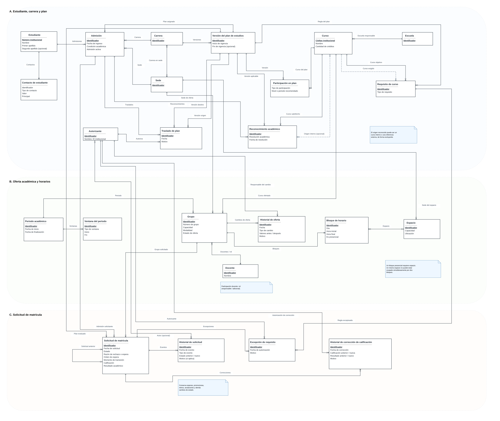

# Modelo conceptual — Proyecto 1 corregido

El diagrama siguiente reproduce **la versión conceptual corregida por el equipo** para la continuidad del Proyecto 1. Esta sección documenta las diferencias frente al diseño entregado inicialmente, su justificación y la relación con el modelo lógico. La representación visual no sustituye las restricciones ni las pruebas de PostgreSQL exigidas en la segunda entrega.

## Correspondencia con el modelo conceptual anterior

| Elemento comparado | Proyecto 1 original | Modelo corregido | Evidencia documental |
| --- | --- | --- | --- |
| Entidades registradas en el diccionario conceptual del análisis | 13 | 20 | Tablas «Entidades» de los análisis anterior y corregido |
| Asociaciones registradas en el análisis conceptual | 13 | 20 | Tablas «Asociaciones» de ambas versiones |
| Representación de hechos asociativos del diagrama | Participación en plan, requisito, traslado y reconocimiento expresados mediante asociaciones y notas de atributos | Los cuatro aparecen como nodos identificables, con vínculos explícitos a sus participantes | Archivos de diagrama anteriores y corregidos; [modelo relacional](03_Modelo_Relacional.md) |
| Información histórica, autorizaciones y ventanas | Reglas reconocidas, pero representación conceptual incompleta o pendiente | Conceptos e interacciones identificados para hechos históricos y validaciones | [análisis corregido](01_Analisis_del_Caso.md), [control de cambios](../Control_de_Cambios.md) |

El diagrama corregido contiene **24 nodos de hechos o entidades**: 20 conceptos del inventario de entidades del análisis y los cuatro hechos asociativos representados ahora mediante nodos. Este conteo de nodos del dibujo **no equivale** al número de relaciones físicas: el [modelo relacional corregido](03_Modelo_Relacional.md) contiene 26 relaciones, incluidas las materializaciones `CARRERA_SEDE` y `GRUPO_DOCENTE`.

## Nuevos conceptos incorporados al diagrama

Las siete filas siguientes corresponden a **entidades conceptuales nuevas** respecto de las 13 originalmente documentadas. No se cuentan aquí los cuatro hechos asociativos que ya existían conceptualmente en el Proyecto 1.

| Concepto incorporado | Ausencia o limitación del modelo inicial | Representación corregida y justificación | Regla y registro |
| --- | --- | --- | --- |
| Contacto de estudiante | `Estudiante` conservaba datos de contacto como noción general, sin distinguir varios medios | Un contacto individual tiene tipo, valor y carácter principal; se vincula a un estudiante, evitando listas multivaluadas | RD-01; CC-P1-01 |
| Persona autorizadora (*Autorizante* en el diagrama) | Las autorizaciones y responsabilidades aparecían como roles sin identidad común comprobable | Se identifica a la persona institucional que autoriza traslados, excepciones y correcciones o responde por un cambio de oferta, sin asumir que sea docente | RN-03, RN-15, RN-17 y RN-19; CC-P1-05 |
| Ventana de periodo (*Ventana del periodo* en el diagrama) | Las fechas de matrícula y modificación estaban agrupadas como atributos del periodo | Cada intervalo se individualiza con tipo, inicio y fin; permite múltiples ventanas y distingue los periodos de retiro | RN-09 y RN-13; CC-P1-03 |
| Cambio de oferta (*Historial de oferta* en el diagrama) | No se conservaban separadamente los eventos relevantes de la oferta | Cada cambio de apertura, cierre, cancelación o cupo identifica grupo, fecha, responsable, motivo y valores anteriores/nuevos | RN-08 y RN-19; CC-P1-08 |
| Evento de solicitud (*Historial de solicitud* en el diagrama) | Estado y momento de transición de la solicitud no bastaban para reconstruir todos sus movimientos | Cada evento registra instante, estados anterior/nuevo y motivo, incluso las evaluaciones de lista de espera sin promoción | RN-11, RN-12 y RN-14; CC-P1-09 |
| Excepción de requisito | Las excepciones exigidas por el caso carecían de hecho conceptual individualizado | La excepción vincula solicitud, regla curricular concreta y persona autorizadora, con fecha y motivo | RN-15; CC-P1-10 |
| Corrección de calificación (*Historial de corrección* en el diagrama) | Se conservaban calificación y resultado vigentes, pero no sus modificaciones | Cada corrección identifica solicitud, valor anterior/nuevo, fecha, motivo y autorizante | RN-17 y RN-20; CC-P1-11 |

## Hechos asociativos representados explícitamente

La siguiente transformación **no añade cuatro hechos de negocio antes inexistentes**: el análisis original ya describía esas asociaciones. Lo que cambia es su identificación y la visibilidad de los participantes y atributos.

| Asociación identificada en el Proyecto 1 | Representación en el diagrama corregido | Motivo y correspondencia lógica |
| --- | --- | --- |
| `Participa en plan` (Curso–Versión) | Nodo `Participación en plan`, conectado a curso y versión | Mantiene el tipo obligatorio/optativo y nivel o periodo recomendado por combinación; `PARTICIPACION_PLAN` |
| `Define requisitos` (Versión–Curso objetivo–Curso exigido) | Nodo `Requisito de curso`, con ambos roles de curso y versión | Permite distinguir una regla de requisito/correquisito y referenciarla mediante la clave alternativa `id_requisito`; `REQUISITO_CURSO` |
| `Registra traslado` (Admisión–Versiones origen/destino) | Nodo `Traslado de plan`, conectado a admisión, ambas versiones y autorizante | Permite atribuir fecha, motivo y responsable a cada traslado; `TRASLADO_PLAN` |
| `Registra reconocimiento` (Estudiante — Curso reconocido — Versión — Curso satisfecho en el modelo inicial) | Nodo `Reconocimiento académico`, asociado ahora a una admisión, versión, curso satisfecho y origen interno opcional o referencia externa | Permite delimitar la resolución al contexto académico concreto y comprobar la pertenencia del curso satisfecho; `RECONOCIMIENTO_ACADEMICO` |

## Cambios en los conceptos ya presentes

| Concepto anterior conservado | Diferencia relevante en el corregido | Fundamento y registro |
| --- | --- | --- |
| Estudiante | Los datos personales genéricos se separan en nombre y apellidos; los contactos pasan a un concepto relacionado | RD-01; CC-P1-01 |
| Admisión | Identidad interna definida; condición `activa` explícita; carrera derivada de la versión del plan en el lógico, conservando sede | RN-02, RN-03 y RN-09; CC-P1-02 |
| Versión del plan | La vigencia genérica se desglosa en inicio y fin opcional; una carrera puede conservar diversas versiones | RN-03, RN-05; CC-P1-03 |
| Periodo académico | Conserva fechas lectivas; las ventanas de matrícula, modificación y retiro se representan individualmente | RD-11, RN-09 y RN-13; CC-P1-03 |
| Grupo | Incluye el estado de la oferta además de cupo, modalidad y contexto; registra modificaciones relevantes mediante eventos históricos | RN-08 y RN-19; CC-P1-04 y CC-P1-08 |
| Bloque de horario | Se agrega indicador de presencialidad para determinar cuándo es obligatorio asignar espacio | RN-07; CC-P1-04 |
| Espacio | Se explicita su sede de pertenencia para comprobar compatibilidad con el grupo presencial | RN-07; CC-P1-04 |
| Docente | Se explicita el nombre y se conserva participación como responsable o adicional; el grupo publicado exige exactamente un responsable | RD-12; CC-P1-04 |
| Solicitud de matrícula | Se agregan fecha de solicitud y versión de plan evaluada; sus transiciones y evaluaciones pasan a tener historia independiente | RN-09, RN-11, RN-12, RN-14 y RN-16; CC-P1-09 |

Se conservan los demás conceptos base, como Carrera, Sede, Curso y Escuela. La asociación Carrera–Sede sigue siendo de muchos a muchos y se materializa como `CARRERA_SEDE` en el modelo lógico. La participación de docentes con su rol se materializa como `GRUPO_DOCENTE`.

## Asociaciones y multiplicidades ajustadas

El análisis corregido mantiene las trece denominaciones originales de asociaciones y añade siete: `Registra contactos`, `Habilita ventanas`, `Identifica autorizaciones`, `Documenta cambios de oferta`, `Documenta eventos de solicitud`, `Concede excepción` y `Documenta corrección`. La semántica de algunas asociaciones originales también se amplió, como reconocimiento, traslado y gestión de solicitudes.

Las cardinalidades se leen en los **extremos de cada vínculo** del diagrama corregido. Por ejemplo, cada admisión se vincula con un estudiante, mientras un estudiante puede tener múltiples admisiones; cada grupo se vincula con un curso y un periodo, mientras estos pueden asociarse con distintos grupos. La orientación de los símbolos de cardinalidad se actualizó respecto del diagrama anterior. Las condiciones de negocio más complejas, como *exactamente un docente responsable*, *no solapar espacios* o *no duplicar matrícula activa*, requieren además mecanismos físicos; el dibujo por sí solo no garantiza su cumplimiento.

## Inventario completo de asociaciones: original frente a corregido

Esta matriz coteja las **13 asociaciones originales** y las **siete incorporadas** directamente contra las tablas «Asociaciones» de ambas versiones del análisis. Cuando la cardinalidad se expresa de otra manera sin modificar su significado, el cambio se identifica como *redacción precisada*, no como una nueva restricción. El detalle íntegro de participantes y atributos corresponde al [análisis corregido](01_Analisis_del_Caso.md); las relaciones físicas están en el [modelo relacional](03_Modelo_Relacional.md).

| Asociación | Condición de origen | Cardinalidad en Proyecto 1 | Cardinalidad corregida | Diferencias documentadas |
| --- | --- | --- | --- | --- |
| Posee admisiones | Conservada y precisada | Estudiante 0..N ↔ Admisión 1..1 | Por Estudiante: 0..N admisiones. Por Admisión: exactamente 1 estudiante. | Columnas modificadas en el análisis: cardinalidad. |
| Contextualiza admisión | Conservada y precisada | Cada Admisión participa con 1 Carrera, 1 Sede y 1 Versión; cada una de estas puede contextualizar 0..N admisiones. | Cada Admisión participa con 1 Carrera, 1 Sede y 1 Versión; cada una de estas puede contextualizar 0..N admisiones. | Columnas modificadas en el análisis: observación. |
| Se ofrece en | Sin cambio textual en el inventario | Carrera 0..N ↔ Sede 0..N | Carrera 0..N ↔ Sede 0..N | Sin modificaciones textuales en los cinco campos de esta asociación. |
| Posee versiones | Conservada y precisada | Carrera 0..N ↔ Versión 1..1 | Por Carrera: 0..N versiones. Por Versión: exactamente 1 carrera. | Columnas modificadas en el análisis: cardinalidad. |
| Pertenece administrativamente | Conservada y precisada | Escuela 0..N ↔ Curso 1..1 | Por Escuela: 0..N cursos. Por Curso: exactamente 1 escuela. | Columnas modificadas en el análisis: cardinalidad. |
| Participa en plan | Conservada y precisada | Curso 0..N ↔ Versión 0..N | Curso 0..N ↔ Versión 0..N | Columnas modificadas en el análisis: observación. |
| Define requisitos | Conservada y precisada | Una Versión y un Curso objetivo pueden tener 0..N cursos exigidos; cada ocurrencia identifica 1 curso exigido. | Una Versión y un Curso objetivo pueden tener 0..N cursos exigidos; cada ocurrencia identifica 1 curso exigido. | Columnas modificadas en el análisis: observación. |
| Registra traslado | Conservada y precisada | Admisión 0..N traslados; cada traslado tiene 1 versión origen y 1 versión destino. | Admisión 0..N traslados; cada traslado tiene 1 versión origen y 1 versión destino. | Columnas modificadas en el análisis: significado, observación. |
| Registra reconocimiento | Conservada y precisada | Estudiante 0..N reconocimientos; cada reconocimiento identifica 1 curso reconocido y 1 requisito satisfecho en 1 versión. | Admisión 0..N reconocimientos; cada reconocimiento pertenece a 1 admisión y satisface 1 curso de 1 versión. El curso reconocido se identifica por FK al catálogo si es institucional o mediante referencia textual si es externo, nunca de ambas maneras. | Columnas modificadas en el análisis: participantes, significado, cardinalidad. |
| Oferta grupo | Sin cambio textual en el inventario | Cada Grupo participa con 1 Curso, 1 Periodo y 1 Sede; cada uno puede aparecer en 0..N grupos. | Cada Grupo participa con 1 Curso, 1 Periodo y 1 Sede; cada uno puede aparecer en 0..N grupos. | Sin modificaciones textuales en los cinco campos de esta asociación. |
| Participación docente | Conservada y precisada | Grupo 1..N ↔ Docente 0..N | Por Grupo publicado: 1..N docentes, exactamente uno responsable. Por Docente: 0..N grupos. | Columnas modificadas en el análisis: cardinalidad, observación. |
| Programa horario | Conservada y precisada | Grupo 1..N bloques; cada Bloque pertenece a 1 Grupo y usa 0..1 Espacio; un Espacio puede aparecer en 0..N bloques no simultáneos. | Cada grupo publicado dispone de 1..N bloques; cada bloque pertenece a 1 grupo y utiliza 0..1 espacio, obligatorio si es presencial. Un espacio participa en 0..N bloques siempre que no haya usos simultáneos, incluso entre periodos que coincidan en fechas. | Columnas modificadas en el análisis: cardinalidad, observación. |
| Gestiona solicitud | Conservada y precisada | Cada Solicitud tiene 1 Admisión y 1 Grupo; puede referenciar 0..1 Solicitud anterior y una solicitud previa puede originar 0..N posteriores. | Cada solicitud corresponde a 1 admisión y 1 grupo. Puede referenciar 0..1 solicitud anterior de la misma admisión y del mismo curso y periodo; una solicitud anterior puede originar 0..N solicitudes vinculadas. | Columnas modificadas en el análisis: cardinalidad, observación. |
| Registra contactos | **Incorporada** | — | Estudiante 1..N contactos registrados; cada Contacto pertenece a 1 estudiante. La obligatoriedad se refiere al estudiante con el alta completada. | Hecho conceptual nuevo: no existía como asociación independiente en el inventario anterior. |
| Habilita ventanas | **Incorporada** | — | Periodo 0..N ventanas; cada Ventana pertenece a 1 periodo. | Hecho conceptual nuevo: no existía como asociación independiente en el inventario anterior. |
| Identifica autorizaciones | **Incorporada** | — | Una persona puede intervenir en 0..N hechos; cada hecho autorizado requiere 1 persona. | Hecho conceptual nuevo: no existía como asociación independiente en el inventario anterior. |
| Documenta cambios de oferta | **Incorporada** | — | Grupo 0..N cambios; cada cambio afecta 1 grupo y tiene 1 responsable. | Hecho conceptual nuevo: no existía como asociación independiente en el inventario anterior. |
| Documenta eventos de solicitud | **Incorporada** | — | Solicitud 0..N eventos; cada evento pertenece a 1 solicitud. | Hecho conceptual nuevo: no existía como asociación independiente en el inventario anterior. |
| Concede excepción | **Incorporada** | — | Solicitud 0..N excepciones; cada Excepción se refiere a 1 regla y 1 autorizante. | Hecho conceptual nuevo: no existía como asociación independiente en el inventario anterior. |
| Documenta corrección | **Incorporada** | — | Solicitud 0..N correcciones; cada Corrección afecta 1 solicitud y tiene 1 autorizante. | Hecho conceptual nuevo: no existía como asociación independiente en el inventario anterior. |

## Comprobación y alcance

- **Cotejo de origen:** se compararon las entidades, asociaciones, atributos y conexiones de las versiones anteriores y corregidas del análisis y el archivo de diagrama editable. La representación SVG adjunta conserva la versión conceptual corregida del equipo.
- **Correspondencia lógica:** los conceptos nuevos y hechos asociativos se vinculan con las [26 relaciones consolidadas](03_Modelo_Relacional.md); los dominios y atributos están en el [diccionario](04_Diccionario_Datos.md), y las reglas en la [matriz](06_Matriz_Trazabilidad.md).
- **Justificación completa de cada corrección:** [Control_de_Cambios.md](../Control_de_Cambios.md), registros CC-P1-01 a CC-P1-13, con situación anterior, cambio, fundamento e impacto.
- **Límite de esta comprobación:** se acredita la correspondencia **documental**, no una ejecución del modelo físico. Las pruebas de integridad, operaciones y concurrencia corresponden a la implementación de la segunda entrega.
