# Diagrama relacional físico consolidado

Generado desde las mismas 19 tablas y sus FK que el [diccionario](Diccionario_Datos.md). Las nueve relaciones pendientes de Jean Carlos no se presentan como implementadas. Los tipos de dominio se muestran sin prefijo de esquema. PK identifica la clave completa; FK/UQ se detallan en el diccionario. Las flechas expresan obligatoriedad de la referencia; los CHECK y triggers pueden restringir más las cardinalidades (por ejemplo, una inicial por etapa y un único sucesor confirmado de decisión).

```mermaid
erDiagram
    animal {
        texto_no_vacio codigo_interno PK "NN"
        texto_no_vacio nombre "NULL"
        especie_animal especie "NN"
        text sexo "NULL"
        texto_no_vacio color "NULL"
        text tamano_aproximado "NULL"
        integer edad_estimada "NULL"
        texto_no_vacio senas_particulares "NULL"
        texto_no_vacio numero_microchip UK "NULL"
    }
    cambio_disponibilidad {
        bigint id_cambio PK "NN"
        texto_no_vacio animal_codigo FK "NN"
        bigint ingreso_id FK "NN"
        instante fecha "NN"
        text estado_disponibilidad "NN"
        bigint responsable_id FK "NN"
        bigint participacion_responsable_id FK "NN"
        texto_no_vacio observacion_general "NN"
        texto_no_vacio valoracion_sanitaria "NN"
    }
    participacion ||--o{ cambio_disponibilidad : "cambio_disponibilidad_participacion_responsable_id_fkey"
    persona ||--o{ cambio_disponibilidad : "cambio_disponibilidad_responsable_id_fkey"
    ingreso ||--o{ cambio_disponibilidad : "disponibilidad_ingreso_animal_fk"
    compatibilidad_animal_hogar {
        bigint id_compatibilidad PK, UK "NN"
        uuid clave_operacion UK "NN"
        bigint solicitud_id FK, UK "NN"
        texto_no_vacio animal_codigo UK, FK "NN"
        bigint ingreso_id UK, FK "NN"
        instante fecha "NN"
        bigint responsable_id FK "NN"
        bigint participacion_responsable_id FK "NN"
        text resultado "NN"
        texto_no_vacio valoracion_hogar "NN"
        texto_no_vacio razon "NN"
        texto_no_vacio observaciones "NN"
        bigint actividad_contexto_id FK "NULL"
    }
    evento_solicitud o|--o{ compatibilidad_animal_hogar : "compatibilidad_actividad_fk"
    participacion ||--o{ compatibilidad_animal_hogar : "compatibilidad_animal_hogar_participacion_responsable_id_fkey"
    persona ||--o{ compatibilidad_animal_hogar : "compatibilidad_animal_hogar_responsable_id_fkey"
    ingreso ||--o{ compatibilidad_animal_hogar : "compatibilidad_ingreso_fk"
    solicitud_animal ||--o{ compatibilidad_animal_hogar : "compatibilidad_interes_fk"
    diagnostico {
        bigint id_diagnostico PK "NN"
        texto_no_vacio nombre_estandarizado UK "NN"
    }
    diagnostico_revision {
        bigint evaluacion_id PK, FK "NN"
        text tipo_evaluacion FK "NN"
        bigint diagnostico_id FK, PK "NN"
        text estado_diagnostico "NN"
    }
    diagnostico ||--o{ diagnostico_revision : "diagnostico_revision_diagnostico_id_fkey"
    evaluacion_salud ||--o{ diagnostico_revision : "fk_diagnostico_revision_evaluacion"
    estancia {
        bigint id_estancia PK "NN"
        texto_no_vacio animal_codigo FK "NN"
        bigint ingreso_id FK "NN"
        bigint ubicacion_id FK "NN"
        instante fecha_inicio_real "NN"
        instante fecha_fin_real "NULL"
        instante fecha_inicio_prevista "NULL"
        instante fecha_fin_prevista "NULL"
        texto_no_vacio condicion_especial "NULL"
        texto_no_vacio condicion_alojamiento "NULL"
        bigint actor_entrada_id FK "NN"
        bigint actor_salida_id FK "NULL"
        bigint aprobacion_hogar_id FK "NULL"
        texto_no_vacio valoracion_sanitaria "NULL"
    }
    persona ||--o{ estancia : "estancia_actor_entrada_id_fkey"
    persona o|--o{ estancia : "estancia_actor_salida_id_fkey"
    participacion o|--o{ estancia : "estancia_aprobacion_hogar_id_fkey"
    ingreso ||--o{ estancia : "estancia_ingreso_animal_fk"
    ubicacion ||--o{ estancia : "estancia_ubicacion_id_fkey"
    evaluacion_salud {
        bigint id_evaluacion PK, UK "NN"
        texto_no_vacio animal_codigo FK "NN"
        bigint ingreso_id FK "NN"
        text tipo_evaluacion UK "NN"
        instante fecha_evaluacion "NN"
        bigint veterinario_id FK "NULL"
        bigint registro_veterinario_id FK "NULL"
        texto_no_vacio motivo "NULL"
        texto_no_vacio observaciones "NULL"
        numeric_7_3_ peso "NULL"
        texto_no_vacio recomendaciones "NULL"
    }
    ingreso ||--o{ evaluacion_salud : "evaluacion_ingreso_animal_fk"
    participacion o|--o{ evaluacion_salud : "evaluacion_salud_registro_veterinario_id_fkey"
    persona o|--o{ evaluacion_salud : "evaluacion_salud_veterinario_id_fkey"
    evento_solicitud {
        bigint id_evento_solicitud UK, PK "NN"
        uuid clave_operacion UK "NN"
        bigint solicitud_id FK, UK "NN"
        instante fecha "NN"
        text tipo_evento "NN"
        bigint responsable_id FK "NN"
        bigint participacion_responsable_id FK "NN"
        texto_no_vacio resultado_actividad "NULL"
        estado_solicitud estado_resultante "NULL"
        texto_no_vacio observaciones "NULL"
        texto_no_vacio razon "NULL"
        bigint antecedente_decision_id FK "NULL"
    }
    evento_solicitud o|--o{ evento_solicitud : "evento_antecedente_fk"
    participacion ||--o{ evento_solicitud : "evento_solicitud_participacion_responsable_id_fkey"
    persona ||--o{ evento_solicitud : "evento_solicitud_responsable_id_fkey"
    solicitud_adopcion ||--o{ evento_solicitud : "evento_solicitud_solicitud_id_fkey"
    ingreso {
        bigint id_ingreso UK, PK "NN"
        texto_no_vacio animal_codigo FK, UK "NN"
        instante fecha_ingreso "NN"
        texto_no_vacio lugar_ingreso "NN"
        texto_no_vacio condicion_general "NN"
        text circunstancia_ingreso "NN"
        texto_no_vacio detalle_circunstancia "NULL"
        bigint propietario_anterior_id FK "NULL"
        bigint organizacion_origen_id FK "NULL"
        bigint adopcion_origen_id UK "NULL"
        bigint receptor_devolucion_id FK "NULL"
        instante fecha_cierre "NULL"
    }
    animal ||--o{ ingreso : "ingreso_animal_codigo_fkey"
    organizacion_externa o|--o{ ingreso : "ingreso_organizacion_origen_id_fkey"
    persona o|--o{ ingreso : "ingreso_propietario_anterior_id_fkey"
    persona o|--o{ ingreso : "ingreso_receptor_devolucion_id_fkey"
    medio_contacto {
        bigint id_medio PK "NN"
        bigint persona_id FK "NN"
        texto_no_vacio tipo_medio "NN"
        texto_no_vacio valor "NN"
    }
    persona ||--o{ medio_contacto : "medio_contacto_persona_id_fkey"
    organizacion_externa {
        bigint id_organizacion PK "NN"
        texto_no_vacio nombre_organizacion "NN"
    }
    participacion {
        bigint id_participacion PK "NN"
        bigint persona_id FK "NN"
        text tipo_participacion "NN"
        instante fecha_inicio "NN"
        instante fecha_fin "NULL"
        texto_no_vacio requisitos "NULL"
        text estado_aprobacion_registro "NULL"
        instante fecha_aprobacion_registro "NULL"
    }
    persona ||--o{ participacion : "participacion_persona_id_fkey"
    persona {
        bigint id_persona PK "NN"
        texto_no_vacio nombre_identificacion "NULL"
    }
    reporte {
        bigint id_reporte PK "NN"
        bigint reportante_id FK "NULL"
        instante fecha_reporte "NULL"
        texto_no_vacio lugar_aproximado "NULL"
        texto_no_vacio situacion_observada "NULL"
    }
    persona o|--o{ reporte : "reporte_reportante_id_fkey"
    reporte_animal {
        bigint reporte_id PK, FK "NN"
        texto_no_vacio animal_codigo FK, PK "NN"
    }
    animal ||--o{ reporte_animal : "reporte_animal_animal_codigo_fkey"
    reporte ||--o{ reporte_animal : "reporte_animal_reporte_id_fkey"
    solicitud_adopcion {
        bigint id_solicitud PK "NN"
        uuid clave_operacion UK "NN"
        bigint solicitante_id FK "NN"
        instante fecha_solicitud "NN"
        texto_no_vacio informacion_vivienda "NN"
        texto_no_vacio integrantes_hogar "NN"
        texto_no_vacio experiencia_animales "NN"
        texto_no_vacio condiciones_cuidado "NN"
    }
    persona ||--o{ solicitud_adopcion : "solicitud_adopcion_solicitante_id_fkey"
    solicitud_animal {
        bigint solicitud_id PK, FK "NN"
        texto_no_vacio animal_codigo FK, PK "NN"
        instante fecha_interes "NN"
    }
    animal ||--o{ solicitud_animal : "solicitud_animal_animal_codigo_fkey"
    solicitud_adopcion ||--o{ solicitud_animal : "solicitud_animal_solicitud_id_fkey"
    ubicacion {
        bigint id_ubicacion PK "NN"
        text tipo_ubicacion "NN"
        texto_no_vacio nombre_descripcion "NN"
        integer capacidad "NULL"
        texto_no_vacio condicion_admitida "NULL"
        instante disponibilidad_desde "NULL"
        instante disponibilidad_hasta "NULL"
        bigint persona_oferente_id FK "NULL"
        texto_no_vacio codigo_hogar "NULL"
    }
    persona o|--o{ ubicacion : "ubicacion_persona_oferente_id_fkey"
    ubicacion_especie_aceptada {
        bigint ubicacion_id PK, FK "NN"
        especie_animal especie PK "NN"
    }
    ubicacion ||--o{ ubicacion_especie_aceptada : "ubicacion_especie_aceptada_ubicacion_id_fkey"
```

Para integrar P03, las referencias propuestas a compatibilidad y las dependencias clínicas se explican en [Integración](../Integracion.md#contrato-de-paula-para-jean-carlos). No existe todavía una FK desde RESERVA/ADOPCION o INDICACION_DIAGNOSTICO porque esas tablas no están disponibles. El bloqueo `zz_ingreso_adopcion_pendiente` sigue activo.
