# Diagrama relacional físico consolidado

Generado a partir de las 28 tablas físicas y sus claves foráneas, correspondientes al modelo integrado de Jason, Paula y Jean Carlos. Se conservan las 27 relaciones originales del modelo normalizado de P1 y la ampliación `compatibilidad_animal_hogar`.

Los tipos de dominio se muestran sin prefijo de esquema. PK identifica la clave primaria, FK las referencias y UK las restricciones de unicidad. Las claves compuestas se detallan en el [diccionario](Diccionario_Datos.md).

Las relaciones expresan las cardinalidades estructurales. Los CHECK, índices parciales, funciones y triggers complementan las reglas de integridad, incluyendo exclusividad de reservas, coherencia contextual y formalización atómica de adopciones.

```mermaid
erDiagram
    animal {
        texto_no_vacio codigo_interno PK "NN"
        texto_no_vacio nombre "NULL"
        especie_animal especie "NN"
        text sexo "NULL"
        texto_no_vacio color "NULL"
        text tamano_aproximado "NULL"
        integer edad_estimada "NULL"
        texto_no_vacio senas_particulares "NULL"
        texto_no_vacio numero_microchip UK "NULL"
    }
    cambio_disponibilidad {
        bigint id_cambio PK "NN"
        texto_no_vacio animal_codigo FK "NN"
        bigint ingreso_id FK "NN"
        instante fecha "NN"
        text estado_disponibilidad "NN"
        bigint responsable_id FK "NN"
        bigint participacion_responsable_id FK "NN"
        texto_no_vacio observacion_general "NN"
        texto_no_vacio valoracion_sanitaria "NN"
    }
    participacion ||--o{ cambio_disponibilidad : "cambio_disponibilidad_participacion_responsable_id_fkey"
    persona ||--o{ cambio_disponibilidad : "cambio_disponibilidad_responsable_id_fkey"
    ingreso ||--o{ cambio_disponibilidad : "disponibilidad_ingreso_animal_fk"
    compatibilidad_animal_hogar {
        bigint id_compatibilidad PK, UK "NN"
        uuid clave_operacion UK "NN"
        bigint solicitud_id FK, UK "NN"
        texto_no_vacio animal_codigo UK, FK "NN"
        bigint ingreso_id UK, FK "NN"
        instante fecha "NN"
        bigint responsable_id FK "NN"
        bigint participacion_responsable_id FK "NN"
        text resultado "NN"
        texto_no_vacio valoracion_hogar "NN"
        texto_no_vacio razon "NN"
        texto_no_vacio observaciones "NN"
        bigint actividad_contexto_id FK "NULL"
    }
    evento_solicitud o|--o{ compatibilidad_animal_hogar : "compatibilidad_actividad_fk"
    participacion ||--o{ compatibilidad_animal_hogar : "compatibilidad_animal_hogar_participacion_responsable_id_fkey"
    persona ||--o{ compatibilidad_animal_hogar : "compatibilidad_animal_hogar_responsable_id_fkey"
    ingreso ||--o{ compatibilidad_animal_hogar : "compatibilidad_ingreso_fk"
    solicitud_animal ||--o{ compatibilidad_animal_hogar : "compatibilidad_interes_fk"
    diagnostico {
        bigint id_diagnostico PK "NN"
        texto_no_vacio nombre_estandarizado UK "NN"
    }
    diagnostico_revision {
        bigint evaluacion_id PK, FK "NN"
        text tipo_evaluacion FK "NN"
        bigint diagnostico_id FK, PK "NN"
        text estado_diagnostico "NN"
    }
    diagnostico ||--o{ diagnostico_revision : "diagnostico_revision_diagnostico_id_fkey"
    evaluacion_salud ||--o{ diagnostico_revision : "fk_diagnostico_revision_evaluacion"
    estancia {
        bigint id_estancia PK "NN"
        texto_no_vacio animal_codigo FK "NN"
        bigint ingreso_id FK "NN"
        bigint ubicacion_id FK "NN"
        instante fecha_inicio_real "NN"
        instante fecha_fin_real "NULL"
        instante fecha_inicio_prevista "NULL"
        instante fecha_fin_prevista "NULL"
        texto_no_vacio condicion_especial "NULL"
        texto_no_vacio condicion_alojamiento "NULL"
        bigint actor_entrada_id FK "NN"
        bigint actor_salida_id FK "NULL"
        bigint aprobacion_hogar_id FK "NULL"
        texto_no_vacio valoracion_sanitaria "NULL"
    }
    persona ||--o{ estancia : "estancia_actor_entrada_id_fkey"
    persona o|--o{ estancia : "estancia_actor_salida_id_fkey"
    participacion o|--o{ estancia : "estancia_aprobacion_hogar_id_fkey"
    ingreso ||--o{ estancia : "estancia_ingreso_animal_fk"
    ubicacion ||--o{ estancia : "estancia_ubicacion_id_fkey"
    evaluacion_salud {
        bigint id_evaluacion PK, UK "NN"
        texto_no_vacio animal_codigo FK "NN"
        bigint ingreso_id FK "NN"
        text tipo_evaluacion UK "NN"
        instante fecha_evaluacion "NN"
        bigint veterinario_id FK "NULL"
        bigint registro_veterinario_id FK "NULL"
        texto_no_vacio motivo "NULL"
        texto_no_vacio observaciones "NULL"
        numeric_7_3_ peso "NULL"
        texto_no_vacio recomendaciones "NULL"
    }
    ingreso ||--o{ evaluacion_salud : "evaluacion_ingreso_animal_fk"
    participacion o|--o{ evaluacion_salud : "evaluacion_salud_registro_veterinario_id_fkey"
    persona o|--o{ evaluacion_salud : "evaluacion_salud_veterinario_id_fkey"
    evento_solicitud {
        bigint id_evento_solicitud UK, PK "NN"
        uuid clave_operacion UK "NN"
        bigint solicitud_id FK, UK "NN"
        instante fecha "NN"
        text tipo_evento "NN"
        bigint responsable_id FK "NN"
        bigint participacion_responsable_id FK "NN"
        texto_no_vacio resultado_actividad "NULL"
        estado_solicitud estado_resultante "NULL"
        texto_no_vacio observaciones "NULL"
        texto_no_vacio razon "NULL"
        bigint antecedente_decision_id FK "NULL"
    }
    evento_solicitud o|--o{ evento_solicitud : "evento_antecedente_fk"
    participacion ||--o{ evento_solicitud : "evento_solicitud_participacion_responsable_id_fkey"
    persona ||--o{ evento_solicitud : "evento_solicitud_responsable_id_fkey"
    solicitud_adopcion ||--o{ evento_solicitud : "evento_solicitud_solicitud_id_fkey"
    ingreso {
        bigint id_ingreso UK, PK "NN"
        texto_no_vacio animal_codigo FK, UK "NN"
        instante fecha_ingreso "NN"
        texto_no_vacio lugar_ingreso "NN"
        texto_no_vacio condicion_general "NN"
        text circunstancia_ingreso "NN"
        texto_no_vacio detalle_circunstancia "NULL"
        bigint propietario_anterior_id FK "NULL"
        bigint organizacion_origen_id FK "NULL"
        bigint adopcion_origen_id UK, FK "NULL"
        bigint receptor_devolucion_id FK "NULL"
        instante fecha_cierre "NULL"
    }
    animal ||--o{ ingreso : "ingreso_animal_codigo_fkey"
    organizacion_externa o|--o{ ingreso : "ingreso_organizacion_origen_id_fkey"
    persona o|--o{ ingreso : "ingreso_propietario_anterior_id_fkey"
    persona o|--o{ ingreso : "ingreso_receptor_devolucion_id_fkey"
    medio_contacto {
        bigint id_medio PK "NN"
        bigint persona_id FK "NN"
        texto_no_vacio tipo_medio "NN"
        texto_no_vacio valor "NN"
    }
    persona ||--o{ medio_contacto : "medio_contacto_persona_id_fkey"
    organizacion_externa {
        bigint id_organizacion PK "NN"
        texto_no_vacio nombre_organizacion "NN"
    }
    participacion {
        bigint id_participacion PK "NN"
        bigint persona_id FK "NN"
        text tipo_participacion "NN"
        instante fecha_inicio "NN"
        instante fecha_fin "NULL"
        texto_no_vacio requisitos "NULL"
        text estado_aprobacion_registro "NULL"
        instante fecha_aprobacion_registro "NULL"
    }
    persona ||--o{ participacion : "participacion_persona_id_fkey"
    persona {
        bigint id_persona PK "NN"
        texto_no_vacio nombre_identificacion "NULL"
    }
    reporte {
        bigint id_reporte PK "NN"
        bigint reportante_id FK "NULL"
        instante fecha_reporte "NULL"
        texto_no_vacio lugar_aproximado "NULL"
        texto_no_vacio situacion_observada "NULL"
    }
    persona o|--o{ reporte : "reporte_reportante_id_fkey"
    reporte_animal {
        bigint reporte_id PK, FK "NN"
        texto_no_vacio animal_codigo FK, PK "NN"
    }
    animal ||--o{ reporte_animal : "reporte_animal_animal_codigo_fkey"
    reporte ||--o{ reporte_animal : "reporte_animal_reporte_id_fkey"
    solicitud_adopcion {
        bigint id_solicitud PK "NN"
        uuid clave_operacion UK "NN"
        bigint solicitante_id FK "NN"
        instante fecha_solicitud "NN"
        texto_no_vacio informacion_vivienda "NN"
        texto_no_vacio integrantes_hogar "NN"
        texto_no_vacio experiencia_animales "NN"
        texto_no_vacio condiciones_cuidado "NN"
    }
    persona ||--o{ solicitud_adopcion : "solicitud_adopcion_solicitante_id_fkey"
    solicitud_animal {
        bigint solicitud_id PK, FK "NN"
        texto_no_vacio animal_codigo FK, PK "NN"
        instante fecha_interes "NN"
    }
    animal ||--o{ solicitud_animal : "solicitud_animal_animal_codigo_fkey"
    solicitud_adopcion ||--o{ solicitud_animal : "solicitud_animal_solicitud_id_fkey"
    ubicacion {
        bigint id_ubicacion PK "NN"
        text tipo_ubicacion "NN"
        texto_no_vacio nombre_descripcion "NN"
        integer capacidad "NULL"
        texto_no_vacio condicion_admitida "NULL"
        instante disponibilidad_desde "NULL"
        instante disponibilidad_hasta "NULL"
        bigint persona_oferente_id FK "NULL"
        texto_no_vacio codigo_hogar "NULL"
    }
    persona o|--o{ ubicacion : "ubicacion_persona_oferente_id_fkey"
    ubicacion_especie_aceptada {
        bigint ubicacion_id PK, FK "NN"
        especie_animal especie PK "NN"
    }
    ubicacion ||--o{ ubicacion_especie_aceptada : "ubicacion_especie_aceptada_ubicacion_id_fkey"


    indicacion {
        bigint id_indicacion PK "NN"
        bigint evaluacion_id FK "NN"
        text tipo_evaluacion FK "NN"
        text tipo_indicacion "NN"
        texto_no_vacio descripcion "NN"
        texto_no_vacio estado_indicacion "NULL"
        bigint indicacion_sustituida_id FK "NULL"
    }

    indicacion_diagnostico {
        bigint indicacion_id PK, FK "NN"
        bigint evaluacion_id FK "NN"
        bigint diagnostico_id PK, FK "NN"
    }

    aplicacion_indicacion {
        bigint id_aplicacion PK "NN"
        bigint indicacion_id FK "NN"
        instante fecha_planificada "NN"
        instante fecha_real "NULL"
        bigint responsable_id FK "NULL"
        texto_no_vacio observaciones "NULL"
    }

    reserva {
        bigint id_reserva PK "NN"
        uuid clave_operacion UK "NN"
        bigint solicitud_id FK "NN"
        texto_no_vacio animal_codigo FK "NN"
        bigint ingreso_id FK "NN"
        bigint compatibilidad_id FK "NN"
        instante fecha_reserva "NN"
        instante fecha_fin_reserva "NULL"
        bigint responsable_id FK "NN"
    }

    adopcion {
        bigint id_adopcion PK "NN"
        uuid clave_operacion UK "NN"
        bigint reserva_id FK, UK "NN"
        bigint solicitud_id FK "NN"
        texto_no_vacio animal_codigo FK "NN"
        bigint ingreso_id FK, UK "NN"
        bigint compatibilidad_id FK "NN"
        instante fecha_entrega "NN"
        texto_no_vacio condiciones_aceptadas "NN"
        bigint responsable_entrega_id FK "NN"
        text tipo_finalizacion "NULL"
        instante fecha_finalizacion "NULL"
    }

    adopcion_responsable {
        bigint adopcion_id PK, FK "NN"
        bigint persona_id PK, FK "NN"
    }

    seguimiento_adopcion {
        bigint id_seguimiento PK "NN"
        bigint adopcion_id FK "NN"
        instante fecha_prevista "NN"
        instante fecha_efectiva "NULL"
        bigint responsable_id FK "NN"
        text medio "NN"
        texto_no_vacio resultado "NULL"
        texto_no_vacio acuerdo "NULL"
        text estado_seguimiento "NN"
        bigint seguimiento_origen_id FK "NULL"
    }

    restriccion_persona {
        bigint id_restriccion PK "NN"
        bigint persona_afectada_id FK "NN"
        texto_no_vacio motivo "NN"
        instante fecha_inicio "NN"
        instante fecha_fin "NULL"
        bigint responsable_decision_id FK "NN"
    }

    resultado_etapa {
        bigint id_resultado PK "NN"
        bigint ingreso_id FK, UK "NN"
        text tipo_resultado "NN"
        instante fecha "NN"
        texto_no_vacio circunstancias "NN"
        bigint responsable_id FK "NN"
        bigint organizacion_destino_id FK "NULL"
        texto_no_vacio condiciones_traslado "NULL"
    }

    evaluacion_salud ||--o{ indicacion : "revision veterinaria"
    indicacion o|--o{ indicacion : "sustitucion clinica"

    indicacion ||--o{ indicacion_diagnostico : "contexto de indicacion"
    diagnostico_revision ||--o{ indicacion_diagnostico : "contexto de diagnostico"

    indicacion ||--o{ aplicacion_indicacion : "aplicaciones"
    persona o|--o{ aplicacion_indicacion : "responsable ejecucion"

    solicitud_animal ||--o{ reserva : "interes individual"
    ingreso ||--o{ reserva : "contexto de ingreso"
    compatibilidad_animal_hogar ||--o{ reserva : "compatibilidad"
    persona ||--o{ reserva : "responsable reserva"

    reserva ||--o| adopcion : "formalizacion"
    solicitud_animal ||--o{ adopcion : "solicitud animal"
    ingreso ||--o| adopcion : "cierre adoptivo"
    compatibilidad_animal_hogar ||--o{ adopcion : "compatibilidad"
    persona ||--o{ adopcion : "responsable entrega"

    adopcion ||--|{ adopcion_responsable : "responsables adoptivos"
    persona ||--o{ adopcion_responsable : "persona responsable"

    adopcion ||--o{ seguimiento_adopcion : "seguimientos"
    persona ||--o{ seguimiento_adopcion : "responsable seguimiento"
    seguimiento_adopcion o|--o| seguimiento_adopcion : "reprogramacion"

    persona ||--o{ restriccion_persona : "persona afectada"
    persona ||--o{ restriccion_persona : "responsable decision"

    ingreso ||--o| resultado_etapa : "resultado no adoptivo"
    persona ||--o{ resultado_etapa : "responsable resultado"
    organizacion_externa o|--o{ resultado_etapa : "destino traslado"

    adopcion o|--o| ingreso : "origen devolucion recuperacion"

```

## Integridad complementaria del modelo

El diagrama representa las 28 relaciones físicas implementadas. Las siguientes restricciones complementan las cardinalidades estructurales:

- Una evaluación inicial obligatoria por ingreso, comprobada al confirmar la transacción.
- Una indicación solo puede asociarse con diagnósticos de su propia revisión veterinaria.
- Una aplicación realizada requiere fecha efectiva, responsable y observaciones.
- Una reserva debe corresponder a una solicitud aprobada, compatibilidad favorable, ingreso abierto y disponibilidad vigente.
- Un animal puede tener varias reservas históricas, pero únicamente una reserva vigente.
- Cada reserva puede originar como máximo una adopción.
- Cada ingreso puede tener como máximo una adopción o un resultado no adoptivo, sin coexistencia de ambos.
- Una adopción requiere al menos un responsable adoptivo.
- La formalización registra la adopción y sus responsables, finaliza la reserva y cierra el ingreso y la estancia de forma atómica.
- La reprogramación de seguimiento conserva la misma adopción y una fecha posterior.
- Las restricciones personales corresponden a decisiones documentadas, no a consecuencias automáticas de una devolución.
- Un nuevo ingreso por devolución o recuperación debe referenciar la adopción de origen del mismo animal.

## Integración del bloque G05-P03

Las referencias contextuales de RESERVA, ADOPCION e INDICACION_DIAGNOSTICO se encuentran implementadas.

La restricción provisional `zz_ingreso_adopcion_pendiente` fue sustituida por la FK contextual `ingreso_adopcion_origen_fk`, que vincula el ingreso con la adopción de origen y su animal.

Las claves únicas compuestas, índices parciales, restricciones CHECK y mecanismos transaccionales se detallan en:

- [Modelo relacional](Modelo_Relacional.md).
- [Diccionario de datos](Diccionario_Datos.md).
- [Matriz de integridad](Matriz_Integridad.md).
- [Integración](../Integracion.md).
- [Resultados del bloque G05-P03](../evidencias/Resultados_Jeank.md).
- [Casos de prueba](../pruebas/Casos_Jeank.md).
