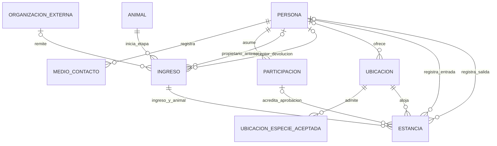

# Modelo físico del bloque de Jason

Las nueve relaciones mantienen su correspondencia con el inventario del anexo y el Proyecto 1 §5.8.1–5.8.2. El esquema inicial §4 y su diagrama incluían `ESTANCIA.responsable_id`. La normalización N-01 y el diccionario §7.2.11 justifican derivar la responsabilidad de alojamiento del oferente bajo S-13. Se conserva esa dependencia porque el oferente queda fijado a la oferta utilizada. La persona que registra el movimiento se representa con un vínculo distinto. Lab03 aportó versiones reducidas de PERSONA y ANIMAL como soporte clínico. Aquí se conserva el alcance de identidad completo del Proyecto 1 y se vuelven a comprobar sus restricciones aplicables. Las demás siete relaciones del bloque aparecen por primera vez en SQL. [Esquema](../sql/01_esquema.sql) · [Cambios](../Control_de_Cambios.md)

## Relaciones y claves

`ingreso_animal_uq` hace referenciable `(id_ingreso, animal_codigo)`. Su unicidad ya se deduce de la PK de INGRESO. Su propósito es la validación de contexto por FK. `numero_microchip` y `adopcion_origen_id` conservan unicidad cuando tienen valor. Pueden coexistir muchos nulos. La FK futura desde INGRESO hacia ADOPCION se instala después del bloque de Jean Carlos. [Contrato de integración](../Integracion.md)

## Diccionario

Los identificadores numéricos propios son `bigint` positivos con identidad generada. Los textos usan `texto_no_vacio` salvo cuando un `CHECK` de categorías especifica sus valores. `instante` es un `timestamptz` finito. Una columna indicada como opcional admite SQL `NULL`. En las FK se usa la acción predeterminada `NO ACTION` para conservar referencias. El esquema físico enumera los nombres y dominios de cada columna.

| Relación | Atributos obligatorios | Opcionales y condiciones | Identidad, unidad o enlace |
|---|---|---|---|
| PERSONA | `id_persona` | `nombre_identificacion` cuando se conoce | PK de persona estable. El mismo ID puede participar en distintos roles. RN-09 y S-06/S-07. |
| MEDIO_CONTACTO | `id_medio`, `persona_id`, `tipo_medio`, `valor` | Cero o más medios si están disponibles | PK `id_medio`, FK a PERSONA. El tipo y el valor son texto. `CORREO` es una etiqueta de la semilla. No se presume unicidad ni formato común para todos los medios. |
| PARTICIPACION | `id_participacion`, `persona_id`, `tipo_participacion`, `fecha_inicio` | `fecha_fin` y `requisitos`. `estado_aprobacion_registro` es obligatorio para hogar. `fecha_aprobacion_registro` es obligatoria con `APROBADO` o `REGISTRADO` y solo se usa en esos estados. | PK `id_participacion`, FK a PERSONA. Roles `PERSONAL_PERMANENTE`, `VOLUNTARIO`, `VETERINARIO`, `HOGAR_TEMPORAL`, `SOLICITANTE`, `ADOPTANTE`. Estados de registro `PENDIENTE`, `APROBADO`, `REGISTRADO`, `RECHAZADO`. La aprobación puede preceder el inicio de vigencia. |
| ANIMAL | `codigo_interno`, `especie` | `nombre`, `sexo`, `color`, `tamano_aproximado`, `edad_estimada`, `senas_particulares`, `numero_microchip` | PK `codigo_interno` estable. Especie en código compartido con especies aceptadas. Edad entera en meses, ≥ 0. Sexo registrado `HEMBRA` o `MACHO`, desconocido `NULL`. Tamaño `PEQUENO`, `MEDIANO` o `GRANDE`. Microchip textual sin espacios exteriores, conserva ceros iniciales y es unívoco cuando se conoce. |
| ORGANIZACION_EXTERNA | `id_organizacion`, `nombre_organizacion` | — | PK `id_organizacion`. El nombre por sí solo no identifica la organización. Modela origen o destino de un traslado según S-09. |
| INGRESO | `id_ingreso`, `animal_codigo`, `fecha_ingreso`, `lugar_ingreso`, `condicion_general`, `circunstancia_ingreso` | `detalle_circunstancia` obligatorio en `OTRA`, `DEVOLUCION` y `RECUPERACION`. `propietario_anterior_id` cuando se conoce. `organizacion_origen_id` obligatorio y exclusivo de `TRASLADO`. `receptor_devolucion_id` y `adopcion_origen_id` obligatorios y exclusivos de devolución o recuperación. `fecha_cierre` solo al cerrar etapa. | PK `id_ingreso`, FK a ANIMAL y FK a PERSONA para propietario y receptor. FK a ORGANIZACION_EXTERNA en traslado. FK compuesta a ADOPCION pendiente. Circunstancias restantes `RESCATE`, `ENTREGA_VOLUNTARIA`. Etapas disjuntas por animal. |
| UBICACION | `id_ubicacion`, `tipo_ubicacion`, `nombre_descripcion` | Área requiere `capacidad` y `condicion_admitida`. Hogar requiere `capacidad`, `disponibilidad_desde`, `disponibilidad_hasta`, `persona_oferente_id` y `codigo_hogar`. Atención externa usa los tres atributos comunes. | PK `id_ubicacion`; tipos `AREA_INTERNA`, `HOGAR_TEMPORAL`, `ATENCION_EXTERNA`. Capacidad en número entero positivo de animales. FK a PERSONA para el oferente. `codigo_hogar` reconoce el mismo recurso físico en distintas ofertas. |
| UBICACION_ESPECIE_ACEPTADA | `ubicacion_id`, `especie` | Una oferta en preparación puede carecer de especies. Para alojar, la especie declarada del animal debe estar registrada en esa oferta. | PK compuesta `(ubicacion_id, especie)`, FK a UBICACION. Solo aplica a hogares. Código de especie con letras ASCII mayúsculas iniciales y letras, dígitos o guiones bajos posteriores. `PERRO` y `GATO` son ejemplos. |
| ESTANCIA | `id_estancia`, `animal_codigo`, `ingreso_id`, `ubicacion_id`, `fecha_inicio_real`, `actor_entrada_id` | `fecha_fin_real` y `actor_salida_id` van juntos al cierre. Las dos fechas previstas se exigen en hogar y van juntas si se indican en otros lugares. `condicion_especial` conserva acuerdos si existen. `condicion_alojamiento` se exige y se compara en área interna. `aprobacion_hogar_id` se registra en hogar. `valoracion_sanitaria` se exige en traslados. | PK `id_estancia`, FK compuesta a INGRESO y FKs a UBICACION, PERSONA para entrada/salida, PARTICIPACION para prueba de aprobación. Exclusión por animal y periodo real. |

Las condiciones del caso exigen distinguir roles, circunstancias, tipos de lugar y condiciones. Las etiquetas concretas, los meses, la unidad de capacidad, el formato de especie y la precisión temporal se adoptaron para esta implementación. Para condición de área se compara un texto declarado contra la condición configurada. `AISLAMIENTO`, `RECUPERACION` y `CONVIVENCIA` son ejemplos de RN-06. La base admite nuevas descripciones sin un catálogo de diagnósticos ni una clasificación automática. Las circunstancias de RN-04 y RN-23 se traducen a las etiquetas anteriores, distinguiendo devolución y recuperación según S-05.

## Decisiones y ambigüedades

| Fragmento o fuente | Pregunta | Decisión e impacto |
|---|---|---|
| RN-04/05/23/25 y S-08 | ¿Cómo se identifica la etapa de cada estancia? | Se incorpora `ESTANCIA.ingreso_id` con FK contextual y `INGRESO.fecha_cierre`. Un ingreso abierto puede estar pendiente de la primera asignación. Quien ya está alojado conserva una sola estancia abierta hasta que se traslada o se cierra la etapa. La etapa siguiente puede empezar en el fin de la anterior. |
| RN-07/08, S-03 y S-13 | ¿Qué pasa si cambia el oferente o se abre otro periodo? | Cada oferta tiene su propia `id_ubicacion`. Se conserva su oferente una vez usada. Una nueva oferta del mismo lugar usa el mismo `codigo_hogar` y un periodo sin solapamiento. El cupo físico se comparte, incluso si quedó una estancia vencida en una oferta anterior. Una vivienda distinta recibe su propio código. Alta y asignación de ese código son responsabilidad de quien administra el catálogo. |
| RN-05/07/08 | ¿Cuándo coincide la salida con la llegada de otro animal? | Se usa `[inicio, fin)` a microsegundos. La asignación ocupa desde su hora real, el cupo se libera en la salida real. Se valida el plan y la llegada contra la oferta. Se registra como desviación una salida real posterior al periodo y se conserva la ocupación hasta la salida. Esto permite registrar dónde sigue el animal y retirar el caso vencido sin borrar hechos reales. |
| RN-07/09 | ¿Cómo se demuestra aprobación previa? | Se guarda la fecha de aprobación y se exige que preceda estrictamente a la llegada. La participación incluye su inicio y excluye su fin. El movimiento guarda qué aprobación utilizó. El cierre posterior de una participación debe conservar la vigencia en cada admisión que respaldó. |
| RN-08/14 y anexo P01 | ¿Quién responde por el hogar y quién ejecuta el traslado? | El oferente responde por el hogar mediante UBICACION. Los actores de entrada y salida registran el movimiento. El actor del traslado declara por escrito la valoración aplicada o su falta de incidencia. Así queda atribuida la decisión sin inferirla a partir de diagnósticos. |
| RN-04/23 y S-12 | ¿Hace falta receptor en todos los ingresos? | El receptor es obligatorio al volver después de adopción, incluso en recuperación por incumplimiento. Rescate y otros ingresos mantienen el alcance de S-12. Un regreso registra también motivo, condición, fecha y la adopción que lo originó. |
| RN-06/07 y S-11 | ¿Existe capacidad en atención externa? | Se conserva la descripción del lugar y se cuentan animales presentes. Capacidad, saldo de cupos y vigencia de oferta quedan sin valor para este tipo. |
| S-01, S-07 y S-14 | ¿Se conservan históricos de nombre, contacto y microchip? | Se guarda el nombre actual, los medios conocidos y el microchip actual con unicidad opcional. El historial permanente exigido aquí es el de ingresos y alojamientos. |

El modelo usa una fila por área interna y por centro externo. El administrador debe mantener la identidad física de esos lugares al dar de alta el catálogo. Las ubicaciones utilizadas conservan su configuración. El bloque admite nuevas ofertas de hogar independientes y la rectificación de lugares aún sin uso. Una política de redimensionamiento de un área ya usada requeriría versionar su configuración y mantener también su identidad física.
