# Modelo relacional consolidado — Grupo 08: Envíos Conecta

**Fuente:** `Modelo_relacional_EnviosConecta.drawio` (Proyecto 1), con los cambios registrados en `Control_de_Cambios.md` (CAM-001 a CAM-009).
**Estado:** versión mínima. El diccionario completo por atributo se completa junto con `sql/01_esquema.sql`.

## 1. Convenciones

- **Negrita:** clave primaria.
- `?`: admite nulos. Todo atributo sin `?` es obligatorio (NOT NULL).
- `→ TABLA`: clave foránea.
- **UK:** clave alternativa (valor único).
- `[CAM-NNN]`: elemento agregado o modificado en esta entrega.
- `(PEN-NN)`: regla pendiente de decisión; se mantiene como en el Proyecto 1.

**Unidades [CAM-009]:** peso en kilogramos (kg), dimensiones en centímetros (cm) y volumen en metros cúbicos (m³). El volumen de un paquete no se almacena: se deriva como largo × ancho × alto / 1 000 000, usando la medición aplicada o, si no la hay, los valores declarados.

## 2. Relaciones

### Clientes y partes

**1. CLIENTE** (**tipo_id, numero_id**, nombre_razon_social, tipo_cliente, condicion_contractual)
- No puede dejar de ser PERSONA_JURIDICA si tiene contactos [CAM-011]

**2. MEDIO_CONTACTO_CLIENTE** (**tipo_id, numero_id, tipo_medio, valor**, descripcion_medio? [CAM-010])
- (tipo_id, numero_id) → CLIENTE
- CHECK: descripcion_medio obligatoria si tipo_medio = OTRO, nula en los demás [CAM-010]

**3. DIRECCION_HABITUAL** (**tipo_id, numero_id, num_direccion**, provincia, canton, distrito, otras_senas, instrucciones_acceso?, referencia_geografica?, activa)
- (tipo_id, numero_id) → CLIENTE

**4. CONTACTO** (**id_contacto**, tipo_id, numero_id, nombre)
- (tipo_id, numero_id) → CLIENTE
- Solo clientes PERSONA_JURIDICA, garantizado por trigger (RN-02, S-02) [CAM-011]

**5. FACULTAD_CONTACTO** (**id_contacto, facultad**)
- id_contacto → CONTACTO

**6. MEDIO_CONTACTO_CONTACTO** (**id_contacto, tipo_medio, valor**, descripcion_medio? [CAM-010])
- id_contacto → CONTACTO
- CHECK: descripcion_medio obligatoria si tipo_medio = OTRO, nula en los demás [CAM-010]

**7. PARTICIPANTE** (**id_participante**, tipo_identificacion [CAM-001], identificacion, nombre, tipo_id?, numero_id?)
- UK (tipo_identificacion, identificacion) [CAM-001]
- UK (tipo_id, numero_id); (tipo_id, numero_id) → CLIENTE
- CHECK: tipo_id y numero_id ambos nulos o ambos con valor
- CHECK: si tiene cliente vinculado, tipo_id = tipo_identificacion y numero_id = identificacion [CAM-001]

**8. MEDIO_CONTACTO_PARTICIPANTE** (**id_participante, tipo_medio, valor**, descripcion_medio? [CAM-010])
- id_participante → PARTICIPANTE
- CHECK: descripcion_medio obligatoria si tipo_medio = OTRO, nula en los demás [CAM-010]

### Solicitudes, envíos y paquetes

**9. SOLICITUD** (**id_solicitud**, tipo_id, numero_id, fecha, lugar_recoleccion_provincia, lugar_recoleccion_canton, lugar_recoleccion_distrito, lugar_recoleccion_otras_senas, periodo_previsto_inicio, periodo_previsto_fin, destino, nivel_servicio, observaciones?)
- (tipo_id, numero_id) → CLIENTE
- CHECK: periodo_previsto_fin ≥ periodo_previsto_inicio
- `destino` es el destino general indicado al solicitar el servicio. Los destinos concretos de cada envío se registran en ENVIO (`destino_*`). Supuesto: el caso original no especifica cómo se reparten los destinos de una solicitud con varios envíos, así que no se impone una correspondencia entre ambos; se conserva el atributo para no perder un hecho que RN-05 exige registrar.

**10. TARIFA** (**id_tarifa**, tipo_id?, numero_id?, nivel_servicio, zona_origen, zona_destino, rango_peso_min, rango_peso_max, rango_volumen_min, rango_volumen_max, condicion_especial?, precio, vigencia_inicio, vigencia_fin?)
- (tipo_id, numero_id) → CLIENTE: tarifa de contrato; ambos nulos si es general [CAM-013]
- Rangos de peso en kg y de volumen en m³; precio en colones (CRC) [CAM-009]
- Aplicable al pagador y vigente al crear el envío: validado en la rutina de P01 [CAM-013]

**11. ENVIO** (**numero_guia**, id_solicitud, id_recoleccion? [CAM-005], tipo_id_pagador, numero_id_pagador, id_participante_remitente, id_participante_destinatario, id_tarifa, fecha_creacion, servicio, origen_provincia, origen_canton, origen_distrito, origen_otras_senas, destino_provincia, destino_canton, destino_distrito, destino_otras_senas, precio_cotizado, cotiz_zona_origen, cotiz_zona_destino, cotiz_peso, cotiz_volumen, cotiz_condiciones?)
- id_solicitud → SOLICITUD
- id_recoleccion → RECOLECCION, opcional [CAM-005]
- (tipo_id_pagador, numero_id_pagador) → CLIENTE
- id_participante_remitente → PARTICIPANTE; id_participante_destinatario → PARTICIPANTE
- id_tarifa → TARIFA
- cotiz_peso en kg, cotiz_volumen en m³ y precio_cotizado en colones (CRC) [CAM-009]
- Al menos un paquete por envío, verificado al confirmar la transacción [CAM-012]

**12. PAQUETE** (**numero_guia, num_paquete**, peso_declarado, largo_declarado, ancho_declarado, alto_declarado, descripcion, politica_contenido [CAM-006], documento_respaldo?, revision_fecha_hora?, revision_resultado?, revision_razon?, id_personal_revisor?, num_medicion_aplicada?)
- numero_guia → ENVIO
- id_personal_revisor → PERSONAL
- (numero_guia, num_paquete, num_medicion_aplicada) → MEDICION
- CHECK: resultado, momento y revisor de la revisión van juntos (RN-11)
- CHECK: revision_razon obligatoria si revision_resultado es RETENIDO o RECHAZADO (diccionario P1)
- CHECK: si politica_contenido = PROHIBIDO, revision_resultado solo puede ser RECHAZADO o nulo [CAM-006]
- CHECK: si politica_contenido = EXIGE_RESPALDO y revision_resultado = ACEPTADO, documento_respaldo es obligatorio [CAM-006]
- No se puede eliminar el último paquete de un envío [CAM-012]

**13. CONDICION_MANEJO_PAQUETE** (**numero_guia, num_paquete, condicion**)
- (numero_guia, num_paquete) → PAQUETE

**14. MEDICION** (**numero_guia, num_paquete, num_medicion**, id_sede, fecha_hora, peso, largo, ancho, alto)
- (numero_guia, num_paquete) → PAQUETE
- id_sede → SEDE
- Las mediciones no se modifican ni se eliminan, salvo al eliminar su paquete [CAM-014]

### Recolección

**15. RECOLECCION** (**id_recoleccion**, fecha, franja_inicio, franja_fin, direccion_provincia?, direccion_canton?, direccion_distrito?, direccion_otras_senas?, estado, id_recoleccion_anterior? [CAM-002])
- UK (id_recoleccion_anterior); id_recoleccion_anterior → RECOLECCION [CAM-002]
- CHECK: id_recoleccion_anterior ≠ id_recoleccion [CAM-002]
- CHECK: dirección completa o ausente
- Excepción de BCNF reconocida y justificada en la sección 7

**16. INTENTO_RECOLECCION** (**id_recoleccion, num_intento**, fecha_hora, resultado, observacion?)
- id_recoleccion → RECOLECCION

### Logística

**17. VEHICULO** (**id_interno**, placa, tipo, capacidad_peso, capacidad_volumen, refrigerado, condicion_operativa)
- UK (placa)
- capacidad_peso en kg y capacidad_volumen en m³ [CAM-009]

**18. PERIODO_FUERA_SERVICIO** (**id_interno, inicio**, fin?)
- id_interno → VEHICULO
- Los periodos de un mismo vehículo no se superponen: `EXCLUDE` sobre [inicio, fin) [CAM-015]

**19. ASIGNACION** (**id_asignacion**, id_personal, id_vehiculo, id_recoleccion?, id_salida?, id_asignacion_sustituida?, inicio, fin, funcion_ejercida, momento_registro, motivo_cambio?, vigente [CAM-015])
- id_personal → PERSONAL; id_vehiculo → VEHICULO
- id_recoleccion → RECOLECCION; id_salida → SALIDA_RUTA
- (id_personal, funcion_ejercida) → FUNCION_PERSONAL [CAM-016]
- CHECK: exactamente uno de id_recoleccion e id_salida tiene valor [CAM-008]
- UK (id_asignacion_sustituida); id_asignacion_sustituida → ASIGNACION
- CHECK: si sustituye a otra, motivo_cambio es obligatorio (RN-23)
- Sin traslapes de la misma persona ni del mismo vehículo entre asignaciones vigentes: `EXCLUDE` sobre [inicio, fin) [CAM-015]

**20. PERSONAL** (**id_personal**, identificacion, nombre)
- UK (identificacion)

**21. FUNCION_PERSONAL** (**id_personal, funcion**)
- id_personal → PERSONAL

**22. SALIDA_PAQUETE** (**id_salida, numero_guia, num_paquete**, momento_registro)
- id_salida → SALIDA_RUTA; (numero_guia, num_paquete) → PAQUETE
- Destino de la referencia compuesta de EVENTO_SEGUIMIENTO [CAM-018]

**23. SALIDA_RUTA** (**id_salida**, id_ruta, fecha, estado)
- id_ruta → RUTA

**24. RUTA** (**id_ruta**, id_sede_origen, id_sede_destino?, nombre, zona_destino?)
- id_sede_origen → SEDE; id_sede_destino → SEDE
- CHECK: sede destino o zona destino, al menos una [CAM-017]

**25. SEDE** (**id_sede**, nombre, tipo, provincia, canton, distrito, otras_senas, zona)

### Entregas, seguimiento, incidencias y devoluciones

**26. ENTREGA** (**id_entrega**, id_personal, fecha_hora, direccion_provincia, direccion_canton, direccion_distrito, direccion_otras_senas, receptor_nombre?, receptor_identificacion?, documento_mostrado?, constancia?, motivo?, evidencia?, proxima_accion?, funcion_mensajero [CAM-022])
- id_personal → PERSONAL; (id_personal, funcion_mensajero) → FUNCION_PERSONAL, con funcion_mensajero = 'MENSAJERO' [CAM-022]
- CHECK: receptor_nombre y receptor_identificacion juntos o ninguno
- Según el resultado de sus paquetes: receptor y constancia si alguno fue ENTREGADO; documento mostrado si alguno ENTREGADO exige PRUEBA_IDENTIDAD; motivo y próxima acción si alguno quedó NO_COMPLETADO o RECHAZADO (RN-15) [CAM-023]

**27. ENTREGA_PAQUETE** (**id_entrega, numero_guia, num_paquete**, resultado, es_final)
- id_entrega → ENTREGA; (numero_guia, num_paquete) → PAQUETE
- Una sola entrega final por paquete: índice único parcial [CAM-019]
- UK (id_entrega, numero_guia, num_paquete, resultado): destino de la referencia de DEVOLUCION_PAQUETE [CAM-020]

**28. EVENTO_SEGUIMIENTO** (**id_evento**, numero_guia, num_paquete, momento, momento_registro [CAM-003], id_personal, id_sede?, descripcion_ubicacion? [CAM-007], id_salida?, id_devolucion?, id_evento_corregido?, tipo_evento, situacion, condicion, observaciones?, motivo_correccion?)
- (numero_guia, num_paquete) → PAQUETE
- id_personal → PERSONAL; id_sede → SEDE
- (id_salida, numero_guia, num_paquete) → SALIDA_PAQUETE [CAM-018]
- (id_devolucion, numero_guia, num_paquete) → DEVOLUCION_PAQUETE [CAM-018]
- (id_evento_corregido, numero_guia, num_paquete) → EVENTO_SEGUIMIENTO; UK (id_evento_corregido) [CAM-018]
- UK (id_evento, numero_guia, num_paquete): destino de la referencia de corrección [CAM-018]
- Se elimina la UK (numero_guia, num_paquete, momento) [CAM-003]
- CHECK: id_sede o descripcion_ubicacion, al menos uno [CAM-007]
- CHECK: motivo_correccion obligatorio en una corrección y nulo en los demás (RN-25)
- Los eventos no se modifican ni se eliminan (RN-25)
- Evento actual: último por momento, luego momento_registro, luego id_evento, excluyendo los corregidos [CAM-003]

**29. INCIDENCIA** (**id_incidencia**, id_personal, tipo, fecha, descripcion, estado, resolucion?)
- id_personal → PERSONAL
- CHECK: resolucion obligatoria si el estado es RESUELTA
- Ya no es referenciada por DEVOLUCION [CAM-020]

**30. INCIDENCIA_PAQUETE** (**id_incidencia, numero_guia, num_paquete**, resultado [CAM-021])
- id_incidencia → INCIDENCIA; (numero_guia, num_paquete) → PAQUETE
- resultado obligatorio, PENDIENTE por defecto [CAM-021]

**31. DEVOLUCION_PAQUETE** (**numero_guia, num_paquete**, id_devolucion, id_entrega [CAM-020], resultado_entrega [CAM-020])
- (numero_guia, num_paquete) → PAQUETE
- UK (id_devolucion) [CAM-004]; UK (id_devolucion, numero_guia, num_paquete) [CAM-018]
- (id_devolucion, numero_guia) → DEVOLUCION [CAM-004]
- (id_entrega, numero_guia, num_paquete, resultado_entrega) → ENTREGA_PAQUETE; resultado_entrega = 'RECHAZADO' [CAM-020]

**32. DEVOLUCION** (**id_devolucion**, numero_guia, fecha, motivo)
- numero_guia → ENVIO
- UK (id_devolucion, numero_guia) [CAM-004]
- Se eliminan id_entrega (trasladada a DEVOLUCION_PAQUETE) e id_incidencia [CAM-020]

## 3. Dominios cerrados conocidos

| tipo_medio | TELEFONO, CORREO, WHATSAPP, OTRO (con descripción) | Lab03, CAM-010 |
| servicio (ENVIO) | ECONOMICO, ESTANDAR, EXPRESS, MISMO_DIA | RN-06, mismo dominio que nivel_servicio |
| condicion (CONDICION_MANEJO_PAQUETE) | FRAGIL, REFRIGERACION, PRUEBA_IDENTIDAD | RN-07 |
| tipo (SEDE) | CENTRO_DISTRIBUCION, SUCURSAL | Propuesta del grupo (S-15) |
| funcion, funcion_ejercida | CONDUCTOR, MENSAJERO, OPERADOR_SEDE | RN-22 |
| estado (RECOLECCION) | PLANIFICADA, COMPLETADA, FALLIDA, REPROGRAMADA | RN-09, CAM-002 |
| resultado (INTENTO_RECOLECCION) | EXITOSO, FALLIDO | RN-09 |
| tipo (VEHICULO) | MOTOCICLETA, AUTOMOVIL, PANEL, CAMION | Propuesta del grupo (S-15) |
| condicion_operativa (VEHICULO) | OPERATIVO, EN_MANTENIMIENTO, FUERA_DE_SERVICIO | RN-20 |
| estado (SALIDA_RUTA) | PLANIFICADA, CONFIRMADA, EN_RUTA, FINALIZADA, CANCELADA | Propuesta del grupo (S-15) |
| resultado (ENTREGA_PAQUETE) | ENTREGADO, RECHAZADO, NO_COMPLETADO | RN-14, RN-15, RN-19 |
| proxima_accion (ENTREGA) | NUEVO_INTENTO, RETIRO_EN_SEDE, DEVOLUCION_REMITENTE, OTRA | RN-15 |
| tipo_evento (EVENTO_SEGUIMIENTO) | RECEPCION, INGRESO_SEDE, SALIDA_SEDE, EN_RUTA, TRANSFERENCIA, INTENTO_ENTREGA, ENTREGA, DEVOLUCION | RN-12, anexo G08-P03 |
| situacion (EVENTO_SEGUIMIENTO) | EN_SEDE, EN_TRANSITO, EN_REPARTO, ENTREGADO, EN_DEVOLUCION, RETENIDO | Propuesta del grupo (S-15) |
| condicion (EVENTO_SEGUIMIENTO) | BUEN_ESTADO, DANADO, INCOMPLETO | RN-12 |
| tipo (INCIDENCIA) | DANO, PERDIDA, DIRECCION_INCORRECTA, ATRASO, DOCUMENTACION_FALTANTE, RUPTURA_CONDICIONES | RN-17 |
| estado (INCIDENCIA) | ABIERTA, EN_ATENCION, RESUELTA | RN-17 |
| resultado (INCIDENCIA_PAQUETE) | PENDIENTE, RESUELTO, SIN_SOLUCION | RN-18, CAM-021 |
| resultado_entrega (DEVOLUCION_PAQUETE) | RECHAZADO | CAM-020 |

## 4. Diagrama

```mermaid
erDiagram
    CLIENTE ||--o{ MEDIO_CONTACTO_CLIENTE : tiene
    CLIENTE ||--o{ DIRECCION_HABITUAL : tiene
    CLIENTE ||--o{ CONTACTO : registra
    CONTACTO ||--|{ FACULTAD_CONTACTO : tiene
    CONTACTO ||--o{ MEDIO_CONTACTO_CONTACTO : tiene
    CLIENTE |o--o| PARTICIPANTE : "puede ser"
    PARTICIPANTE ||--o{ MEDIO_CONTACTO_PARTICIPANTE : tiene
    CLIENTE ||--o{ SOLICITUD : contrata
    CLIENTE |o--o{ TARIFA : "tiene contrato"
    SOLICITUD ||--|{ ENVIO : origina
    CLIENTE ||--o{ ENVIO : paga
    PARTICIPANTE ||--o{ ENVIO : remite
    PARTICIPANTE ||--o{ ENVIO : recibe
    TARIFA ||--o{ ENVIO : cotiza
    RECOLECCION |o--o{ ENVIO : recoge
    RECOLECCION |o--o| RECOLECCION : reemplaza
    RECOLECCION ||--o{ INTENTO_RECOLECCION : registra
    ENVIO ||--|{ PAQUETE : contiene
    PAQUETE ||--o{ CONDICION_MANEJO_PAQUETE : tiene
    PAQUETE ||--o{ MEDICION : "se mide"
    SEDE ||--o{ MEDICION : "lugar de"
    PERSONAL |o--o{ PAQUETE : revisa
    VEHICULO ||--o{ PERIODO_FUERA_SERVICIO : tiene
    PERSONAL ||--o{ FUNCION_PERSONAL : desempena
    PERSONAL ||--o{ ASIGNACION : asignado
    VEHICULO ||--o{ ASIGNACION : asignado
    RECOLECCION |o--o{ ASIGNACION : atiende
    SALIDA_RUTA |o--o{ ASIGNACION : atiende
    ASIGNACION |o--o| ASIGNACION : sustituye
    SEDE ||--o{ RUTA : origen
    SEDE |o--o{ RUTA : destino
    RUTA ||--o{ SALIDA_RUTA : programa
    SALIDA_RUTA ||--o{ SALIDA_PAQUETE : manifiesto
    PAQUETE ||--o{ SALIDA_PAQUETE : viaja
    PERSONAL ||--o{ ENTREGA : realiza
    ENTREGA ||--|{ ENTREGA_PAQUETE : incluye
    PAQUETE ||--o{ ENTREGA_PAQUETE : intenta
    PAQUETE ||--o{ EVENTO_SEGUIMIENTO : registra
    PERSONAL ||--o{ EVENTO_SEGUIMIENTO : responsable
    SEDE |o--o{ EVENTO_SEGUIMIENTO : ubica
    SALIDA_RUTA |o--o{ EVENTO_SEGUIMIENTO : contexto
    DEVOLUCION |o--o{ EVENTO_SEGUIMIENTO : contexto
    EVENTO_SEGUIMIENTO |o--o| EVENTO_SEGUIMIENTO : corrige
    PERSONAL ||--o{ INCIDENCIA : atiende
    INCIDENCIA ||--|{ INCIDENCIA_PAQUETE : afecta
    PAQUETE ||--o{ INCIDENCIA_PAQUETE : afectado
    ENVIO ||--o{ DEVOLUCION : resuelve
    ENTREGA_PAQUETE ||--o| DEVOLUCION_PAQUETE : origina
    DEVOLUCION ||--|| DEVOLUCION_PAQUETE : incluye
    PAQUETE ||--o| DEVOLUCION_PAQUETE : devuelto
```

## 5. Diccionario de datos

Columnas: **Tipo** es el tipo físico en PostgreSQL; **Nulo** indica si admite nulos; **Clave**: PK, FK o UK; **Dominio o regla**: valores permitidos y restricciones.

### 5.1 Clientes y partes

**CLIENTE**

| Atributo | Descripción | Tipo | Nulo | Clave | Dominio o regla |
|---|---|---|---|---|---|
| tipo_id | Tipo de documento del cliente | VARCHAR(20) | No | PK | CEDULA_FISICA, CEDULA_JURIDICA, DIMEX, PASAPORTE (S-01) |
| numero_id | Número de documento | VARCHAR(30) | No | PK | Único junto con tipo_id |
| nombre_razon_social | Nombre de la persona o razón social | VARCHAR(150) | No | — | No vacío |
| tipo_cliente | Persona u organización | VARCHAR(20) | No | — | PERSONA_FISICA, PERSONA_JURIDICA. No puede dejar de ser PERSONA_JURIDICA si tiene contactos (CAM-011) |
| condicion_contractual | Condición de contrato con la empresa | VARCHAR(30) | No | — | SIN_CONTRATO, CONTRATO_ESTANDAR, CONTRATO_CORPORATIVO |

**MEDIO_CONTACTO_CLIENTE**

| Atributo | Descripción | Tipo | Nulo | Clave | Dominio o regla |
|---|---|---|---|---|---|
| tipo_id, numero_id | Cliente dueño del medio | VARCHAR(20), VARCHAR(30) | No | PK, FK → CLIENTE | Se elimina con el cliente (CASCADE) |
| tipo_medio | Tipo de medio | VARCHAR(20) | No | PK | TELEFONO, CORREO, WHATSAPP, OTRO (CAM-010) |
| valor | Número, dirección o identificador del medio | VARCHAR(120) | No | PK | No vacío |
| descripcion_medio | Qué medio es, cuando el tipo es OTRO | VARCHAR(120) | Sí | — | Obligatoria y no vacía si tipo_medio = OTRO; nula en los demás (CAM-010) |

**DIRECCION_HABITUAL**

| Atributo | Descripción | Tipo | Nulo | Clave | Dominio o regla |
|---|---|---|---|---|---|
| tipo_id, numero_id | Cliente dueño de la dirección | VARCHAR(20), VARCHAR(30) | No | PK, FK → CLIENTE | Se elimina con el cliente (CASCADE) |
| num_direccion | Consecutivo de la dirección dentro del cliente | SMALLINT | No | PK | Mayor que 0 |
| provincia | Provincia | VARCHAR(40) | No | — | SAN_JOSE, ALAJUELA, CARTAGO, HEREDIA, GUANACASTE, PUNTARENAS, LIMON |
| canton, distrito, otras_senas | Resto de la dirección | VARCHAR(40), VARCHAR(40), VARCHAR(250) | No | — | No vacíos |
| instrucciones_acceso | Indicaciones para llegar o ingresar | VARCHAR(250) | Sí | — | — |
| referencia_geografica | Referencia de ubicación | VARCHAR(250) | Sí | — | — |
| activa | Si la dirección sigue en uso | BOOLEAN | No | — | RN-03 |

**CONTACTO**

| Atributo | Descripción | Tipo | Nulo | Clave | Dominio o regla |
|---|---|---|---|---|---|
| id_contacto | Identificador del contacto | INTEGER (IDENTITY) | No | PK | Generado por la base |
| tipo_id, numero_id | Organización a la que pertenece | VARCHAR(20), VARCHAR(30) | No | FK → CLIENTE | El cliente debe ser PERSONA_JURIDICA (RN-02, S-02, CAM-011). No se puede eliminar un cliente con contactos (RESTRICT) |
| nombre | Nombre del contacto | VARCHAR(120) | No | — | No vacío |

**FACULTAD_CONTACTO**

| Atributo | Descripción | Tipo | Nulo | Clave | Dominio o regla |
|---|---|---|---|---|---|
| id_contacto | Contacto | INTEGER | No | PK, FK → CONTACTO | Se elimina con el contacto (CASCADE) |
| facultad | Facultad del contacto | VARCHAR(40) | No | PK | SOLICITAR_SERVICIOS, AUTORIZAR_CARGOS, RECIBIR_REPORTES. Al menos una por contacto, garantizada por `sp_registrar_contacto` (S-02) |

**MEDIO_CONTACTO_CONTACTO**

| Atributo | Descripción | Tipo | Nulo | Clave | Dominio o regla |
|---|---|---|---|---|---|
| id_contacto | Contacto dueño del medio | INTEGER | No | PK, FK → CONTACTO | Se elimina con el contacto (CASCADE) |
| tipo_medio | Tipo de medio | VARCHAR(20) | No | PK | TELEFONO, CORREO, WHATSAPP, OTRO (CAM-010) |
| valor | Valor del medio | VARCHAR(120) | No | PK | No vacío |
| descripcion_medio | Qué medio es, cuando el tipo es OTRO | VARCHAR(120) | Sí | — | Obligatoria si tipo_medio = OTRO; nula en los demás (CAM-010) |

**PARTICIPANTE**

| Atributo | Descripción | Tipo | Nulo | Clave | Dominio o regla |
|---|---|---|---|---|---|
| id_participante | Identificador del participante | INTEGER (IDENTITY) | No | PK | Generado por la base |
| tipo_identificacion | Tipo de documento | VARCHAR(20) | No | UK | Mismo dominio que cliente.tipo_id (CAM-001) |
| identificacion | Número de documento | VARCHAR(30) | No | UK | Único junto con tipo_identificacion; no vacío (CAM-001) |
| nombre | Nombre del remitente o destinatario | VARCHAR(120) | No | — | No vacío |
| tipo_id, numero_id | Cliente vinculado, si lo es | VARCHAR(20), VARCHAR(30) | Sí | UK, FK → CLIENTE | Ambos nulos o ambos con valor; si tienen valor, coinciden con tipo_identificacion e identificacion (CAM-001). No se puede eliminar un cliente vinculado (RESTRICT) |

**MEDIO_CONTACTO_PARTICIPANTE**

| Atributo | Descripción | Tipo | Nulo | Clave | Dominio o regla |
|---|---|---|---|---|---|
| id_participante | Participante dueño del medio | INTEGER | No | PK, FK → PARTICIPANTE | Se elimina con el participante (CASCADE) |
| tipo_medio | Tipo de medio | VARCHAR(20) | No | PK | TELEFONO, CORREO, WHATSAPP, OTRO (CAM-010) |
| valor | Valor del medio | VARCHAR(120) | No | PK | No vacío |
| descripcion_medio | Qué medio es, cuando el tipo es OTRO | VARCHAR(120) | Sí | — | Obligatoria si tipo_medio = OTRO; nula en los demás (CAM-010) |

### 5.2 Sedes, personal, solicitudes, envíos y paquetes

**SEDE**

| Atributo | Descripción | Tipo | Nulo | Clave | Dominio o regla |
|---|---|---|---|---|---|
| id_sede | Identificador de la sede | INTEGER (IDENTITY) | No | PK | Generado por la base |
| nombre | Nombre de la sede | VARCHAR(100) | No | — | No vacío |
| tipo | Tipo de sede | VARCHAR(30) | No | — | CENTRO_DISTRIBUCION, SUCURSAL |
| provincia | Provincia | VARCHAR(40) | No | — | Mismo dominio que en DIRECCION_HABITUAL |
| canton, distrito, otras_senas | Resto de la dirección | VARCHAR(40), VARCHAR(40), VARCHAR(250) | No | — | No vacíos |
| zona | Zona logística de la sede | VARCHAR(60) | No | — | Texto libre, no vacío |

**PERSONAL**

| Atributo | Descripción | Tipo | Nulo | Clave | Dominio o regla |
|---|---|---|---|---|---|
| id_personal | Identificador de la persona | INTEGER (IDENTITY) | No | PK | Generado por la base |
| identificacion | Documento de identidad | VARCHAR(30) | No | UK | No vacío |
| nombre | Nombre | VARCHAR(120) | No | — | No vacío |

**SOLICITUD**

| Atributo | Descripción | Tipo | Nulo | Clave | Dominio o regla |
|---|---|---|---|---|---|
| id_solicitud | Identificador de la solicitud | INTEGER (IDENTITY) | No | PK | Generado por la base |
| tipo_id, numero_id | Cliente contratante | VARCHAR(20), VARCHAR(30) | No | FK → CLIENTE | Un único contratante (RN-05). RESTRICT al eliminar el cliente |
| fecha | Fecha de la solicitud | DATE | No | — | — |
| lugar_recoleccion_* | Provincia, cantón, distrito y otras señas del lugar previsto | VARCHAR | No | — | Provincia en su dominio; resto no vacío |
| periodo_previsto_inicio, periodo_previsto_fin | Periodo previsto de recolección | TIMESTAMPTZ | No | — | Fin ≥ inicio |
| destino | Destino general de la solicitud | VARCHAR(250) | No | — | No vacío. Los destinos concretos están en ENVIO (supuesto PEN-20) |
| nivel_servicio | Nivel de servicio solicitado | VARCHAR(30) | No | — | ECONOMICO, ESTANDAR, EXPRESS, MISMO_DIA |
| observaciones | Observaciones | TEXT | Sí | — | — |

**TARIFA**

| Atributo | Descripción | Tipo | Nulo | Clave | Dominio o regla |
|---|---|---|---|---|---|
| id_tarifa | Identificador de la tarifa | INTEGER (IDENTITY) | No | PK | Generado por la base |
| tipo_id, numero_id | Cliente del contrato, si es tarifa de contrato | VARCHAR(20), VARCHAR(30) | Sí | FK → CLIENTE | Ambos nulos (tarifa general) o ambos con valor (CAM-013) |
| nivel_servicio | Nivel de servicio | VARCHAR(30) | No | — | Mismo dominio que en SOLICITUD |
| zona_origen, zona_destino | Zonas a las que aplica | VARCHAR(60) | No | — | Texto libre, no vacío |
| rango_peso_min, rango_peso_max | Rango de peso | NUMERIC(10,3), en kg | No | — | Mínimo ≥ 0; máximo > mínimo |
| rango_volumen_min, rango_volumen_max | Rango de volumen | NUMERIC(10,6), en m³ | No | — | Mínimo ≥ 0; máximo > mínimo |
| condicion_especial | Condición especial a la que aplica | VARCHAR(100) | Sí | — | — |
| precio | Precio | NUMERIC(12,2), en colones (CRC) | No | — | Mayor que 0 |
| vigencia_inicio, vigencia_fin | Periodo de vigencia | DATE | Inicio no; fin sí | — | Fin nulo (vigente) o ≥ inicio. La aplicabilidad al pagador y la vigencia al crear el envío se validan en P01 (CAM-013) |

**ENVIO**

| Atributo | Descripción | Tipo | Nulo | Clave | Dominio o regla |
|---|---|---|---|---|---|
| numero_guia | Número de guía | VARCHAR(20) | No | PK | Único (RN-06); no vacío |
| id_solicitud | Solicitud de origen | INTEGER | No | FK → SOLICITUD | RESTRICT |
| id_recoleccion | Recolección asignada | INTEGER | Sí | FK → RECOLECCION | Opcional (CAM-005) |
| tipo_id_pagador, numero_id_pagador | Responsable del pago | VARCHAR(20), VARCHAR(30) | No | FK → CLIENTE | Cliente registrado (S-05) |
| id_participante_remitente, id_participante_destinatario | Remitente y destinatario | INTEGER | No | FK → PARTICIPANTE | Pueden ser la misma persona (S-04) |
| id_tarifa | Tarifa usada para cotizar | INTEGER | No | FK → TARIFA | Debe ser general o del pagador, y vigente (CAM-013, validado en P01) |
| fecha_creacion | Fecha de creación | DATE | No | — | — |
| servicio | Servicio contratado | VARCHAR(30) | No | — | ECONOMICO, ESTANDAR, EXPRESS, MISMO_DIA |
| origen_*, destino_* | Direcciones de origen y destino tal como se usaron | VARCHAR | No | — | Provincia en su dominio; resto no vacío. No cambian si cambia la dirección habitual (RN-04, S-03) |
| precio_cotizado | Precio cotizado | NUMERIC(12,2), en colones (CRC) | No | — | Mayor que 0. Se conserva aunque cambie la tarifa (RN-08) |
| cotiz_zona_origen, cotiz_zona_destino | Zonas usadas para cotizar | VARCHAR(60) | No | — | No vacías |
| cotiz_peso | Peso usado para cotizar | NUMERIC(10,3), en kg | No | — | Mayor que 0 |
| cotiz_volumen | Volumen usado para cotizar | NUMERIC(10,6), en m³ | No | — | Mayor que 0 |
| cotiz_condiciones | Condiciones especiales usadas | VARCHAR(250) | Sí | — | — |

**PAQUETE**

| Atributo | Descripción | Tipo | Nulo | Clave | Dominio o regla |
|---|---|---|---|---|---|
| numero_guia | Envío al que pertenece | VARCHAR(20) | No | PK, FK → ENVIO | Se elimina con el envío (CASCADE). Todo envío tiene al menos un paquete (CAM-012) |
| num_paquete | Número del paquete dentro del envío | SMALLINT | No | PK | Mayor que 0 |
| peso_declarado | Peso declarado | NUMERIC(10,3), en kg | No | — | Mayor que 0 |
| largo_declarado, ancho_declarado, alto_declarado | Dimensiones declaradas | NUMERIC(8,2), en cm | No | — | Mayores que 0 |
| descripcion | Descripción del contenido | VARCHAR(250) | No | — | No vacía |
| politica_contenido | Política del contenido | VARCHAR(20) | No | — | PERMITIDO, PROHIBIDO, EXIGE_RESPALDO (CAM-006) |
| documento_respaldo | Documento de respaldo | VARCHAR(250) | Sí | — | Obligatorio para aceptar contenido EXIGE_RESPALDO (CAM-006) |
| revision_fecha_hora | Momento de la revisión inicial | TIMESTAMPTZ | Sí | — | Junto con resultado y revisor: los tres o ninguno |
| revision_resultado | Resultado de la revisión | VARCHAR(20) | Sí | — | ACEPTADO, RETENIDO, RECHAZADO. Contenido PROHIBIDO solo puede RECHAZARSE (CAM-006) |
| revision_razon | Razón de la retención o el rechazo | VARCHAR(250) | Sí | — | Obligatoria si RETENIDO o RECHAZADO |
| id_personal_revisor | Persona que revisó | INTEGER | Sí | FK → PERSONAL | — |
| num_medicion_aplicada | Medición usada para clasificar y cobrar | SMALLINT | Sí | FK → MEDICION | Junto con numero_guia y num_paquete (misma medición del paquete). Nulo si se usaron los valores declarados (S-07) |

**CONDICION_MANEJO_PAQUETE**

| Atributo | Descripción | Tipo | Nulo | Clave | Dominio o regla |
|---|---|---|---|---|---|
| numero_guia, num_paquete | Paquete | VARCHAR(20), SMALLINT | No | PK, FK → PAQUETE | Se elimina con el paquete (CASCADE) |
| condicion | Condición de manejo | VARCHAR(30) | No | PK | FRAGIL, REFRIGERACION, PRUEBA_IDENTIDAD (RN-07) |

**MEDICION**

| Atributo | Descripción | Tipo | Nulo | Clave | Dominio o regla |
|---|---|---|---|---|---|
| numero_guia, num_paquete | Paquete medido | VARCHAR(20), SMALLINT | No | PK, FK → PAQUETE | Se elimina solo con su paquete (CASCADE) |
| num_medicion | Número de la medición dentro del paquete | SMALLINT | No | PK | Mayor que 0. No se modifica ni se borra (CAM-014) |
| id_sede | Sede donde se midió | INTEGER | No | FK → SEDE | RESTRICT |
| fecha_hora | Momento de la medición | TIMESTAMPTZ | No | — | — |
| peso | Peso medido | NUMERIC(10,3), en kg | No | — | Mayor que 0 |
| largo, ancho, alto | Dimensiones medidas | NUMERIC(8,2), en cm | No | — | Mayores que 0 |

### 5.3 Recolección y logística

**RECOLECCION**

| Atributo | Descripción | Tipo | Nulo | Clave | Dominio o regla |
|---|---|---|---|---|---|
| id_recoleccion | Identificador de la recolección | INTEGER (IDENTITY) | No | PK | Generado por la base |
| fecha | Fecha planificada | DATE | No | — | — |
| franja_inicio, franja_fin | Franja horaria planificada | TIME | No | — | Fin > inicio |
| direccion_provincia, direccion_canton, direccion_distrito, direccion_otras_senas | Dirección, si hay un único punto (S-08) | VARCHAR | Sí | — | Las cuatro o ninguna; provincia en su dominio, resto no vacío. Copia histórica (S-03); excepción de BCNF en la sección 7 |
| estado | Estado de la recolección | VARCHAR(20) | No | — | PLANIFICADA, COMPLETADA, FALLIDA, REPROGRAMADA |
| id_recoleccion_anterior | Recolección que esta reemplaza | INTEGER | Sí | UK, FK → RECOLECCION | Distinta de sí misma; una recolección se reemplaza directamente a lo sumo una vez (CAM-002) |

**INTENTO_RECOLECCION**

| Atributo | Descripción | Tipo | Nulo | Clave | Dominio o regla |
|---|---|---|---|---|---|
| id_recoleccion | Recolección intentada | INTEGER | No | PK, FK → RECOLECCION | Se elimina con la recolección (CASCADE) |
| num_intento | Número del intento | SMALLINT | No | PK | Mayor que 0 |
| fecha_hora | Momento del intento | TIMESTAMPTZ | No | — | — |
| resultado | Resultado | VARCHAR(20) | No | — | EXITOSO, FALLIDO (RN-09) |
| observacion | Observación | VARCHAR(250) | Sí | — | — |

**VEHICULO**

| Atributo | Descripción | Tipo | Nulo | Clave | Dominio o regla |
|---|---|---|---|---|---|
| id_interno | Identificador interno | INTEGER (IDENTITY) | No | PK | Generado por la base |
| placa | Placa | VARCHAR(10) | No | UK | No vacía |
| tipo | Tipo de vehículo | VARCHAR(20) | No | — | MOTOCICLETA, AUTOMOVIL, PANEL, CAMION |
| capacidad_peso | Capacidad de carga | NUMERIC(10,3), en kg | No | — | Mayor que 0 (CAM-009) |
| capacidad_volumen | Capacidad de volumen | NUMERIC(10,6), en m³ | No | — | Mayor que 0 (CAM-009) |
| refrigerado | Si tiene refrigeración | BOOLEAN | No | — | RN-20 |
| condicion_operativa | Condición actual | VARCHAR(20) | No | — | OPERATIVO, EN_MANTENIMIENTO, FUERA_DE_SERVICIO (RN-20) |

**PERIODO_FUERA_SERVICIO**

| Atributo | Descripción | Tipo | Nulo | Clave | Dominio o regla |
|---|---|---|---|---|---|
| id_interno | Vehículo | INTEGER | No | PK, FK → VEHICULO | Se elimina con el vehículo (CASCADE) |
| inicio | Inicio del periodo | TIMESTAMPTZ | No | PK | — |
| fin | Fin del periodo | TIMESTAMPTZ | Sí | — | Nulo: periodo abierto. Si tiene valor, > inicio. Los periodos de un vehículo no se superponen (CAM-015) |

**FUNCION_PERSONAL**

| Atributo | Descripción | Tipo | Nulo | Clave | Dominio o regla |
|---|---|---|---|---|---|
| id_personal | Persona | INTEGER | No | PK, FK → PERSONAL | Se elimina con la persona (CASCADE) |
| funcion | Función que desempeña | VARCHAR(30) | No | PK | CONDUCTOR, MENSAJERO, OPERADOR_SEDE (RN-22, S-14). No se elimina si está en uso en una asignación (CAM-016) |

**RUTA**

| Atributo | Descripción | Tipo | Nulo | Clave | Dominio o regla |
|---|---|---|---|---|---|
| id_ruta | Identificador de la ruta de catálogo | INTEGER (IDENTITY) | No | PK | Generado por la base |
| id_sede_origen | Sede de salida | INTEGER | No | FK → SEDE | RESTRICT |
| id_sede_destino | Sede de destino | INTEGER | Sí | FK → SEDE | Al menos uno de sede destino o zona destino (CAM-017) |
| nombre | Nombre de la ruta | VARCHAR(100) | No | — | No vacío |
| zona_destino | Zona de destino | VARCHAR(60) | Sí | — | No vacía si tiene valor (CAM-017) |

**SALIDA_RUTA**

| Atributo | Descripción | Tipo | Nulo | Clave | Dominio o regla |
|---|---|---|---|---|---|
| id_salida | Identificador de la salida concreta | INTEGER (IDENTITY) | No | PK | Generado por la base |
| id_ruta | Ruta de catálogo | INTEGER | No | FK → RUTA | RESTRICT |
| fecha | Fecha de la salida | DATE | No | — | — |
| estado | Estado de la salida | VARCHAR(20) | No | — | PLANIFICADA, CONFIRMADA, EN_RUTA, FINALIZADA, CANCELADA |

**SALIDA_PAQUETE**

| Atributo | Descripción | Tipo | Nulo | Clave | Dominio o regla |
|---|---|---|---|---|---|
| id_salida | Salida | INTEGER | No | PK, FK → SALIDA_RUTA | Se elimina con la salida (CASCADE) |
| numero_guia, num_paquete | Paquete del manifiesto | VARCHAR(20), SMALLINT | No | PK, FK → PAQUETE | RESTRICT |
| momento_registro | Momento en que se incluyó en el manifiesto | TIMESTAMPTZ | No | — | Por defecto, el momento de inserción. Antes de la partida (S-12, PEN-12) |

**ASIGNACION**

| Atributo | Descripción | Tipo | Nulo | Clave | Dominio o regla |
|---|---|---|---|---|---|
| id_asignacion | Identificador | INTEGER (IDENTITY) | No | PK | Generado por la base |
| id_personal | Persona asignada | INTEGER | No | FK → PERSONAL | Sin traslapes entre sus asignaciones vigentes (CAM-015) |
| id_vehiculo | Vehículo asignado | INTEGER | No | FK → VEHICULO | Sin traslapes entre sus asignaciones vigentes (CAM-015) |
| id_recoleccion | Recolección atendida | INTEGER | Sí | FK → RECOLECCION | Exactamente una de id_recoleccion e id_salida (CAM-008) |
| id_salida | Salida atendida | INTEGER | Sí | FK → SALIDA_RUTA | Exactamente una de id_recoleccion e id_salida (CAM-008) |
| id_asignacion_sustituida | Asignación original que esta sustituye | INTEGER | Sí | UK, FK → ASIGNACION | Distinta de sí misma; si tiene valor, motivo_cambio es obligatorio (RN-23) |
| inicio, fin | Intervalo de la asignación | TIMESTAMPTZ | No | — | Fin > inicio; intervalo [inicio, fin) (S-13) |
| funcion_ejercida | Función en esta asignación | VARCHAR(30) | No | FK → FUNCION_PERSONAL | Junto con id_personal: debe ser una función de la persona (CAM-016) |
| momento_registro | Momento de registro | TIMESTAMPTZ | No | — | Por defecto, el momento de inserción |
| motivo_cambio | Motivo de la sustitución | VARCHAR(250) | Sí | — | Obligatorio si sustituye a otra (RN-23) |
| vigente | Si la asignación sigue vigente | BOOLEAN | No | — | Por defecto verdadero; falso cuando fue sustituida (CAM-015) |

### 5.4 Entregas, incidencias, devoluciones y seguimiento

**ENTREGA**

| Atributo | Descripción | Tipo | Nulo | Clave | Dominio o regla |
|---|---|---|---|---|---|
| id_entrega | Identificador de la entrega | INTEGER (IDENTITY) | No | PK | Generado por la base |
| id_personal | Persona mensajera | INTEGER | No | FK → PERSONAL | RESTRICT |
| fecha_hora | Momento de la entrega | TIMESTAMPTZ | No | — | — |
| direccion_provincia, direccion_canton, direccion_distrito, direccion_otras_senas | Dirección utilizada | VARCHAR | No | — | Copia; puede diferir del destino del envío (S-17). Provincia en su dominio, resto no vacío |
| receptor_nombre, receptor_identificacion | Quien recibió | VARCHAR(120), VARCHAR(30) | Sí | — | Ambos o ninguno; puede no ser el destinatario (S-18) |
| documento_mostrado | Documento mostrado al recibir | VARCHAR(60) | Sí | — | Cuando el paquete exige prueba de identidad (RN-15) |
| constancia | Constancia obtenida | VARCHAR(250) | Sí | — | RN-15 |
| motivo, evidencia | Motivo y evidencia de una entrega no completada | VARCHAR(250) | Sí | — | RN-15 |
| proxima_accion | Próxima acción tras una entrega no completada | VARCHAR(30) | Sí | — | NUEVO_INTENTO, RETIRO_EN_SEDE, DEVOLUCION_REMITENTE, OTRA (RN-15) |
| funcion_mensajero | Función con la que actúa la persona | VARCHAR(30) | No | FK → FUNCION_PERSONAL | Siempre MENSAJERO; junto con id_personal, la persona debe ser mensajera (RN-14, CAM-022) |

**ENTREGA_PAQUETE**

| Atributo | Descripción | Tipo | Nulo | Clave | Dominio o regla |
|---|---|---|---|---|---|
| id_entrega | Entrega | INTEGER | No | PK, FK → ENTREGA | Se elimina con la entrega (CASCADE) |
| numero_guia, num_paquete | Paquete intentado | VARCHAR(20), SMALLINT | No | PK, FK → PAQUETE | RESTRICT |
| resultado | Resultado para el paquete | VARCHAR(20) | No | UK (con la PK) | ENTREGADO, RECHAZADO, NO_COMPLETADO. No puede cambiar si el paquete ya fue devuelto por esa entrega (CAM-020) |
| es_final | Si es la entrega final del paquete | BOOLEAN | No | — | Como máximo una entrega final por paquete (RN-16, CAM-019) |

**INCIDENCIA**

| Atributo | Descripción | Tipo | Nulo | Clave | Dominio o regla |
|---|---|---|---|---|---|
| id_incidencia | Identificador | INTEGER (IDENTITY) | No | PK | Generado por la base |
| id_personal | Responsable de atención | INTEGER | No | FK → PERSONAL | RESTRICT |
| tipo | Tipo de incidencia | VARCHAR(30) | No | — | DANO, PERDIDA, DIRECCION_INCORRECTA, ATRASO, DOCUMENTACION_FALTANTE, RUPTURA_CONDICIONES (RN-17) |
| fecha | Fecha | DATE | No | — | — |
| descripcion | Descripción del hecho | VARCHAR(500) | No | — | No vacía |
| estado | Estado | VARCHAR(20) | No | — | ABIERTA, EN_ATENCION, RESUELTA |
| resolucion | Resolución | VARCHAR(500) | Sí | — | Obligatoria si el estado es RESUELTA |

**INCIDENCIA_PAQUETE**

| Atributo | Descripción | Tipo | Nulo | Clave | Dominio o regla |
|---|---|---|---|---|---|
| id_incidencia | Incidencia | INTEGER | No | PK, FK → INCIDENCIA | Se elimina con la incidencia (CASCADE) |
| numero_guia, num_paquete | Paquete afectado | VARCHAR(20), SMALLINT | No | PK, FK → PAQUETE | RESTRICT |
| resultado | Resultado para ese paquete | VARCHAR(20) | No | — | PENDIENTE (por defecto), RESUELTO, SIN_SOLUCION (RN-18, CAM-021) |

**DEVOLUCION**

| Atributo | Descripción | Tipo | Nulo | Clave | Dominio o regla |
|---|---|---|---|---|---|
| id_devolucion | Identificador | INTEGER (IDENTITY) | No | PK, UK (con numero_guia) | Generado por la base |
| numero_guia | Envío al que pertenece | VARCHAR(20) | No | FK → ENVIO | Resolución del envío (RN-19) |
| fecha | Fecha | DATE | No | — | — |
| motivo | Motivo | VARCHAR(250) | No | — | No vacío |

**DEVOLUCION_PAQUETE**

| Atributo | Descripción | Tipo | Nulo | Clave | Dominio o regla |
|---|---|---|---|---|---|
| numero_guia, num_paquete | Paquete devuelto | VARCHAR(20), SMALLINT | No | PK, FK → PAQUETE | Un paquete se devuelve una sola vez |
| id_devolucion | Devolución | INTEGER | No | UK, FK → DEVOLUCION | Junto con numero_guia: el paquete es del envío de la devolución (CAM-004). Una devolución, un paquete |
| id_entrega | Entrega que la originó | INTEGER | No | FK → ENTREGA_PAQUETE | Junto con el paquete y resultado_entrega: el paquete fue rechazado en esa entrega (CAM-020) |
| resultado_entrega | Resultado exigido de la entrega | VARCHAR(20) | No | FK → ENTREGA_PAQUETE | Siempre RECHAZADO (CAM-020) |

**EVENTO_SEGUIMIENTO**

| Atributo | Descripción | Tipo | Nulo | Clave | Dominio o regla |
|---|---|---|---|---|---|
| id_evento | Identificador | INTEGER (IDENTITY) | No | PK | Generado por la base |
| numero_guia, num_paquete | Paquete | VARCHAR(20), SMALLINT | No | FK → PAQUETE | RESTRICT |
| momento | Cuándo ocurrió el hecho | TIMESTAMPTZ | No | — | Puede repetirse para un mismo paquete (CAM-003) |
| momento_registro | Cuándo se registró | TIMESTAMPTZ | No | — | Por defecto, el momento de inserción (CAM-003) |
| id_personal | Responsable del evento o autor de la corrección | INTEGER | No | FK → PERSONAL | RN-24, RN-25 |
| id_sede | Sede donde ocurrió | INTEGER | Sí | FK → SEDE | Sede o descripción, al menos una (CAM-007) |
| descripcion_ubicacion | Ubicación fuera de sede o complemento | VARCHAR(250) | Sí | — | Sede o descripción, al menos una (CAM-007) |
| id_salida | Salida relacionada | INTEGER | Sí | FK → SALIDA_PAQUETE | El paquete debe estar en el manifiesto de esa salida (CAM-018) |
| id_devolucion | Devolución relacionada | INTEGER | Sí | FK → DEVOLUCION_PAQUETE | Debe ser la devolución de ese paquete (CAM-018) |
| id_evento_corregido | Evento que esta corrección reemplaza | INTEGER | Sí | UK, FK → EVENTO_SEGUIMIENTO | Del mismo paquete (CAM-018); un evento se corrige a lo sumo una vez |
| tipo_evento | Tipo de evento | VARCHAR(30) | No | — | RECEPCION, INGRESO_SEDE, SALIDA_SEDE, EN_RUTA, TRANSFERENCIA, INTENTO_ENTREGA, ENTREGA, DEVOLUCION |
| situacion | Situación del paquete | VARCHAR(30) | No | — | EN_SEDE, EN_TRANSITO, EN_REPARTO, ENTREGADO, EN_DEVOLUCION, RETENIDO |
| condicion | Condición del paquete | VARCHAR(20) | No | — | BUEN_ESTADO, DANADO, INCOMPLETO |
| observaciones | Observaciones | VARCHAR(500) | Sí | — | — |
| motivo_correccion | Por qué se corrigió | VARCHAR(250) | Sí | — | Obligatorio si es una corrección y nulo si no (RN-25) |

Los eventos no se modifican ni se eliminan (RN-25): un error se corrige con un nuevo evento.

## 6. Matriz de integridad: relación o regla → mecanismo → prueba

La columna **Prueba** se completa en el paso 4 con los identificadores de `pruebas/Pruebas.md`.

| Relación o regla | Representación física | Mecanismo | Prueba |
|---|---|---|---|
| CLIENTE: identidad compuesta (S-01) | `cliente (tipo_id, numero_id)` | `pk_cliente` | _Pendiente_ |
| CLIENTE: dominios | tipo_id, tipo_cliente, condicion_contractual | `ck_cliente_tipo_id`, `ck_cliente_tipo_cliente`, `ck_cliente_condicion` | _Pendiente_ |
| CLIENTE: no se elimina si tiene solicitudes, contactos o participante vinculado | FK desde solicitud, contacto y participante | `ON DELETE RESTRICT` | _Pendiente_ |
| MEDIO_CONTACTO_* (RN-01): medio pertenece a su dueño; categoría OTRO (CAM-010) | Tres tablas con PK compuesta | PK, FK con `ON DELETE CASCADE`, `ck_*_tipo`, `ck_*_descripcion` | _Pendiente_ |
| DIRECCION_HABITUAL (RN-03) | `direccion_habitual` | `pk_direccion_habitual`, `fk_direccion_habitual_cliente` (CASCADE), `ck_direccion_habitual_*` | _Pendiente_ |
| RN-02 / S-02: solo organizaciones con contactos (CAM-011) | `contacto`, `cliente.tipo_cliente` | `trg_contacto_solo_organizacion` y `trg_cliente_tipo_con_contactos` | _Pendiente_ |
| RN-02 / S-02: al menos una facultad por contacto | `facultad_contacto` | Ruta controlada: `sp_registrar_contacto` (contacto y facultad en una transacción) | _Pendiente_ |
| FACULTAD_CONTACTO: dominio | `facultad` | `ck_facultad_contacto_facultad` | _Pendiente_ |
| PARTICIPANTE: identidad propia con tipo y número (CAM-001) | `participante (tipo_identificacion, identificacion)` | `uq_participante_identificacion`, `ck_participante_tipo_identificacion` | _Pendiente_ |
| PARTICIPANTE: opcionalmente cliente, sin datos contradictorios (RN-04, CAM-001) | `participante (tipo_id, numero_id)` | `fk_participante_cliente`, `uq_participante_cliente`, `ck_participante_cliente_completo`, `ck_participante_coincide_cliente` | _Pendiente_ |
| SEDE, PERSONAL: identidad y dominios | `sede`, `personal` | `pk_sede`, `ck_sede_*`, `pk_personal`, `uq_personal_identificacion`, `ck_personal_textos_no_vacios` | _Pendiente_ |
| SOLICITUD: un contratante (RN-05) | `solicitud (tipo_id, numero_id)` | `fk_solicitud_cliente` (RESTRICT), `ck_solicitud_*` | _Pendiente_ |
| S-06: al menos un envío por solicitud | `envio.id_solicitud` | Ruta controlada: rutina de creación de P01 (CAM-012) | _Pendiente_ |
| TARIFA: general o de contrato, rangos y vigencia (RN-08) | `tarifa` | `ck_tarifa_cliente_completo`, `ck_tarifa_rango_*`, `ck_tarifa_vigencia`, `ck_tarifa_precio` | _Pendiente_ |
| RN-08: tarifa aplicable al pagador y vigente (CAM-013) | `envio.id_tarifa` | Ruta controlada: rutina de creación de P01 | _Pendiente_ |
| RN-06: guía única y un pagador | `envio (numero_guia)`, `envio (tipo_id_pagador, numero_id_pagador)` | `pk_envio`, `fk_envio_pagador` | _Pendiente_ |
| RN-04, S-03: direcciones usadas conservadas | `envio.origen_*`, `envio.destino_*` | Copia en el envío (sin FK a la dirección habitual), `ck_envio_provincias`, `ck_envio_direcciones_no_vacias` | _Pendiente_ |
| RN-08: cotización conservada | `envio.precio_cotizado`, `envio.cotiz_*` | Copia en el envío, `ck_envio_cotizacion` | _Pendiente_ |
| CAM-005: recolección opcional | `envio.id_recoleccion` | Columna nula con FK a `recoleccion` | _Pendiente_ |
| RN-07: paquete identificado dentro de su envío | `paquete (numero_guia, num_paquete)` | `pk_paquete`, `fk_paquete_envio` | _Pendiente_ |
| S-06, RN-07: al menos un paquete por envío (CAM-012) | `envio`, `paquete` | `trg_envio_con_paquetes`, `trg_paquete_envio_no_vacio` (diferidos) | _Pendiente_ |
| RN-11: revisión completa con razón | `paquete.revision_*` | `ck_paquete_revision_completa`, `ck_paquete_revision_razon` | _Pendiente_ |
| RN-11: prohibido se rechaza; respaldo exigido (CAM-006) | `paquete.politica_contenido`, `paquete.documento_respaldo` | `ck_paquete_politica`, `ck_paquete_prohibido_rechazado`, `ck_paquete_respaldo_exigido` | _Pendiente_ |
| RN-07: condiciones de manejo | `condicion_manejo_paquete` | `pk_condicion_manejo_paquete`, `ck_condicion_manejo_paquete_condicion` | _Pendiente_ |
| RN-10: declarado y medido por separado | `paquete.*_declarado`, `medicion` | Tablas separadas; `pk_medicion`, `ck_medicion_valores` | _Pendiente_ |
| RN-10: mediciones solo se agregan (CAM-014) | `medicion` | `trg_medicion_solo_agregar` | _Pendiente_ |
| S-07: medición aplicada del mismo paquete | `paquete.num_medicion_aplicada` | `fk_paquete_medicion_aplicada` (FK compuesta) | _Pendiente_ |
| RECOLECCION: franja, dirección completa o ausente, estados (RN-09, S-08) | `recoleccion` | `ck_recoleccion_franja`, `ck_recoleccion_direccion_completa`, `ck_recoleccion_direccion_valores`, `ck_recoleccion_estado` | _Pendiente_ |
| CAM-002: reprogramación crea una nueva recolección enlazada | `recoleccion.id_recoleccion_anterior` | `fk_recoleccion_anterior`, `uq_recoleccion_anterior`, `ck_recoleccion_no_autorreferencia`; mover los envíos: ruta controlada | _Pendiente_ |
| RN-09: intentos de recolección | `intento_recoleccion` | `pk_intento_recoleccion`, `fk_intento_recoleccion_recoleccion` (CASCADE), `ck_intento_recoleccion_*` | _Pendiente_ |
| VEHICULO: identidad, capacidades y condición (RN-20) | `vehiculo` | `pk_vehiculo`, `uq_vehiculo_placa`, `ck_vehiculo_*` | _Pendiente_ |
| RN-20: vehículo operativo y compatible con la carga | `vehiculo`, `periodo_fuera_servicio`, `salida_paquete` | Ruta controlada: rutina de P02 (PEN-10) | _Pendiente_ |
| PERIODO_FUERA_SERVICIO: sin superposición (CAM-015) | `periodo_fuera_servicio` | `ex_periodo_fuera_servicio_traslape`, `ck_periodo_fuera_servicio_intervalo` | _Pendiente_ |
| RN-22, S-14: funciones del personal | `funcion_personal` | `pk_funcion_personal`, `ck_funcion_personal_funcion` | _Pendiente_ |
| RN-13: ruta de catálogo con al menos un destino (CAM-017) | `ruta` | `fk_ruta_sede_origen`, `fk_ruta_sede_destino`, `ck_ruta_destino` | _Pendiente_ |
| RN-13: salida fechada distinta de la ruta | `salida_ruta` | `fk_salida_ruta_ruta`, `ck_salida_ruta_estado` | _Pendiente_ |
| RN-13: manifiesto de paquetes por salida | `salida_paquete` | `pk_salida_paquete`, `fk_salida_paquete_salida`, `fk_salida_paquete_paquete` | _Pendiente_ |
| S-12: no agregar paquetes después de la partida | `salida_paquete.momento_registro`, `salida_ruta.estado` | Ruta controlada: rutina de P02 (PEN-12) | _Pendiente_ |
| CAM-008: asignación atiende una sola operación | `asignacion.id_recoleccion`, `asignacion.id_salida` | `ck_asignacion_una_operacion` | _Pendiente_ |
| RN-21, S-13: sin traslapes de persona ni vehículo (CAM-015) | `asignacion (inicio, fin, vigente)` | `ex_asignacion_personal_traslape`, `ex_asignacion_vehiculo_traslape`, `ck_asignacion_intervalo` | _Pendiente_ |
| RN-22: función ejercida es de la persona (CAM-016) | `asignacion (id_personal, funcion_ejercida)` | `fk_asignacion_funcion_personal` | _Pendiente_ |
| RN-23: sustitución conserva original, momento y motivo | `asignacion.id_asignacion_sustituida`, `vigente`, `motivo_cambio`, `momento_registro` | `fk_asignacion_sustituida`, `uq_asignacion_sustituida`, `ck_asignacion_motivo_sustitucion`; marcar la original como no vigente: rutina de P02 | _Pendiente_ |
| RN-14: entrega con mensajero, dirección, fecha y resultado | `entrega`, `entrega_paquete` | `fk_entrega_personal`, `ck_entrega_direccion`, `ck_entrega_paquete_resultado` | _Pendiente_ |
| RN-14: la persona de la entrega es mensajera (CAM-022) | `entrega (id_personal, funcion_mensajero)` | `fk_entrega_mensajero`, `ck_entrega_funcion_mensajero` | _Pendiente_ |
| RN-15: datos de la entrega según el resultado de sus paquetes (CAM-023) | `entrega`, `entrega_paquete`, `condicion_manejo_paquete` | `trg_entrega_paquete_datos_resultado`, `trg_entrega_datos_resultado` (diferidos) | _Pendiente_ |
| RN-15: próxima acción de una entrega no completada | `entrega.proxima_accion` | `ck_entrega_proxima_accion` | _Pendiente_ |
| RN-16: una sola entrega final por paquete (CAM-019) | `entrega_paquete.es_final` | `uq_entrega_paquete_final` (índice único parcial) | _Pendiente_ |
| RN-17: incidencia con tipo, estado y resolución | `incidencia` | `ck_incidencia_tipo`, `ck_incidencia_estado`, `ck_incidencia_resolucion` | _Pendiente_ |
| RN-18: resultado explícito por paquete afectado (CAM-021) | `incidencia_paquete.resultado` | `pk_incidencia_paquete`, `ck_incidencia_paquete_resultado`, valor por defecto PENDIENTE | _Pendiente_ |
| RN-18: incidencia no resuelta con paquetes pendientes | `incidencia.estado`, `incidencia_paquete.resultado` | Ruta controlada: rutina de P03 | _Pendiente_ |
| RN-19: devolución por paquete, ligada a su envío (CAM-004) | `devolucion`, `devolucion_paquete` | `uq_devolucion_envio`, `fk_devolucion_paquete_devolucion`, `uq_devolucion_paquete_devolucion`, `pk_devolucion_paquete` | _Pendiente_ |
| RN-19: la causa es una entrega donde el paquete fue rechazado (CAM-020) | `devolucion_paquete (id_entrega, resultado_entrega)` | `fk_devolucion_paquete_entrega_rechazada`, `ck_devolucion_paquete_rechazado` | _Pendiente_ |
| CAM-012: devolución registrada con su paquete | `devolucion`, `devolucion_paquete` | Ruta controlada: ambos en la misma transacción | _Pendiente_ |
| RN-24: evento con momento, ubicación, responsable y situación | `evento_seguimiento` | NOT NULL, `ck_evento_seguimiento_ubicacion`, `ck_evento_seguimiento_tipo`, `ck_evento_seguimiento_situacion`, `ck_evento_seguimiento_condicion` | _Pendiente_ |
| RN-24, S-11: eventos simultáneos y evento actual derivado (CAM-003) | `evento_seguimiento (momento, momento_registro, id_evento)` | Sin UK de paquete y momento; `idx_evento_seguimiento_orden`; consulta de evento actual | _Pendiente_ |
| CAM-007: ubicación fuera de sede | `evento_seguimiento.descripcion_ubicacion` | `ck_evento_seguimiento_ubicacion` | _Pendiente_ |
| CAM-018: contexto del evento del mismo paquete | `evento_seguimiento (id_salida, id_devolucion, id_evento_corregido)` | `fk_evento_seguimiento_salida_paquete`, `fk_evento_seguimiento_devolucion_paquete`, `fk_evento_seguimiento_corregido` | _Pendiente_ |
| RN-25: corrección con antecedente, autor y motivo | `evento_seguimiento.id_evento_corregido`, `id_personal`, `motivo_correccion` | `uq_evento_seguimiento_corregido`, `ck_evento_seguimiento_correccion` | _Pendiente_ |
| RN-25: los eventos no se modifican ni se eliminan | `evento_seguimiento` | `trg_evento_seguimiento_inmutable` | _Pendiente_ |

## 7. Normalización y excepción de RECOLECCION

El modelo se mantiene sin descomposiciones respecto del Proyecto 1. No se afirma que todas las relaciones estén en BCNF: en el Proyecto 1 se verificó, por ejemplo, que PAQUETE y ASIGNACION cumplen BCNF (sus determinantes son claves candidatas), y se reconoció una excepción en RECOLECCION.

**Excepción reconocida.** En RECOLECCION existe la dependencia `direccion_canton → direccion_provincia`, cuyo determinante no es clave candidata, por lo que la relación no cumple BCNF.

**Por qué se conserva.** La dirección de una recolección es una copia de los datos vigentes al momento de la operación (S-03), no una referencia a un catálogo. Si después cambiara el nombre de un cantón o su provincia, los registros históricos deben conservar el valor original. Por eso la anomalía de modificación no aplica: estos datos no se actualizan, solo se registran. Descomponerla en una tabla de cantones haría que un cambio en el catálogo alterara retroactivamente la historia.

**Coherencia.** La base no valida que el cantón corresponda a la provincia, porque eso exigiría un catálogo oficial de cantones que el caso no provee. La provincia sí se restringe a su dominio cerrado, y el cantón a un texto no vacío. La coherencia entre ambos depende de la fuente de la que se copia la dirección (la dirección habitual o la indicada en la solicitud).

**Alcance.** El mismo criterio se aplica a todas las direcciones copiadas del modelo: las de ENVIO (origen y destino), ENTREGA y SOLICITUD. DIRECCION_HABITUAL y SEDE guardan direcciones vigentes, pero tampoco se descomponen, para mantener un formato de dirección uniforme en todo el modelo.