# Modelo relacional consolidado — Grupo 08: Envíos Conecta

**Fuente:** `Modelo_relacional_EnviosConecta.drawio` (Proyecto 1), con los cambios registrados en `Control_de_Cambios.md` (CAM-001 a CAM-009).
**Estado:** versión mínima. El diccionario completo por atributo se completa junto con `sql/01_esquema.sql`.

## 1. Convenciones

- **Negrita:** clave primaria.
- `?`: admite nulos. Todo atributo sin `?` es obligatorio (NOT NULL).
- `→ TABLA`: clave foránea.
- **UK:** clave alternativa (valor único).
- `[CAM-NNN]`: elemento agregado o modificado en esta entrega.
- `(PEN-NN)`: regla pendiente de decisión; se mantiene como en el Proyecto 1.

**Unidades [CAM-009]:** peso en kilogramos (kg), dimensiones en centímetros (cm) y volumen en metros cúbicos (m³). El volumen de un paquete no se almacena: se deriva como largo × ancho × alto / 1 000 000, usando la medición aplicada o, si no la hay, los valores declarados.

## 2. Relaciones

### Clientes y partes

**1. CLIENTE** (**tipo_id, numero_id**, nombre_razon_social, tipo_cliente, condicion_contractual)

**2. MEDIO_CONTACTO_CLIENTE** (**tipo_id, numero_id, tipo_medio, valor**)
- (tipo_id, numero_id) → CLIENTE

**3. DIRECCION_HABITUAL** (**tipo_id, numero_id, num_direccion**, provincia, canton, distrito, otras_senas, instrucciones_acceso?, referencia_geografica?, activa)
- (tipo_id, numero_id) → CLIENTE

**4. CONTACTO** (**id_contacto**, tipo_id, numero_id, nombre)
- (tipo_id, numero_id) → CLIENTE. Solo clientes organización (S-02, PEN-03)

**5. FACULTAD_CONTACTO** (**id_contacto, facultad**)
- id_contacto → CONTACTO

**6. MEDIO_CONTACTO_CONTACTO** (**id_contacto, tipo_medio, valor**)
- id_contacto → CONTACTO

**7. PARTICIPANTE** (**id_participante**, tipo_identificacion [CAM-001], identificacion, nombre, tipo_id?, numero_id?)
- UK (tipo_identificacion, identificacion) [CAM-001]
- UK (tipo_id, numero_id); (tipo_id, numero_id) → CLIENTE
- CHECK: tipo_id y numero_id ambos nulos o ambos con valor
- CHECK: si tiene cliente vinculado, tipo_id = tipo_identificacion y numero_id = identificacion [CAM-001]

**8. MEDIO_CONTACTO_PARTICIPANTE** (**id_participante, tipo_medio, valor**)
- id_participante → PARTICIPANTE

### Solicitudes, envíos y paquetes

**9. SOLICITUD** (**id_solicitud**, tipo_id, numero_id, fecha, lugar_recoleccion_provincia, lugar_recoleccion_canton, lugar_recoleccion_distrito, lugar_recoleccion_otras_senas, periodo_previsto_inicio, periodo_previsto_fin, destino, nivel_servicio, observaciones?)
- (tipo_id, numero_id) → CLIENTE
- CHECK: periodo_previsto_fin ≥ periodo_previsto_inicio

**10. TARIFA** (**id_tarifa**, tipo_id?, numero_id?, nivel_servicio, zona_origen, zona_destino, rango_peso_min, rango_peso_max, rango_volumen_min, rango_volumen_max, condicion_especial?, precio, vigencia_inicio, vigencia_fin?)
- (tipo_id, numero_id) → CLIENTE (tarifa de contrato; nula si es general) (PEN-19)
- Rangos de peso en kg y de volumen en m³ [CAM-009]

**11. ENVIO** (**numero_guia**, id_solicitud, id_recoleccion? [CAM-005], tipo_id_pagador, numero_id_pagador, id_participante_remitente, id_participante_destinatario, id_tarifa, fecha_creacion, servicio, origen_provincia, origen_canton, origen_distrito, origen_otras_senas, destino_provincia, destino_canton, destino_distrito, destino_otras_senas, precio_cotizado, cotiz_zona_origen, cotiz_zona_destino, cotiz_peso, cotiz_volumen, cotiz_condiciones?)
- id_solicitud → SOLICITUD
- id_recoleccion → RECOLECCION, opcional [CAM-005]
- (tipo_id_pagador, numero_id_pagador) → CLIENTE
- id_participante_remitente → PARTICIPANTE; id_participante_destinatario → PARTICIPANTE
- id_tarifa → TARIFA
- cotiz_peso en kg y cotiz_volumen en m³ [CAM-009]

**12. PAQUETE** (**numero_guia, num_paquete**, peso_declarado, largo_declarado, ancho_declarado, alto_declarado, descripcion, politica_contenido [CAM-006], documento_respaldo?, revision_fecha_hora?, revision_resultado?, revision_razon?, id_personal_revisor?, num_medicion_aplicada?)
- numero_guia → ENVIO
- id_personal_revisor → PERSONAL
- (numero_guia, num_paquete, num_medicion_aplicada) → MEDICION
- CHECK: revision_razon obligatoria si revision_resultado es RETENIDO o RECHAZADO (diccionario P1)
- CHECK: si politica_contenido = PROHIBIDO, revision_resultado solo puede ser RECHAZADO o nulo [CAM-006]
- CHECK: si politica_contenido = EXIGE_RESPALDO y revision_resultado = ACEPTADO, documento_respaldo es obligatorio [CAM-006]

**13. CONDICION_MANEJO_PAQUETE** (**numero_guia, num_paquete, condicion**)
- (numero_guia, num_paquete) → PAQUETE

**14. MEDICION** (**numero_guia, num_paquete, num_medicion**, id_sede, fecha_hora, peso, largo, ancho, alto)
- (numero_guia, num_paquete) → PAQUETE
- id_sede → SEDE

### Recolección

**15. RECOLECCION** (**id_recoleccion**, fecha, franja_inicio, franja_fin, direccion_provincia?, direccion_canton?, direccion_distrito?, direccion_otras_senas?, estado, id_recoleccion_anterior? [CAM-002])
- UK (id_recoleccion_anterior); id_recoleccion_anterior → RECOLECCION [CAM-002]
- CHECK: id_recoleccion_anterior ≠ id_recoleccion [CAM-002]
- Excepción de BCNF reconocida en el Proyecto 1 (PEN-21)

**16. INTENTO_RECOLECCION** (**id_recoleccion, num_intento**, fecha_hora, resultado, observacion?)
- id_recoleccion → RECOLECCION

### Logística

**17. VEHICULO** (**id_interno**, placa, tipo, capacidad_peso, capacidad_volumen, refrigerado, condicion_operativa)
- UK (placa)
- capacidad_peso en kg y capacidad_volumen en m³ [CAM-009]

**18. PERIODO_FUERA_SERVICIO** (**id_interno, inicio**, fin?)
- id_interno → VEHICULO

**19. ASIGNACION** (**id_asignacion**, id_personal, id_vehiculo, id_recoleccion?, id_salida?, id_asignacion_sustituida?, inicio, fin, funcion_ejercida, momento_registro, motivo_cambio?)
- id_personal → PERSONAL; id_vehiculo → VEHICULO
- id_recoleccion → RECOLECCION; id_salida → SALIDA_RUTA
- CHECK: exactamente uno de id_recoleccion e id_salida tiene valor [CAM-008]
- UK (id_asignacion_sustituida); id_asignacion_sustituida → ASIGNACION
- Traslapes (RN-21, PEN-11) y función de la persona (RN-22, PEN-13) pendientes

**20. PERSONAL** (**id_personal**, identificacion, nombre)
- UK (identificacion)

**21. FUNCION_PERSONAL** (**id_personal, funcion**)
- id_personal → PERSONAL

**22. SALIDA_PAQUETE** (**id_salida, numero_guia, num_paquete**, momento_registro)
- id_salida → SALIDA_RUTA; (numero_guia, num_paquete) → PAQUETE

**23. SALIDA_RUTA** (**id_salida**, id_ruta, fecha, estado)
- id_ruta → RUTA

**24. RUTA** (**id_ruta**, id_sede_origen, id_sede_destino?, nombre, zona_destino?)
- id_sede_origen → SEDE; id_sede_destino → SEDE (PEN-18)

**25. SEDE** (**id_sede**, nombre, tipo, provincia, canton, distrito, otras_senas, zona)

### Entregas, seguimiento, incidencias y devoluciones

**26. ENTREGA** (**id_entrega**, id_personal, fecha_hora, direccion_provincia, direccion_canton, direccion_distrito, direccion_otras_senas, receptor_nombre?, receptor_identificacion?, documento_mostrado?, constancia?, motivo?, evidencia?, proxima_accion?)
- id_personal → PERSONAL

**27. ENTREGA_PAQUETE** (**id_entrega, numero_guia, num_paquete**, resultado, es_final)
- id_entrega → ENTREGA; (numero_guia, num_paquete) → PAQUETE
- Una sola entrega final por paquete (RN-16, PEN-08)

**28. EVENTO_SEGUIMIENTO** (**id_evento**, numero_guia, num_paquete, momento, momento_registro [CAM-003], id_personal, id_sede?, descripcion_ubicacion? [CAM-007], id_salida?, id_devolucion?, id_evento_corregido?, tipo_evento, situacion, condicion, observaciones?, motivo_correccion?)
- (numero_guia, num_paquete) → PAQUETE
- id_personal → PERSONAL; id_sede → SEDE
- id_salida → SALIDA_RUTA; id_devolucion → DEVOLUCION (PEN-06)
- UK (id_evento_corregido); id_evento_corregido → EVENTO_SEGUIMIENTO
- Se elimina la UK (numero_guia, num_paquete, momento) [CAM-003]
- CHECK: id_sede o descripcion_ubicacion, al menos uno [CAM-007]
- Evento actual: último por momento, luego momento_registro, luego id_evento, excluyendo los corregidos [CAM-003]

**29. INCIDENCIA** (**id_incidencia**, id_personal, tipo, fecha, descripcion, estado, resolucion?)
- id_personal → PERSONAL

**30. INCIDENCIA_PAQUETE** (**id_incidencia, numero_guia, num_paquete**, resultado?)
- id_incidencia → INCIDENCIA; (numero_guia, num_paquete) → PAQUETE

**31. DEVOLUCION_PAQUETE** (**numero_guia, num_paquete**, id_devolucion)
- (numero_guia, num_paquete) → PAQUETE
- UK (id_devolucion) [CAM-004]
- (id_devolucion, numero_guia) → DEVOLUCION [CAM-004]

**32. DEVOLUCION** (**id_devolucion**, numero_guia, id_entrega?, id_incidencia?, fecha, motivo)
- numero_guia → ENVIO
- id_entrega → ENTREGA; id_incidencia → INCIDENCIA (sin UK) [CAM-004]
- UK (id_devolucion, numero_guia) [CAM-004]
- Causa obligatoria (PEN-17)

## 3. Dominios cerrados conocidos

| Atributo | Valores | Fuente |
|---|---|---|
| tipo_id, tipo_identificacion | CEDULA_FISICA, CEDULA_JURIDICA, DIMEX, PASAPORTE | S-01, Lab03, CAM-001 |
| tipo_cliente | PERSONA_FISICA, PERSONA_JURIDICA | Lab03 |
| condicion_contractual | SIN_CONTRATO, CONTRATO_ESTANDAR, CONTRATO_CORPORATIVO | Lab03 |
| provincia | SAN_JOSE, ALAJUELA, CARTAGO, HEREDIA, GUANACASTE, PUNTARENAS, LIMON | Lab03 |
| tipo_medio | TELEFONO, CORREO, WHATSAPP (categoría «Otro» pendiente, PEN-02) | Lab03 |
| facultad | SOLICITAR_SERVICIOS, AUTORIZAR_CARGOS, RECIBIR_REPORTES | RN-02, Lab03 |
| nivel_servicio | ECONOMICO, ESTANDAR, EXPRESS, MISMO_DIA | Lab03 |
| revision_resultado | ACEPTADO, RETENIDO, RECHAZADO | RN-11, diccionario P1 |
| politica_contenido | PERMITIDO, PROHIBIDO, EXIGE_RESPALDO | CAM-006 |
| Estados, situaciones y resultados restantes | Pendientes | S-15, PEN-16 |

## 4. Diagrama

```mermaid
erDiagram
    CLIENTE ||--o{ MEDIO_CONTACTO_CLIENTE : tiene
    CLIENTE ||--o{ DIRECCION_HABITUAL : tiene
    CLIENTE ||--o{ CONTACTO : registra
    CONTACTO ||--|{ FACULTAD_CONTACTO : tiene
    CONTACTO ||--o{ MEDIO_CONTACTO_CONTACTO : tiene
    CLIENTE |o--o| PARTICIPANTE : "puede ser"
    PARTICIPANTE ||--o{ MEDIO_CONTACTO_PARTICIPANTE : tiene
    CLIENTE ||--o{ SOLICITUD : contrata
    CLIENTE |o--o{ TARIFA : "tiene contrato"
    SOLICITUD ||--|{ ENVIO : origina
    CLIENTE ||--o{ ENVIO : paga
    PARTICIPANTE ||--o{ ENVIO : remite
    PARTICIPANTE ||--o{ ENVIO : recibe
    TARIFA ||--o{ ENVIO : cotiza
    RECOLECCION |o--o{ ENVIO : recoge
    RECOLECCION |o--o| RECOLECCION : reemplaza
    RECOLECCION ||--o{ INTENTO_RECOLECCION : registra
    ENVIO ||--|{ PAQUETE : contiene
    PAQUETE ||--o{ CONDICION_MANEJO_PAQUETE : tiene
    PAQUETE ||--o{ MEDICION : "se mide"
    SEDE ||--o{ MEDICION : "lugar de"
    PERSONAL |o--o{ PAQUETE : revisa
    VEHICULO ||--o{ PERIODO_FUERA_SERVICIO : tiene
    PERSONAL ||--o{ FUNCION_PERSONAL : desempena
    PERSONAL ||--o{ ASIGNACION : asignado
    VEHICULO ||--o{ ASIGNACION : asignado
    RECOLECCION |o--o{ ASIGNACION : atiende
    SALIDA_RUTA |o--o{ ASIGNACION : atiende
    ASIGNACION |o--o| ASIGNACION : sustituye
    SEDE ||--o{ RUTA : origen
    SEDE |o--o{ RUTA : destino
    RUTA ||--o{ SALIDA_RUTA : programa
    SALIDA_RUTA ||--o{ SALIDA_PAQUETE : manifiesto
    PAQUETE ||--o{ SALIDA_PAQUETE : viaja
    PERSONAL ||--o{ ENTREGA : realiza
    ENTREGA ||--|{ ENTREGA_PAQUETE : incluye
    PAQUETE ||--o{ ENTREGA_PAQUETE : intenta
    PAQUETE ||--o{ EVENTO_SEGUIMIENTO : registra
    PERSONAL ||--o{ EVENTO_SEGUIMIENTO : responsable
    SEDE |o--o{ EVENTO_SEGUIMIENTO : ubica
    SALIDA_RUTA |o--o{ EVENTO_SEGUIMIENTO : contexto
    DEVOLUCION |o--o{ EVENTO_SEGUIMIENTO : contexto
    EVENTO_SEGUIMIENTO |o--o| EVENTO_SEGUIMIENTO : corrige
    PERSONAL ||--o{ INCIDENCIA : atiende
    INCIDENCIA ||--|{ INCIDENCIA_PAQUETE : afecta
    PAQUETE ||--o{ INCIDENCIA_PAQUETE : afectado
    ENVIO ||--o{ DEVOLUCION : resuelve
    ENTREGA |o--o{ DEVOLUCION : origina
    INCIDENCIA |o--o{ DEVOLUCION : origina
    DEVOLUCION ||--|| DEVOLUCION_PAQUETE : incluye
    PAQUETE ||--o| DEVOLUCION_PAQUETE : devuelto
```

