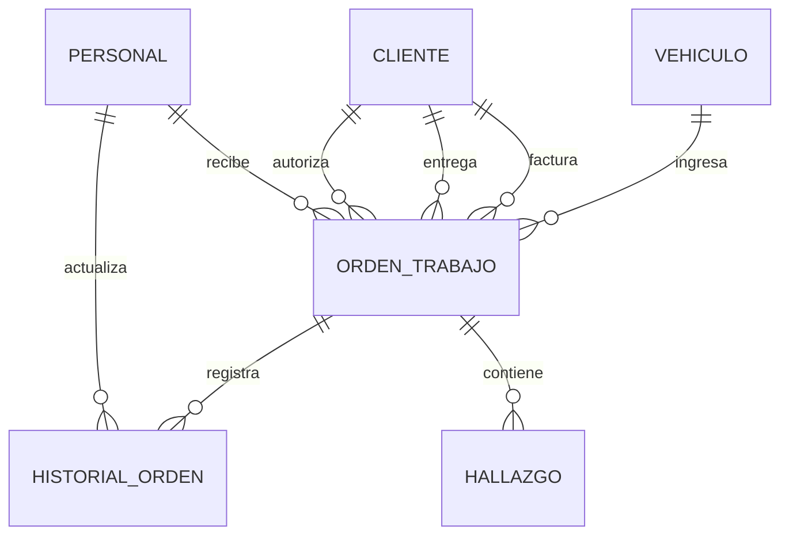

# Laboratorio 3 — Taller Ruta 27

**Instituto Tecnológico de Costa Rica**  
**Escuela de Ingeniería en Computación**  
**Curso:** IC-4301 Bases de Datos I  
**Grupo:** 02  
**Integrantes:** Jimena Pérez Alfaro y Rachel Priscilla Ramírez González  
**Motor de base de datos:** PostgreSQL 17

## 1. Descripción del proyecto

El Taller Ruta 27 es un taller de reparación de vehículos que necesita organizar la información relacionada con la recepción, diagnóstico y seguimiento de los vehículos que ingresan a sus instalaciones.

En el Proyecto 1 se desarrolló el diseño conceptual y lógico de una base de datos para administrar diferentes procesos del taller. A partir de ese diseño, el presente laboratorio implementa un subsistema funcional utilizando PostgreSQL.

La implementación permite registrar clientes, vehículos, personal del taller, órdenes de trabajo, cambios de estado y hallazgos técnicos. Además, incluye datos de prueba, consultas de negocio, funciones, un procedimiento almacenado y pruebas de integridad.

El propósito es comprobar que el modelo relacional desarrollado anteriormente puede transformarse en una base de datos funcional, conservando las relaciones y restricciones fundamentales del negocio.

## 2. Proceso de negocio seleccionado

Para este laboratorio se seleccionó el proceso de recepción, diagnóstico y seguimiento de vehículos.

Este proceso inicia cuando un vehículo ingresa al taller y se registra una orden de trabajo. Posteriormente, se documentan los cambios de estado y los hallazgos identificados durante el diagnóstico.

Se implementaron las siguientes seis tablas:

| Tabla | Descripción |
|---|---|
| CLIENTE | Almacena los datos de las personas y organizaciones relacionadas con las órdenes. |
| VEHICULO | Registra las características de los vehículos, identificados mediante su VIN. |
| PERSONAL | Contiene la información básica de los trabajadores del taller. |
| ORDEN_TRABAJO | Registra cada visita de un vehículo al taller. |
| HISTORIAL_ORDEN | Conserva los cambios de estado de las órdenes de trabajo. |
| HALLAZGO | Registra los problemas y recomendaciones técnicas asociados a las órdenes. |

### Justificación del subsistema

Se seleccionaron estas seis tablas porque permiten representar un proceso de negocio coherente, desde la recepción del vehículo hasta el registro de los resultados del diagnóstico.

El subsistema incluye relaciones de uno a muchos, claves primarias, claves foráneas y restricciones que permiten mantener la integridad de la información.

### Alcance y exclusiones

La implementación comprende únicamente una parte del modelo relacional desarrollado en el Proyecto 1.

No incluye la ejecución de reparaciones, autorización de labores, participación técnica, gestión de repuestos, movimientos de inventario, entrega final ni reclamos de garantía.

Estas funcionalidades forman parte del modelo original, pero quedan fuera del alcance de este laboratorio.

La selección permite implementar y comprobar un proceso completo y acotado sin desarrollar todas las entidades del sistema original.

## 3. Modelo lógico del subsistema

El modelo lógico utilizado corresponde a una parte del diseño relacional elaborado en el Proyecto 1 del Taller Ruta 27.

Se seleccionaron seis relaciones que permiten registrar los datos principales de los vehículos, las órdenes de trabajo, el personal responsable, el historial de estados y los hallazgos técnicos.

### 3.1. Diagrama de relaciones



### 3.2. Relaciones implementadas

- **CLIENTE:** cliente_id (PK), identificacion (UNIQUE), nombre_razon_social, tipo_cliente.
- **VEHICULO:** vin (PK), placa, marca, modelo, anio, tipo_combustible.
- **PERSONAL:** personal_id (PK), nombre, rol.
- **ORDEN_TRABAJO:** orden_id (PK), vin (FK), cliente_factura_id (FK), entregado_por_cliente_id (FK), autorizador_cliente_id (FK), receptor_id (FK), fecha_hora_recepcion, kilometraje_ingreso, nivel_combustible, motivo_informado, observaciones_visibles, fecha_prometida_actual.
- **HISTORIAL_ORDEN:** historial_id (PK), orden_id (FK), estado, fecha_hora, personal_id (FK).
- **HALLAZGO:** hallazgo_id (PK), orden_id (FK), sintoma_comprobado, posible_causa, urgencia, recomendacion.

### 3.3. Explicación de las relaciones

Un cliente puede participar en diferentes órdenes de trabajo, ya sea como la persona a quien se factura, quien entrega el vehículo o quien autoriza.

Un vehículo puede ingresar al taller varias veces. Cada visita se registra mediante una orden de trabajo diferente.

Cada orden tiene un trabajador responsable de recibir el vehículo y puede registrar distintos cambios de estado. Estos cambios se almacenan en HISTORIAL_ORDEN, junto con el trabajador que los registró.

Además, una orden puede tener varios hallazgos técnicos, relacionados con los problemas identificados durante el diagnóstico.

Las relaciones se implementaron mediante claves foráneas para mantener la integridad referencial.

## 4. Matriz de trazabilidad

La matriz de trazabilidad permite relacionar el diseño lógico del Proyecto 1 con las tablas físicas creadas en PostgreSQL.

| Relación lógica | Tabla física | Clave primaria | Claves foráneas | Restricciones relevantes |
|---|---|---|---|---|
| CLIENTE | cliente | cliente_id | No tiene | Identificación única, nombre obligatorio y tipo de cliente controlado. |
| VEHICULO | vehiculo | vin | No tiene | VIN de 17 caracteres, datos obligatorios, año permitido y tipo de combustible controlado. |
| PERSONAL | personal | personal_id | No tiene | Nombre obligatorio y rol limitado a Recepción, Técnico u Otro. |
| ORDEN_TRABAJO | orden_trabajo | orden_id | vin, cliente_factura_id, entregado_por_cliente_id, autorizador_cliente_id, receptor_id | Relaciones obligatorias, kilometraje no negativo, combustible válido y motivo obligatorio. |
| HISTORIAL_ORDEN | historial_orden | historial_id | orden_id, personal_id | Estado controlado, fecha obligatoria e identificador generado automáticamente. |
| HALLAZGO | hallazgo | hallazgo_id | orden_id | Síntoma y recomendación obligatorios, urgencia controlada. |

### 4.1. Decisiones del diseño físico

Para transformar el modelo lógico en una base de datos funcional se aplicaron las siguientes decisiones:

**Claves primarias:** se utilizan para identificar de manera única los registros. En VEHICULO se utiliza el VIN, mientras que las demás tablas tienen identificadores propios.

**Claves foráneas:** permiten conectar las tablas y evitan registrar órdenes, historiales o hallazgos asociados con registros inexistentes.

**Restricciones NOT NULL:** se utilizan en los atributos obligatorios para evitar que se almacenen valores nulos.

**Restricciones CHECK:** permiten validar datos como el kilometraje, los tipos de combustible, los estados y los niveles de urgencia.

**Restricción UNIQUE:** se utiliza en la identificación del cliente para evitar duplicados.

**Generación automática de identificadores:** en HISTORIAL_ORDEN se utiliza IDENTITY para generar el identificador de cada cambio de estado.

**Valores predeterminados:** las fechas de recepción y de registro del historial utilizan CURRENT_TIMESTAMP cuando no se proporciona una fecha.

**Índice complementario:** se creó idx_historial_orden_ultimo sobre el historial para facilitar la búsqueda del último estado registrado de cada orden.

### 4.2. Justificación de las decisiones

Se mantuvieron las seis relaciones seleccionadas del modelo lógico y sus claves principales.

Los tipos de datos INTEGER, VARCHAR, TEXT y TIMESTAMP permiten representar las características de los atributos en PostgreSQL.

La generación automática de identificadores y las restricciones de integridad complementan el diseño lógico, facilitando el registro correcto de información.

Las decisiones aplicadas buscan evitar registros duplicados, referencias inválidas y datos que no cumplen las reglas del negocio.

## 5. Entorno de trabajo y ejecución

### 5.1. Herramientas utilizadas

Para desarrollar y comprobar la base de datos del Taller Ruta 27 se utilizaron las siguientes herramientas:

| Herramienta | Uso |
|---|---|
| PostgreSQL 17 | Motor de base de datos relacional. |
| Docker Desktop | Ejecución de PostgreSQL mediante un contenedor. |
| Visual Studio Code | Edición y organización de los archivos SQL. |
| WSL Ubuntu | Ejecución de comandos y conexión al contenedor desde Linux. |
| Git y GitHub | Control de versiones e integración del trabajo grupal. |

La base de datos utilizada durante las pruebas se llamó `taller_ruta27_lab3`.

### 5.2. Organización de los archivos SQL

Los scripts se encuentran en la carpeta `lab03/grupo-02/sql/`.

| Archivo | Función |
|---|---|
| 01_esquema.sql | Crea las seis tablas, sus restricciones y el índice complementario. |
| 02_datos.sql | Inserta los datos ficticios para comprobar el funcionamiento. |
| 03_consultas.sql | Contiene las consultas que responden a necesidades del taller. |
| 04_rutinas.sql | Implementa funciones, procedimiento almacenado y tabla temporal. |
| 05_pruebas.sql | Ejecuta las pruebas válidas e inválidas de integridad. |

### 5.3. Preparación de la base de datos

Antes de ejecutar los scripts se necesita tener PostgreSQL 17 disponible y crear una base de datos vacía.

Para nuestra implementación se utilizó un contenedor de Docker llamado `bd1-semana09`, con el usuario `bd1`.

Desde WSL Ubuntu, la creación de la base de datos puede realizarse con el siguiente comando:

```bash
docker exec -i bd1-semana09 psql -U bd1 -d postgres -c "CREATE DATABASE taller_ruta27_lab3;"
```

Este comando debe ejecutarse solamente si la base de datos todavía no existe.

El nombre del contenedor y el usuario deben modificarse si se utiliza otra instalación de PostgreSQL.

### 5.4. Orden correcto de ejecución

Los archivos deben ejecutarse en el siguiente orden:

1. `01_esquema.sql`: creación de tablas y restricciones.
2. `02_datos.sql`: inserción de datos ficticios.
3. `04_rutinas.sql`: creación de funciones y procedimiento almacenado.
4. `03_consultas.sql`: ejecución de consultas de negocio.
5. `05_pruebas.sql`: validación de integridad mediante pruebas.

El archivo `04_rutinas.sql` se ejecuta antes de `03_consultas.sql` para que las rutinas estén disponibles cuando se necesiten.

### 5.5. Comandos utilizados

Desde la carpeta principal del repositorio, en WSL Ubuntu, los scripts pueden ejecutarse con estos comandos:

**Crear las tablas:**

```bash
docker exec -i bd1-semana09 psql -U bd1 -d taller_ruta27_lab3 -v ON_ERROR_STOP=1 < lab03/grupo-02/sql/01_esquema.sql
```

**Insertar los datos:**

```bash
docker exec -i bd1-semana09 psql -U bd1 -d taller_ruta27_lab3 -v ON_ERROR_STOP=1 < lab03/grupo-02/sql/02_datos.sql
```

**Crear las rutinas:**

```bash
docker exec -i bd1-semana09 psql -U bd1 -d taller_ruta27_lab3 -v ON_ERROR_STOP=1 < lab03/grupo-02/sql/04_rutinas.sql
```

**Ejecutar las consultas:**

```bash
docker exec -i bd1-semana09 psql -U bd1 -d taller_ruta27_lab3 -v ON_ERROR_STOP=1 < lab03/grupo-02/sql/03_consultas.sql
```

**Ejecutar las pruebas:**

```bash
docker exec -i bd1-semana09 psql -U bd1 -d taller_ruta27_lab3 -v ON_ERROR_STOP=1 < lab03/grupo-02/sql/05_pruebas.sql
```

La opción `ON_ERROR_STOP=1` permite detener la ejecución si PostgreSQL encuentra un error no controlado.

Estos comandos corresponden al entorno utilizado por el grupo. También es posible ejecutar los scripts mediante una conexión a PostgreSQL desde otra herramienta compatible, respetando el mismo orden.

### 5.6. Resultados de la ejecución

Durante la comprobación del laboratorio se verificó lo siguiente:

- Se crearon correctamente las seis tablas y el índice.
- Se insertaron los datos ficticios.
- Las consultas SQL devolvieron información del taller.
- Las funciones y el procedimiento almacenado se crearon correctamente.
- Las siete pruebas de integridad finalizaron con el resultado esperado.

Las pruebas incluyen operaciones válidas y operaciones inválidas que deben ser rechazadas.

El archivo `05_pruebas.sql` utiliza una transacción que finaliza con `ROLLBACK`, por lo que los registros temporales utilizados en las pruebas no permanecen almacenados.

Los resultados se documentan en `evidencias/resultados.md`.

### 5.7. Consideraciones importantes

Los archivos `01_esquema.sql` y `02_datos.sql` están preparados para ejecutarse sobre una base de datos vacía.

Si se intenta ejecutar nuevamente la creación de tablas o insertar los mismos identificadores, PostgreSQL puede generar errores porque los objetos o registros ya existen.

Por esta razón, para repetir la implementación completa se recomienda crear otra base de datos vacía, sin eliminar información de una base de datos que esté en uso.

## 6. Datos de prueba

Para comprobar el funcionamiento de la base de datos se utilizaron datos ficticios, incluidos en el archivo 02_datos.sql.

Los registros representan diferentes situaciones que pueden presentarse durante la atención de vehículos en el Taller Ruta 27.

### 6.1. Datos registrados

| Tabla | Cantidad de registros |
|---|---:|
| CLIENTE | 5 |
| VEHICULO | 4 |
| PERSONAL | 3 |
| ORDEN_TRABAJO | 5 |
| HISTORIAL_ORDEN | 11 |
| HALLAZGO | 5 |
| **Total** | **33** |

Los datos incluyen clientes individuales y organizaciones, vehículos de diferentes características y trabajadores con funciones de recepción y diagnóstico.

También se registraron órdenes con diferentes estados, varios niveles de urgencia y un vehículo que ingresó dos veces al taller.

### 6.2. Justificación de los datos

Los datos fueron seleccionados para comprobar distintas situaciones del proceso de negocio.

Por ejemplo, el vehículo con placa ABC123 tiene dos órdenes de trabajo, lo que permite verificar si el sistema identifica correctamente las visitas repetidas.

También existen hallazgos de urgencia baja, media, alta y crítica, lo que permite evaluar las consultas y las funciones relacionadas con la prioridad de atención.

Además, se incluyó una orden sin hallazgos para comprobar cómo responde la función de prioridad cuando todavía no se ha registrado un problema técnico.

Esta variedad permite obtener resultados diferentes y verificar las relaciones entre las tablas.

## 7. Consultas SQL implementadas

En el archivo 03_consultas.sql se desarrollaron cuatro consultas para obtener información útil para la administración del taller.

Estas consultas utilizan operaciones como JOIN, COUNT, GROUP BY, HAVING y consultas sobre el historial de estados.

### 7.1. Consulta Q01: Órdenes y estado actual

**Pregunta de negocio:** ¿Qué órdenes están registradas, a qué cliente y vehículo corresponden y cuál es su último estado conocido?

Esta consulta relaciona las órdenes de trabajo con los clientes y vehículos.

Además, busca el último estado registrado para cada orden utilizando el historial y ordenando los registros por fecha e identificador.

**Resultado esperado:** cinco órdenes con su cliente, placa, marca, modelo y estado más reciente.

**Utilidad:** permite consultar el avance de las órdenes y dar seguimiento a los vehículos ingresados.

### 7.2. Consulta Q02: Visitas facturables por cliente

**Pregunta de negocio:** ¿Cuántas visitas facturables registra cada cliente?

La consulta agrupa las órdenes según el cliente al que se factura y utiliza COUNT para determinar la cantidad de visitas.

**Resultado esperado:** cuatro clientes con órdenes. El cliente 101 tiene dos visitas y los otros tres clientes tienen una visita cada uno.

**Utilidad:** permite conocer la frecuencia de atención de los clientes y consultar su historial de visitas.

### 7.3. Consulta Q03: Hallazgos de alta prioridad

**Pregunta de negocio:** ¿Cuáles son los hallazgos de urgencia alta o crítica y en qué vehículo se identificaron?

Esta consulta relaciona los hallazgos con las órdenes y los vehículos.

Utiliza WHERE para seleccionar únicamente los hallazgos clasificados como Alta o Crítica.

**Resultado esperado:** dos hallazgos, uno de urgencia alta y otro de urgencia crítica.

**Utilidad:** ayuda a identificar problemas que requieren una atención más urgente y facilita la priorización de diagnósticos.

### 7.4. Consulta Q04: Vehículos con visitas repetidas

**Pregunta de negocio:** ¿Qué vehículos han regresado al taller más de una vez?

La consulta agrupa las órdenes por vehículo y utiliza HAVING para mostrar únicamente aquellos que tienen más de una visita.

**Resultado esperado:** un vehículo con dos visitas, correspondiente a la placa ABC123.

**Utilidad:** permite identificar vehículos que regresan al taller y revisar su frecuencia de atención.

### 7.5. Importancia de las consultas

Las cuatro consultas permiten transformar los registros almacenados en información útil para el taller.

Con ellas es posible conocer el estado de las órdenes, consultar la frecuencia de visitas, identificar hallazgos prioritarios y detectar vehículos con ingresos repetidos.

De esta manera, la base de datos no se limita a almacenar información, sino que también permite consultarla para apoyar las actividades de seguimiento y diagnóstico.

## 8. Funciones, procedimiento almacenado y tabla temporal

En el archivo 04_rutinas.sql se implementaron dos funciones, un procedimiento almacenado y una tabla temporal utilizando PostgreSQL y PL/pgSQL.

Estas herramientas permiten realizar operaciones de negocio y obtener información de manera organizada.

### 8.1. Función fn_total_ordenes_cliente

Esta función permite conocer cuántas órdenes de trabajo se han facturado a un cliente específico.

**Parámetro de entrada:** p_cliente_id, de tipo INTEGER.

**Valor de retorno:** INTEGER, correspondiente a la cantidad de órdenes encontradas.

La función utiliza COUNT para contar las órdenes en las que el cliente aparece como responsable de facturación.

**Ejemplo de ejecución:**

```sql
SELECT fn_total_ordenes_cliente(101);
```

**Resultado esperado:** 2.

**Utilidad:** facilita la consulta del historial de visitas facturables de un cliente.

### 8.2. Función fn_prioridad_orden

Esta función permite determinar la prioridad de atención de una orden a partir de sus hallazgos técnicos.

**Parámetro de entrada:** p_orden_id, de tipo INTEGER.

**Valor de retorno:** TEXT, correspondiente a la clasificación de prioridad.

La función revisa los hallazgos asociados con la orden e identifica el nivel de urgencia más alto.

La clasificación utilizada es la siguiente:

| Urgencia del hallazgo | Prioridad asignada |
|---|---|
| Crítica | Atención inmediata |
| Alta | Revisión prioritaria |
| Media | Atención programada |
| Baja | Baja prioridad |
| Sin hallazgos | Sin hallazgos |

Para tomar la decisión se utilizan estructuras condicionales IF y ELSIF.

**Ejemplo de ejecución:**

```sql
SELECT fn_prioridad_orden(9003);
```

**Resultado esperado:** Atención inmediata.

También se puede comprobar una orden sin hallazgos:

```sql
SELECT fn_prioridad_orden(9005);
```

**Resultado esperado:** Sin hallazgos.

**Utilidad:** ayuda a identificar órdenes que necesitan atención prioritaria según los problemas detectados.

### 8.3. Procedimiento almacenado sp_registrar_orden

Este procedimiento permite registrar una nueva orden de trabajo y crear automáticamente su primer estado en el historial.

Recibe como parámetros el identificador de la orden, el VIN del vehículo, los identificadores de los clientes involucrados, el empleado receptor, el kilometraje, el nivel de combustible y el motivo de ingreso.

Antes de registrar la orden realiza las siguientes validaciones:

1. Comprueba que el identificador de la orden sea positivo.
2. Verifica que el kilometraje no sea negativo ni nulo.
3. Comprueba que el vehículo exista en la base de datos.
4. Verifica que no exista otra orden con el mismo identificador.

Si alguna validación falla, utiliza RAISE EXCEPTION para rechazar la operación y mostrar un mensaje de error.

Cuando los datos son válidos, el procedimiento realiza dos operaciones:

- Inserta la nueva orden en ORDEN_TRABAJO.
- Inserta el estado inicial "Recibida" en HISTORIAL_ORDEN.

Las claves foráneas y restricciones CHECK de las tablas siguen verificando los datos correspondientes.

**Utilidad:** permite registrar una recepción de manera organizada y evita crear una orden sin su estado inicial cuando el procedimiento finaliza correctamente.

Este procedimiento se comprueba mediante las pruebas de integridad incluidas en 05_pruebas.sql.

### 8.4. Tabla temporal tmp_resumen_prioridades

En el archivo de rutinas también se implementó una tabla temporal llamada tmp_resumen_prioridades.

Su función es almacenar un resumen de las órdenes de trabajo con su placa y prioridad de atención.

La tabla se construye utilizando información de ORDEN_TRABAJO, VEHICULO y la función fn_prioridad_orden.

Contiene los siguientes datos:

| Campo | Descripción |
|---|---|
| orden_id | Identificador de la orden de trabajo. |
| placa | Placa del vehículo asociado. |
| prioridad | Clasificación obtenida mediante la función de prioridad. |

La tabla es temporal, por lo que no forma parte de las tablas permanentes del sistema.

**Utilidad:** permite disponer de un resumen operativo que puede consultarse durante la sesión de PostgreSQL.

### 8.5. Justificación de la técnica adicional

Se seleccionó el uso de una tabla temporal porque permite guardar un resultado intermedio y reutilizarlo durante una sesión.

Esta técnica puede ser útil cuando se necesita consultar varias veces un resumen de órdenes y prioridades.

Sin embargo, también existe una alternativa más sencilla que consiste en ejecutar directamente una consulta SELECT con JOIN y la función fn_prioridad_orden.

La alternativa directa es preferible cuando solamente se necesita visualizar el resultado una vez, porque no requiere crear una tabla temporal.

La implementación de ambas opciones permite comprender las diferencias entre almacenar un resultado intermedio y obtenerlo directamente mediante una consulta.

### 8.6. Importancia de las rutinas implementadas

Las funciones permiten consultar la cantidad de visitas de un cliente y determinar la prioridad de una orden.

El procedimiento almacenado facilita el registro de nuevas órdenes y sus estados iniciales, mientras que la tabla temporal permite organizar un resumen de prioridades.

En conjunto, estas herramientas complementan las consultas SQL y representan operaciones útiles para la gestión del Taller Ruta 27.

## 9. Pruebas de integridad y evidencias

Para comprobar el funcionamiento de la base de datos se desarrolló el archivo 05_pruebas.sql.

Este archivo contiene siete pruebas que permiten verificar operaciones válidas y el rechazo de información que incumple las restricciones del sistema.

Las pruebas fueron ejecutadas en PostgreSQL 17 y los siete casos produjeron los resultados esperados.

### 9.1. Pruebas realizadas

| Prueba | Descripción | Resultado esperado | Resultado observado |
|---|---|---|---|
| P01 | Registrar un cliente válido. | El cliente se inserta correctamente. | Aprobada. |
| P02 | Registrar una orden mediante el procedimiento almacenado. | Se crean la orden y su estado inicial. | Aprobada. |
| P03 | Registrar un hallazgo válido. | El hallazgo se inserta correctamente. | Aprobada. |
| P04 | Intentar registrar una identificación duplicada. | PostgreSQL rechaza el duplicado. | Aprobada. |
| P05 | Intentar registrar una referencia inexistente. | La clave foránea impide la operación. | Aprobada. |
| P06 | Intentar registrar una urgencia inválida. | La restricción CHECK rechaza el valor. | Aprobada. |
| P07 | Intentar registrar una orden con kilometraje negativo. | El procedimiento rechaza la operación. | Aprobada. |

### 9.2. Pruebas válidas

Las primeras tres pruebas comprueban que el sistema permite registrar información cuando los datos cumplen las restricciones establecidas.

Se verificó el registro de un cliente, la creación de una orden con su historial inicial y el registro de un hallazgo técnico.

Estos casos permiten comprobar las operaciones principales del subsistema seleccionado.

### 9.3. Pruebas inválidas

Las últimas cuatro pruebas comprueban que el sistema rechaza operaciones incorrectas.

Se verificaron las siguientes situaciones:

- Identificación duplicada, rechazada mediante UNIQUE.
- Referencia a un registro inexistente, rechazada mediante FOREIGN KEY.
- Nivel de urgencia no permitido, rechazado mediante CHECK.
- Kilometraje negativo, rechazado mediante RAISE EXCEPTION en el procedimiento almacenado.

En estas pruebas, el resultado correcto consiste en impedir que los datos inválidos sean aceptados.

### 9.4. Resultados obtenidos

Durante la ejecución del archivo 05_pruebas.sql se mostraron mensajes de aprobación para los siete casos.

Al finalizar, PostgreSQL mostró ROLLBACK.

Esto significa que las operaciones realizadas dentro de la transacción de prueba se revirtieron, por lo que los registros utilizados durante las pruebas no quedaron guardados permanentemente.

Los resultados se documentaron en el siguiente archivo:

[Ver resultados de las pruebas](evidencias/resultados.md)

La captura de ejecución se incorporará a la carpeta de evidencias del repositorio.

### 9.5. Importancia de las pruebas

Las pruebas permiten comprobar que las restricciones definidas en el diseño físico funcionan y que el procedimiento almacenado realiza las validaciones correspondientes.

También permiten identificar si una modificación futura afecta el comportamiento esperado de la base de datos.

De esta manera, las pruebas constituyen una herramienta para verificar la integridad y el funcionamiento básico del subsistema.

## 10. Limitaciones del sistema

El laboratorio implementa únicamente el subsistema de recepción, diagnóstico y seguimiento de vehículos del Taller Ruta 27.

Aunque el modelo original del Proyecto 1 contempla otros procesos, estos no se desarrollaron en esta implementación.

Entre las principales limitaciones se encuentran:

- No se implementó la administración completa de repuestos e inventario.
- No se incluyeron los procesos de autorización individual de reparaciones y labores.
- No se desarrolló el registro completo de intervenciones técnicas.
- No se implementó el proceso de entrega final de vehículos.
- No se incluyó la administración de garantías.
- No se implementó CONTACTO_CLIENTE, por lo que no se verifica la existencia de un medio de contacto habilitado para cada cliente.
- No se implementaron todas las validaciones de negocio que dependen de las entidades excluidas.

Estas limitaciones responden al alcance seleccionado para el laboratorio y no significan que esas funcionalidades hayan sido eliminadas del modelo original.

El subsistema implementado permite demostrar la creación de tablas relacionadas, consultas, rutinas, validaciones y pruebas de integridad mediante PostgreSQL.

## 11. Distribución del trabajo grupal

El Laboratorio 3 del Taller Ruta 27 fue desarrollado por Jimena Pérez Alfaro y Rachel Priscilla Ramírez González.

Las actividades se distribuyeron de la siguiente manera:

### Jimena Pérez Alfaro

- Elaboración del esquema físico de la base de datos.
- Creación de las seis tablas y sus restricciones.
- Preparación de los datos ficticios.
- Desarrollo de las cuatro consultas SQL.
- Implementación de las dos funciones.
- Desarrollo del procedimiento almacenado.
- Implementación de la tabla temporal.
- Ejecución y verificación de los scripts en PostgreSQL.
- Integración del trabajo grupal y preparación de la entrega final.

### Rachel Priscilla Ramírez González

- Desarrollo del archivo de pruebas de integridad.
- Documentación de los casos válidos e inválidos.
- Elaboración del README del laboratorio.
- Explicación del modelo lógico y matriz de trazabilidad.
- Documentación de las decisiones técnicas, consultas y rutinas.
- Organización de la documentación para la entrega.

### Trabajo conjunto

Ambas integrantes participaron en el desarrollo del Taller Ruta 27 y en la preparación de la entrega.

El control de versiones se realizó mediante Git y GitHub, utilizando ramas individuales y una rama de integración grupal.

## 12. Evidencias del laboratorio

Las evidencias permiten comprobar el funcionamiento de los scripts SQL y las pruebas realizadas.

Los archivos se organizan en la carpeta evidencias del Grupo 02.

**Resultados documentados:**

[Consultar resultados de las pruebas](evidencias/resultados.md)

**Captura de las pruebas de integridad:**

Pendiente de incorporar la imagen correspondiente al repositorio.

Las evidencias muestran los resultados obtenidos al ejecutar el laboratorio en PostgreSQL 17.

## 13. Vídeos de defensa individual

Cada integrante realizará una defensa individual de máximo cinco minutos, explicando sus aportes, decisiones técnicas y una demostración funcional del laboratorio.

Las grabaciones se realizarán en una sola toma continua, sin cortes ni ediciones, mostrando la cámara y la pantalla.

Los vídeos se almacenarán fuera del repositorio y sus enlaces se agregarán a continuación.

### Defensa de Jimena Pérez Alfaro

**Enlace:** Pendiente de incorporar.

### Defensa de Rachel Priscilla Ramírez González

**Enlace:** Pendiente de incorporar.

## 14. Estado de la entrega

El proyecto incluye los cinco archivos SQL correspondientes al esquema, datos, consultas, rutinas y pruebas.

La implementación fue comprobada en PostgreSQL 17 y las siete pruebas ejecutadas por el grupo obtuvieron los resultados esperados.

Antes de realizar la entrega definitiva se incorporarán las evidencias visuales y los enlaces de las defensas individuales.

La entrega final se realizará mediante un único Pull Request dirigido al repositorio original del curso, que permanecerá abierto para su revisión.
