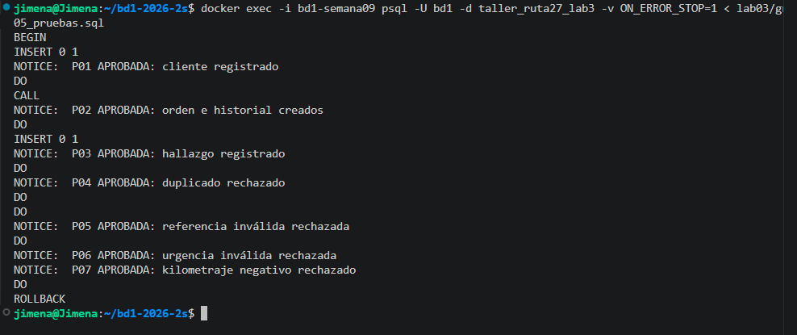

# Evidencias de ejecución — Laboratorio 3

## Taller Ruta 27 — Grupo 02

### Entorno utilizado
- Motor: PostgreSQL 17
- Base de datos: taller_ruta27_lab3
- Herramientas: Docker, WSL Ubuntu y Visual Studio Code

## Pruebas de integridad

Precondición general: ejecutar los archivos
01_esquema.sql, 02_datos.sql y 04_rutinas.sql
sobre una base preparada para el laboratorio.

Las pruebas se ejecutaron mediante 05_pruebas.sql.

| ID | Operación | Resultado esperado | Resultado observado | Conclusión |
|---|---|---|---|---|
| P01 | Insertar cliente válido | Inserción exitosa | Cliente registrado | Aprobada |
| P02 | Crear orden con procedimiento | Orden e historial creados | Ambos registros creados | Aprobada |
| P03 | Insertar hallazgo válido | Inserción exitosa | Hallazgo registrado | Aprobada |
| P04 | Insertar identificación duplicada | Rechazo por UNIQUE | Duplicado rechazado | Aprobada |
| P05 | Referenciar orden inexistente | Rechazo por FOREIGN KEY | Referencia rechazada | Aprobada |
| P06 | Registrar urgencia inválida | Rechazo por CHECK | Valor rechazado | Aprobada |
| P07 | Registrar kilometraje negativo | Rechazo mediante RAISE EXCEPTION | Operación rechazada | Aprobada |

## Resultado general

Las siete pruebas obtuvieron los resultados esperados.

Se utilizó ROLLBACK al finalizar la ejecución,
por lo que los registros creados durante las
pruebas no permanecen en la base de datos.

## Evidencia visual

La terminal donde aparecen los mensajes P01 a P07 y el ROLLBACK final.
