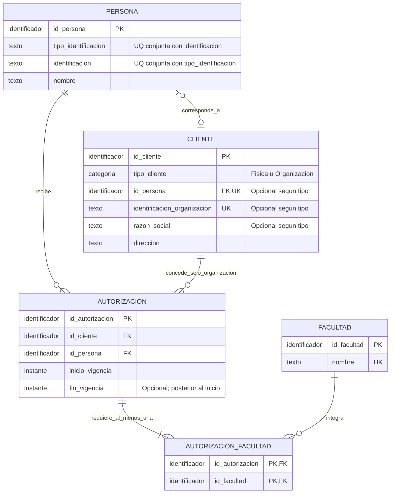

# Fragmento lógico — Autorizaciones

Fuente: Modelo-Relacional-11.pdf, secciones 3 y 4; Diccionario-8.pdf, relaciones indicadas; correspondencia del resultado normalizado en Matriz-de-Trazabilidad-9.pdf. Cinco relaciones y 19 atributos, sin nuevas columnas. El diagrama es lógico: sus tipos son dominios conceptuales, no DDL.

## Interpretación autosuficiente

- PERSONA–CLIENTE: 0..1 en ambos sentidos. Si el cliente es físico, debe tener exactamente una persona; si es organización, ninguna. La identificación y nombre del cliente físico se obtienen de PERSONA.
- PERSONA–AUTORIZACION: una persona recibe 0..N autorizaciones; cada autorización corresponde a exactamente una persona.
- CLIENTE–AUTORIZACION: una organización concede 0..N; un cliente físico concede cero. Cada autorización tiene exactamente un cliente. La FK por sí sola no comprueba el tipo organización.
- AUTORIZACION–AUTORIZACION_FACULTAD: mínimo de negocio 1..N; cada vínculo pertenece a una autorización. El mínimo 1 no queda garantizado solo por la FK: lo valida el procedimiento para su operación, con el límite de escrituras directas declarado en DL-05.
- FACULTAD–AUTORIZACION_FACULTAD: 0..N vínculos por facultad; cada vínculo identifica exactamente una facultad. La PK de la tabla asociativa es la pareja, no cada componente por separado.

PK identifica filas. UK representa unicidad; las UK opcionales de CLIENTE solo aplican a valores presentes, no son claves candidatas globales. La candidata de PERSONA es (tipo_identificacion, identificacion). La candidata adicional de FACULTAD es nombre. Nombre de PERSONA no es único.

No existe unicidad cliente-persona en AUTORIZACION. El fin puede estar ausente; inicio no. La vigencia se consulta con inicio incluido y fin excluido, sin cambiar las fechas para conservar historial.

## Relación con la retroalimentación

Las condiciones por tipo, la obligatoriedad, el mínimo de facultades y el alcance real de las FK se explican junto a la figura, evitando remisiones genéricas. Esto atiende el fragmento del laboratorio, no corrige todas las figuras del Proyecto 1. La representación Mermaid y su legibilidad aún deben verificarse visualmente.

La especificación de los 19 atributos y la matriz lógica-física están en [diseño y trazabilidad](../documentacion/diseno-fisico-y-trazabilidad.md).
