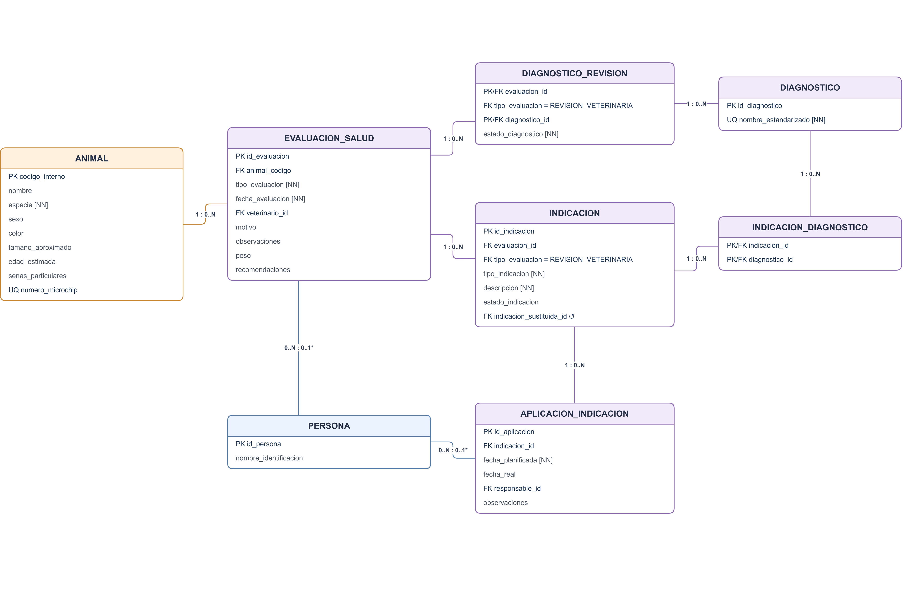

# IC-4301  Bases de Datos I - Laboratorio 
### Grupo 05 — Proyecto Refugio Huellas Seguras

---

## 1. Descripción del Proceso de Negocio Seleccionado

Para este laboratorio, seleccionamos el **Subsistema de Salud y Tratamientos de Animales**, un módulo acotado y coherente derivado del proyecto *Huellas Seguras*. 

### Alcance del Subsistema
El subsistema administra el historial clínico completo desde la llegada del animal al refugio:
- **Evaluación e Historial Clínico:** Registro de la evaluación inicial y revisiones veterinarias periódicas.
- **Diagnósticos:** Asociación de diagnósticos estandarizados a cada revisión con su respectivo estado (`PROVISIONAL`, `CONFIRMADO`, `DESCARTADO`).
- **Indicaciones Médicas:** Asignación de tratamientos, medicamentos, vacunas, procedimientos o controles posteriores.
- **Aplicaciones y Sesiones:** Planificación y seguimiento de la ejecución de cada indicación médica, distinguiendo lo programado de lo efectivamente realizado.

Se implementan ocho tablas porque las relaciones entre revisiones y diagnósticos, y entre indicaciones y diagnósticos, requieren sus propias tablas asociativas. `PERSONA` se incluye como referencia mínima para veterinarios y responsables de aplicaciones.

---

## 2. Parte A — Del Modelo Lógico al Esquema Físico

### A1. Fragmento del Modelo y Matriz de Trazabilidad

El siguiente fragmento presenta las ocho relaciones del subsistema de salud y tratamientos tomadas del modelo relacional del proyecto. Incluye las claves y relaciones implementadas en `sql/01_esquema.sql`; las columnas `tipo_evaluacion` de las tablas hijas y la clave primaria compuesta de `diagnostico_revision` corresponden a las adaptaciones físicas explicadas en la matriz.



[Abrir el diagrama en tamaño completo](modelo/fragmento_modelo_salud.png). La imagen conserva el diagrama incrustado y puede abrirse en Draw.io para editarlo.

| Relación Lógica (Proyecto 1) | Tabla Física (PostgreSQL) | Clave Primaria (PK) | Claves Foráneas (FK) | Restricciones Relevantes (NN, UNIQUE, CHECK) | Justificación de Cambios / Diseño Físico |
| :--- | :--- | :--- | :--- | :--- | :--- |
| **PERSONA** | `persona` | `id_persona` | Ninguna | `nombre_identificacion` (NULL) | Tabla maestra simplificada para registrar veterinarios y personal responsable de aplicaciones. |
| **ANIMAL** | `animal` | `codigo_interno` | Ninguna | `especie` (NN); `numero_microchip` (UQ, NULL); `edad_estimada` (CHECK >= 0) | Entidad central del refugio; conserva el código interno como PK estable a lo largo de su historia. |
| **EVALUACION_SALUD** | `evaluacion_salud` | `id_evaluacion` | `animal_codigo` → `animal`<br>`veterinario_id` → `persona` | `tipo_evaluacion` y `fecha_evaluacion` (NN); `peso` (> 0); revisión: veterinario, motivo, observaciones, peso y recomendaciones obligatorios, con textos no vacíos | Agrupa evaluaciones iniciales y revisiones; `UNIQUE (id_evaluacion, tipo_evaluacion)` permite referenciar únicamente revisiones desde las tablas clínicas hijas. |
| **DIAGNOSTICO** | `diagnostico` | `id_diagnostico` | Ninguna | `nombre_estandarizado` (NN, UQ) | Catálogo de condiciones médicas estandarizadas para evitar duplicidad de nombres. |
| **DIAGNOSTICO_REVISION** | `diagnostico_revision` | (`evaluacion_id`, `diagnostico_id`) | (`evaluacion_id`, `tipo_evaluacion`) → `evaluacion_salud`<br>`diagnostico_id` → `diagnostico` | Estado NN y limitado a `PROVISIONAL`, `CONFIRMADO`, `DESCARTADO`; tipo fijo `REVISION_VETERINARIA` | Resuelve la M:N entre revisiones y diagnósticos; la FK compuesta impide vincular un diagnóstico a una evaluación inicial. |
| **INDICACION** | `indicacion` | `id_indicacion` | (`evaluacion_id`, `tipo_evaluacion`) → `evaluacion_salud`<br>`indicacion_sustituida_id` → `indicacion` | Tipo y descripción NN; tipo de evaluación fijo `REVISION_VETERINARIA` | Registra órdenes originadas en una revisión; la FK compuesta impide originarlas en una evaluación inicial. |
| **INDICACION_DIAGNOSTICO** | `indicacion_diagnostico` | (`indicacion_id`, `diagnostico_id`) | `indicacion_id` → `indicacion`<br>`diagnostico_id` → `diagnostico` | Ambos identificadores NN; pareja única por PK | Materializa la M:N del modelo lógico: una indicación puede atender varios diagnósticos y un diagnóstico puede estar asociado a varias indicaciones. |
| **APLICACION_INDICACION** | `aplicacion_indicacion` | `id_aplicacion` | `indicacion_id` → `indicacion`<br>`responsable_id` → `persona` | `fecha_planificada` NN; si hay `fecha_real`, responsable y observaciones no vacías obligatorios | Separa lo planificado de lo ejecutado y exige los datos de la aplicación realizada. |

`tipo_evaluacion` en `diagnostico_revision` e `indicacion` es un discriminador físico con valor fijo `REVISION_VETERINARIA`. Junto con la FK compuesta, conserva la regla de que ambas relaciones nacen de una revisión sin alterar sus claves primarias lógicas. La unicidad compuesta de `evaluacion_salud` existe para que PostgreSQL pueda ser destino de esas claves foráneas.

---

### A2 & A3. Decisiones de Diseño Físico e Instrucciones de Ejecución

#### Entorno y Motor Requerido
- **Motor objetivo:** PostgreSQL 16.x.
- **Garantía de Reproducibilidad:** El script `sql/01_esquema.sql` se ejecuta sobre una base de datos totalmente vacía. No depende de objetos o tipos creados previamente de forma manual.

Los índices adicionales sobre `evaluacion_salud.animal_codigo`, `indicacion.evaluacion_id` y `aplicacion_indicacion.indicacion_id` facilitan respectivamente consultar el historial de un animal, buscar las indicaciones de una revisión y recuperar las sesiones de una indicación. Son columnas de FK sin índice automático propio; los índices de las PK están sobre otros identificadores.

#### Orden de Ejecución Obligatorio
Para garantizar la integridad referencial y evitar fallos de dependencias, los scripts deben ejecutarse secuencialmente en el siguiente orden:

1. `sql/01_esquema.sql` — Creación de tablas, llaves, restricciones e índices.
2. `sql/02_datos.sql` — Carga inicial de datos ficticios de prueba.
3. `sql/04_rutinas.sql` — Creación de funciones y procedimientos PL/pgSQL.
4. `sql/03_consultas.sql` — Consultas de negocio.
5. `sql/05_pruebas.sql` — Pruebas de integridad y casos de borde.

#### Ejecución desde CLI (`psql`):
Desde `lab03/grupo-05`, crear una base de laboratorio vacía y ejecutar cada archivo. Para repetir la carga, recrear esa base.

```bash
createdb -U postgres huellas_seguras_lab3
psql -X -v ON_ERROR_STOP=1 -U postgres -d huellas_seguras_lab3 -f sql/01_esquema.sql
psql -X -v ON_ERROR_STOP=1 -U postgres -d huellas_seguras_lab3 -f sql/02_datos.sql
psql -X -v ON_ERROR_STOP=1 -U postgres -d huellas_seguras_lab3 -f sql/04_rutinas.sql
psql -X -v ON_ERROR_STOP=1 -U postgres -d huellas_seguras_lab3 -f sql/03_consultas.sql
psql -X -v ON_ERROR_STOP=1 -U postgres -d huellas_seguras_lab3 -f sql/05_pruebas.sql
```

---

## 3. Parte B — Datos, Consultas e Integridad

### B1. Cobertura de Datos de Prueba (`02_datos.sql`)
El conjunto de datos ficticios incluye:
- **3 Personas:** Identificadas en los datos ficticios como profesionales veterinarios y responsable de cuidados; la vigencia de esos roles queda fuera del subconjunto implementado.
- **5 Animales:** Cobertura de diferentes especies, edades y microchips.
- **9 Evaluaciones de Salud:** 5 iniciales y 4 revisiones veterinarias.
- **4 Diagnósticos en Catálogo:** 6 asignaciones en `diagnostico_revision` probando estados `PROVISIONAL`, `CONFIRMADO` y `DESCARTADO`.
- **6 Indicaciones Médicas:** Incluye una indicación sustituida y seis vínculos en `indicacion_diagnostico`; la indicación 1 atiende dos diagnósticos.
- **6 Aplicaciones:** Escenarios de sesiones ejecutadas, pendientes programadas y pendientes vencidas.

### B2. Consultas de Negocio (`03_consultas.sql`)

| ID | Pregunta de Negocio | Técnica Utilizada | Resultado Esperado |
| :--- | :--- | :--- | :--- |
| **Q01** | ¿Cuál es el historial clínico detallado del animal 'Luna' (`HS-001`)? | `JOIN` múltiple | Tres evaluaciones registradas; la inicial sin diagnóstico y la revisión con Otitis cambiando de `PROVISIONAL` a `DESCARTADO`. |
| **Q02** | ¿Qué aplicaciones médicas están pendientes al 27-10-2026? | Filtro y comparación de fechas | Tres aplicaciones: `HS-001` (vencida) y `HS-002` / `HS-003` (programadas). |
| **Q03** | ¿Cuántas revisiones veterinarias y diagnósticos confirmados tiene registrado cada animal? | Agregación (`GROUP BY`, `LEFT JOIN`, `COUNT`) | `HS-001`: 2 rev / 2 conf; `HS-002`: 1 rev / 1 conf; `HS-003`: 1 rev / 0 conf; `HS-004` y `HS-005`: 0 rev / 0 conf. |
| **Q04** | ¿Qué indicaciones atienden más de un diagnóstico? | M:N y agregación con `HAVING` | La indicación 1 de `HS-001` atiende Dermatitis y Otitis. |

### B3. Pruebas de Integridad (`05_pruebas.sql`)
El script ejecuta **12 pruebas aisladas** mediante una transacción (`BEGIN` ... `ROLLBACK`) y bloques que capturan cada rechazo esperado:
- **3 Casos Válidos:** Inserción correcta de evaluación, diagnóstico y aplicación realizada.
- **9 Casos Rechazados:** Microchip duplicado, animal inexistente, edad negativa, estado diagnóstico inválido, aplicación sin responsable, revisión sin veterinario, diagnóstico o indicación en evaluación inicial y observaciones vacías en aplicación realizada.

---

## 4. Parte C — Programación Almacenada (`04_rutinas.sql`)

### C1. Funciones PL/pgSQL

1. **`contar_revisiones_animal(p_codigo_animal VARCHAR)`**
   - **Propósito:** Retorna la cantidad (`INTEGER`) de revisiones veterinarias recibidas por un animal.
   - **Ejemplo:** `SELECT contar_revisiones_animal('HS-001');` $\rightarrow$ Devuelve `2`.

2. **`estado_aplicacion(p_id_aplicacion INTEGER)`**
   - **Propósito:** Evalúa el estado actual de una sesión. Retorna `REALIZADA` si posee `fecha_real`; `VENCIDA` si `fecha_planificada < CURRENT_DATE`; o `PROGRAMADA` en caso contrario. Lanza `RAISE EXCEPTION` si el ID no existe.
   - **Ejemplo:** `SELECT estado_aplicacion(2);` $\rightarrow$ Devuelve `VENCIDA`.

### C2. Procedimiento Almacenado

- **`registrar_aplicacion(p_id_aplicacion, p_fecha_real, p_responsable_id, p_observaciones)`**
  - **Propósito:** Registra la ejecución de una aplicación médica pendiente.
  - **Validaciones:** Bloquea la fila con `FOR UPDATE`, verifica la existencia de la aplicación, impide reejecutar sesiones ya realizadas y exige fecha real, responsable y observaciones no vacías.
  - **Prueba Válida:** Ejecución exitosa para la aplicación #4 con fecha y responsable válidos.
  - **Prueba Rechazada:** Intento de registro enviando `p_responsable_id = NULL`, provocando `RAISE EXCEPTION 'Debe indicar fecha, responsable y observaciones'`.

### C3. Técnica Procedimental Adicional (Tabla Temporal)

- **`generar_reporte_pendientes()`**
  - **Técnica:** Utiliza `CREATE TEMP TABLE ... ON COMMIT PRESERVE ROWS` para generar la tabla temporal `reporte_pendientes`.
  - **Discusión vs. SQL Basado en Conjuntos:** Un `SELECT` directo con `JOIN` y `CASE` logra el mismo resultado de forma más limpia en ejecuciones puntuales. No obstante, la tabla temporal se justifica cuando el resultado debe ser consumido múltiples veces durante la misma sesión de trabajo sin reevaluar las uniones entre las tablas principales.

---

## 5. Parte D — Documentación, Limitaciones y Evidencias

### D1 & D2. Limitaciones y Evidencia de Ejecución
- **Entorno de pruebas:** Los cinco scripts y las rutinas se ejecutaron sobre una base vacía en PostgreSQL 16.15; se registraron los resultados en [`evidencias/resultados.md`](evidencias/resultados.md).
- **Alcance de las reglas:** El esquema exige un `veterinario_id` en cada revisión y los campos clínicos obligatorios. `PERSONA` es una entidad mínima sin `PARTICIPACION`, por lo que este subsistema no comprueba el rol profesional vigente. Tampoco puede imponer con una FK simple que todo animal tenga una evaluación inicial inmediatamente después de insertarse; la carga de datos sí registra una para cada animal.

video: https://estudianteccr-my.sharepoint.com/:v:/g/personal/j_segura_1_estudiantec_cr/IQDVYp0fJi52TaOhdbw6jpR4AYk31sQDgWK3xAbbo-THq9c?nav=eyJyZWZlcnJhbEluZm8iOnsicmVmZXJyYWxBcHAiOiJPbmVEcml2ZUZvckJ1c2luZXNzIiwicmVmZXJyYWxBcHBQbGF0Zm9ybSI6IldlYiIsInJlZmVycmFsTW9kZSI6InZpZXciLCJyZWZlcnJhbFZpZXciOiJNeUZpbGVzTGlua0NvcHkifX0&e=IzpzTM

---
