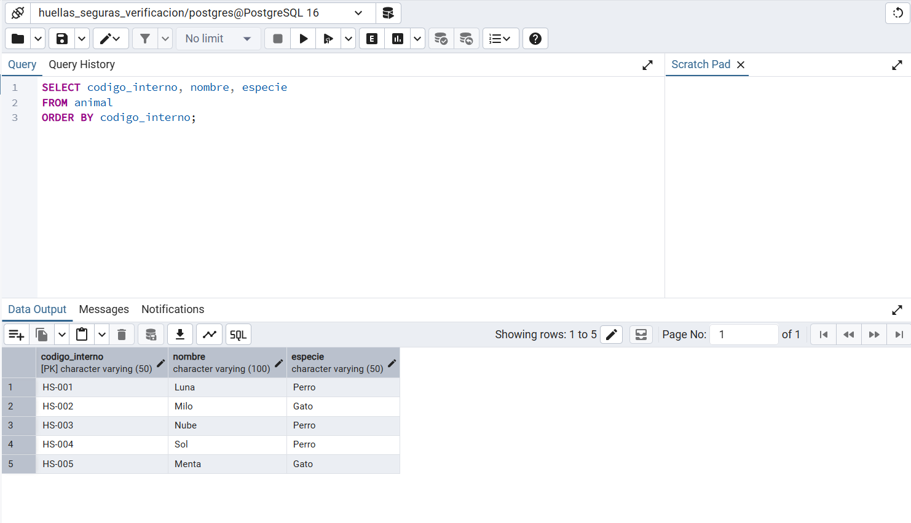
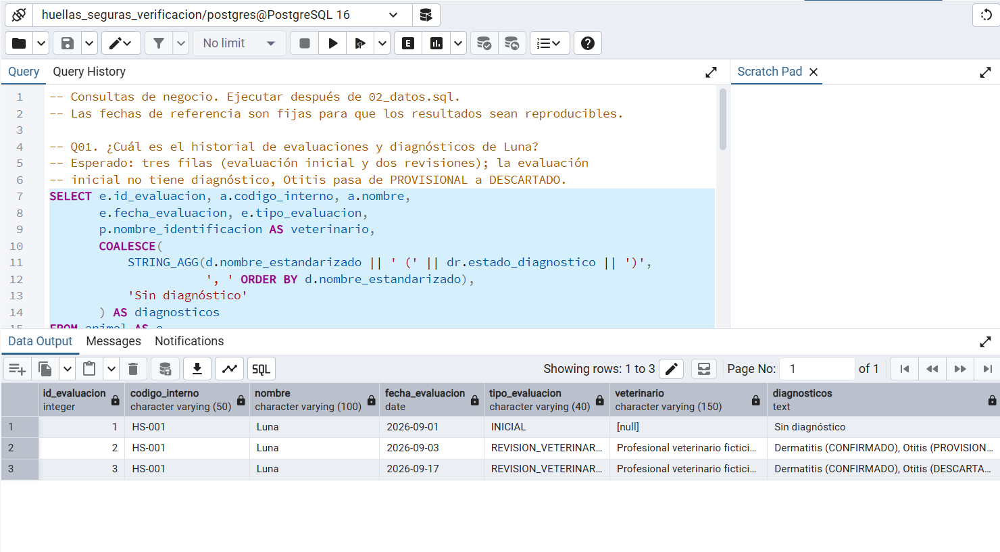
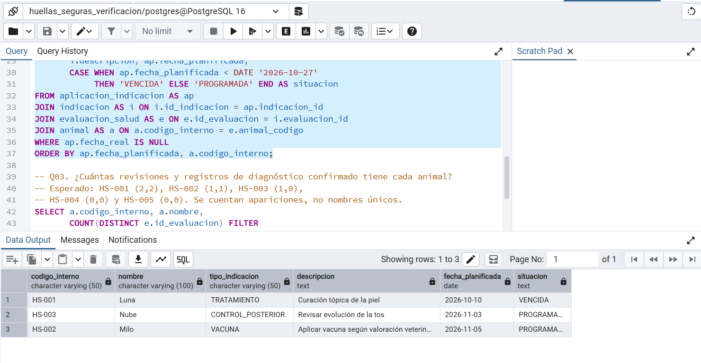
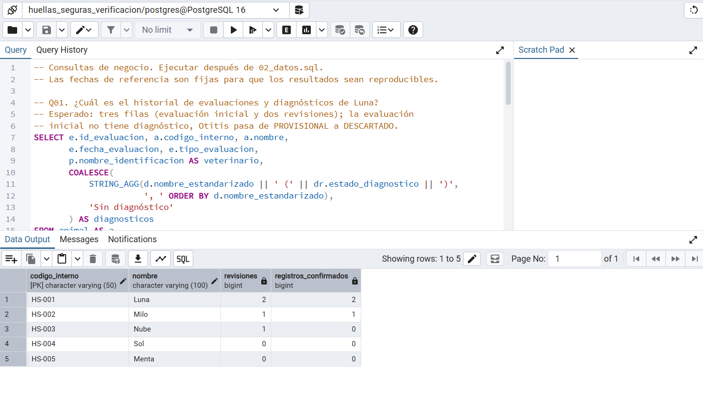
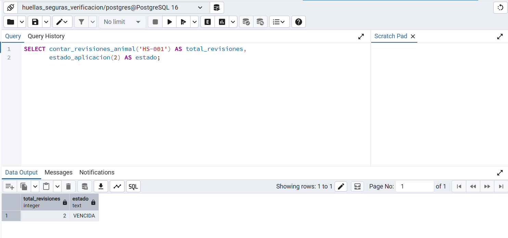
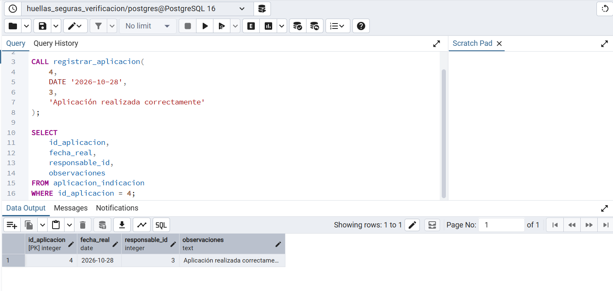
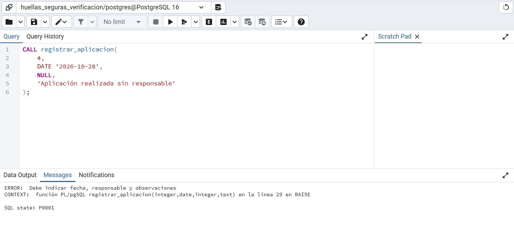
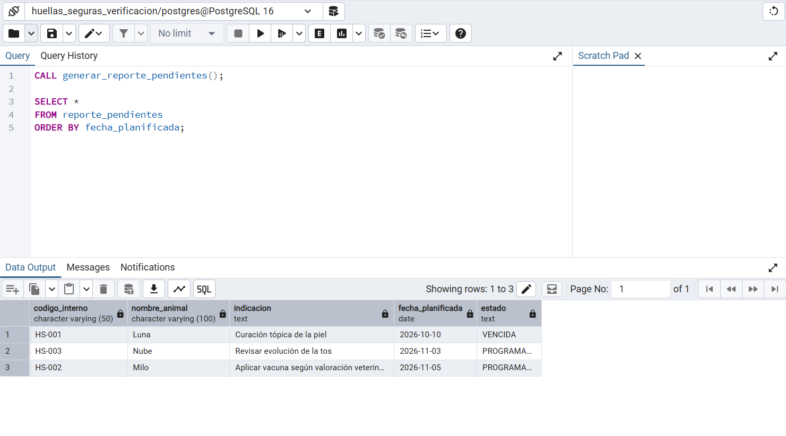
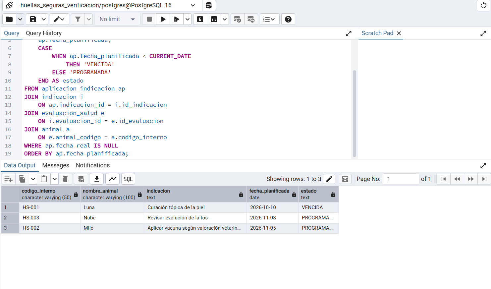

# Evidencias de consultas y pruebas — Grupo 05

El 28-10-2026 se ejecutaron los scripts en la base `huellas_seguras_lab3` con PostgreSQL 16.15 en Docker. `SELECT version()` confirmó la versión. Cada archivo se ejecutó en una conexión `psql -X -v ON_ERROR_STOP=1` independiente, en el orden del laboratorio. El directorio del grupo se montó en `/work` en modo lectura.

| Archivo | Resultado observado |
| --- | --- |
| `01_esquema.sql` | Tablas, restricciones e índices creados; `COMMIT` sin errores. |
| `02_datos.sql` | Datos cargados; cinco secuencias `SERIAL` sincronizadas; `COMMIT` sin errores. |
| `04_rutinas.sql` | Dos funciones y dos procedimientos creados sin errores. |
| `03_consultas.sql` | Q01–Q04 devolvieron respectivamente 3, 3, 5 y 1 filas. |
| `05_pruebas.sql` | P01–P12 devolvieron doce conclusiones `Cumple`; el script terminó con `ROLLBACK`. |



Para repetir un archivo desde PowerShell, ejecutar el comando en una sola línea. Este ejemplo ejecuta las consultas; para los demás scripts, cambiar `03_consultas.sql` por el nombre correspondiente y respetar el orden anterior. La preparación del contenedor y la base está en el [README](../README.md).

```powershell
docker exec huellas-lab3 psql -X -v ON_ERROR_STOP=1 -U postgres -d huellas_seguras_lab3 -f /work/sql/03_consultas.sql
```

## Consultas

**Q01 — Historial de Luna.** Esperado: una evaluación inicial sin diagnóstico y dos revisiones; Otitis cambia de PROVISIONAL a DESCARTADO. Observado:

| id_evaluacion | fecha | tipo | veterinario | diagnósticos |
| ---: | --- | --- | --- | --- |
| 1 | 2026-09-01 | INICIAL | NULL | Sin diagnóstico |
| 2 | 2026-09-03 | REVISION_VETERINARIA | Profesional veterinario ficticio A | Dermatitis (CONFIRMADO), Otitis (PROVISIONAL) |
| 3 | 2026-09-17 | REVISION_VETERINARIA | Profesional veterinario ficticio A | Dermatitis (CONFIRMADO), Otitis (DESCARTADO) |

Conclusión: coincide con lo esperado. La consulta usa varias tablas y conserva la evaluación inicial sin diagnóstico mediante `LEFT JOIN`.



**Q02 — Aplicaciones pendientes al 27-10-2026.** Esperado: tres pendientes, una vencida. Observado:

| animal | tipo | fecha planificada | situación |
| --- | --- | --- | --- |
| HS-001 Luna | TRATAMIENTO | 2026-10-10 | VENCIDA |
| HS-003 Nube | CONTROL_POSTERIOR | 2026-11-03 | PROGRAMADA |
| HS-002 Milo | VACUNA | 2026-11-05 | PROGRAMADA |

Conclusión: coincide con lo esperado. Las tres aplicaciones realizadas no aparecen.



**Q03 — Revisiones y registros confirmados.** Esperado y observado:

| animal | revisiones | registros confirmados |
| --- | ---: | ---: |
| HS-001 Luna | 2 | 2 |
| HS-002 Milo | 1 | 1 |
| HS-003 Nube | 1 | 0 |
| HS-004 Sol | 0 | 0 |
| HS-005 Menta | 0 | 0 |

Conclusión: coincide con lo esperado. Se cuentan apariciones confirmadas por revisión; el mismo diagnóstico en dos revisiones cuenta dos veces.



**Q04 — Indicaciones que atienden varios diagnósticos.** Esperado y observado:

| id_indicacion | animal | descripción | cantidad de diagnósticos | diagnósticos atendidos |
| ---: | --- | --- | ---: | --- |
| 1 | HS-001 | Curación de piel y limpieza de oído | 2 | Dermatitis, Otitis |

Conclusión: la relación `indicacion_diagnostico` conserva los dos diagnósticos atendidos por una misma indicación.

## Pruebas de integridad

Las sentencias completas, los valores y el control de errores están en [05_pruebas.sql](../sql/05_pruebas.sql). La ejecución registró doce conclusiones `Cumple` y terminó con `ROLLBACK`.

| ID | Precondición | Sentencia ejecutada | Esperado | Observado | Conclusión |
| --- | --- | --- | --- | --- | --- |
| P01 | PRB-001 no existe. | Insertar PRB-001 y evaluación inicial 9001 sin datos clínicos. | ACEPTADO | ACEPTADO | Cumple: el tipo inicial admite esos campos ausentes. |
| P02 | Diagnóstico 1 y revisión 5 existen; pareja (5,1) ausente. | Insertar `(5,1,'PROVISIONAL')` en `diagnostico_revision`. | ACEPTADO | ACEPTADO | Cumple: el catálogo se reutiliza. |
| P03 | Indicación 4, responsable 3 existen; aplicación 9001 ausente. | Insertar aplicación realizada con fecha, responsable y observación. | ACEPTADO | ACEPTADO | Cumple: están los datos requeridos. |
| P04 | HS-001 usa `MC-HS-001`. | Insertar PRB-004 con `MC-HS-001`. | RECHAZADO | `unique_violation` | Cumple RN-03: microchip único. |
| P05 | PRB-INEXISTENTE no existe. | Insertar evaluación 9002 de PRB-INEXISTENTE. | RECHAZADO | `foreign_key_violation` | Cumple: la evaluación exige animal existente. |
| P06 | PRB-006 no existe. | Insertar PRB-006 con `edad_estimada = -1`. | RECHAZADO | `check_violation` | Cumple: edad no negativa. |
| P07 | Revisión 5 y diagnóstico 2 existen; pareja (5,2) ausente. | Insertar `(5,2,'INVALIDO')` en `diagnostico_revision`. | RECHAZADO | `check_violation` | Cumple RN-11: estado permitido. |
| P08 | Indicación 4 existe; aplicación 9002 ausente. | Insertar aplicación realizada sin responsable. | RECHAZADO | `check_violation` | Cumple RN-13: responsable requerido. |
| P09 | HS-001 existe y los demás datos clínicos son válidos. | Insertar revisión 9003 sin veterinario. | RECHAZADO | `check_violation` | Cumple RN-10: veterinario obligatorio. |
| P10 | Evaluación 1 es INICIAL; diagnóstico 4 existe. | Vincular diagnóstico 4 a la evaluación 1. | RECHAZADO | `foreign_key_violation` | Cumple RN-11: diagnóstico solo en revisión. |
| P11 | Evaluación 1 es INICIAL; indicación 9003 ausente. | Crear indicación 9003 desde la evaluación 1. | RECHAZADO | `foreign_key_violation` | Cumple RN-12: indicación solo desde revisión. |
| P12 | Indicación 4 existe; aplicación 9003 ausente. | Registrar aplicación realizada con observaciones de solo espacios. | RECHAZADO | `check_violation` | Cumple RN-13: observaciones no vacías. |

## Funciones y procedimientos almacenados

Las siguientes llamadas se verificaron en **PostgreSQL 16.15**, después de cargar los datos y crear las rutinas de [04_rutinas.sql](../sql/04_rutinas.sql).

### R01 — Conteo de revisiones veterinarias

La función `contar_revisiones_animal(codigo)` cuenta únicamente las evaluaciones de tipo `REVISION_VETERINARIA` asociadas al animal indicado.

```sql
SELECT contar_revisiones_animal('HS-001');
```

| Animal | Resultado esperado | Resultado observado | Conclusión |
| --- | ---: | ---: | --- |
| HS-001 (Luna) | 2 | 2 | Cumple: Luna tiene dos revisiones veterinarias. |

### R02 — Estado de una aplicación

La función `estado_aplicacion(id)` devuelve `REALIZADA` si existe una fecha real; de lo contrario, `VENCIDA` cuando la fecha planificada es anterior a `CURRENT_DATE`, o `PROGRAMADA` en los demás casos.

```sql
SELECT estado_aplicacion(2);
```

| Aplicación | Resultado esperado | Resultado observado | Conclusión |
| --- | --- | --- | --- |
| 2 | VENCIDA | VENCIDA | Cumple: la aplicación sigue pendiente y su fecha planificada (2026-10-10) ya pasó. |

**Consideración:** los estados calculados mediante `CURRENT_DATE` dependen del día en que se ejecute la consulta.



### R03 y R04 — Registro de una aplicación realizada

El procedimiento `registrar_aplicacion` permite registrar la fecha efectiva, el responsable y las observaciones de una aplicación pendiente. Valida la existencia de la aplicación, impide registrar nuevamente una ya realizada y exige los tres datos obligatorios.

**Prueba aceptada.** Se ejecutó dentro de una transacción para no modificar permanentemente los datos de ejemplo:

```sql
BEGIN;

CALL registrar_aplicacion(
    4,
    DATE '2026-10-28',
    3,
    'Aplicación realizada correctamente'
);

SELECT id_aplicacion, fecha_real, responsable_id, observaciones
FROM aplicacion_indicacion
WHERE id_aplicacion = 4;

ROLLBACK;
```

| id_aplicacion | fecha_real | responsable_id | observaciones | Conclusión |
| ---: | --- | ---: | --- | --- |
| 4 | 2026-10-28 | 3 | Aplicación realizada correctamente | Cumple: el procedimiento registra los datos proporcionados. |



El `ROLLBACK` devuelve la aplicación a su estado original, de modo que las pruebas siguientes pueden utilizar el mismo conjunto de datos.

**Prueba rechazada.** Se intentó registrar la aplicación sin responsable:

```sql
CALL registrar_aplicacion(
    4,
    DATE '2026-10-28',
    NULL,
    'Aplicación realizada sin responsable'
);
```

| Resultado esperado | Resultado observado | Conclusión |
| --- | --- | --- |
| Rechazo por ausencia del responsable | `ERROR: Debe indicar fecha, responsable y observaciones` (`SQLSTATE P0001`) | Cumple: no se admite el registro incompleto. |



### R05 — Reporte temporal de aplicaciones pendientes

El procedimiento `generar_reporte_pendientes()` crea una **tabla temporal** llamada `reporte_pendientes` con las aplicaciones que aún no tienen `fecha_real`. El reporte reúne datos del animal, la indicación, la fecha planificada y el estado calculado. La tabla temporal está disponible en la sesión actual de PostgreSQL y se vuelve a generar al invocar el procedimiento.

```sql
CALL generar_reporte_pendientes();

SELECT *
FROM reporte_pendientes
ORDER BY fecha_planificada;
```

| codigo_interno | nombre_animal | indicacion | fecha_planificada | estado |
| --- | --- | --- | --- | --- |
| HS-001 | Luna | Curación de piel y limpieza de oído | 2026-10-10 | VENCIDA |
| HS-003 | Nube | Revisar evolución de la tos | 2026-11-03 | PROGRAMADA |
| HS-002 | Milo | Aplicar vacuna según valoración veterinaria | 2026-11-05 | PROGRAMADA |

**Resultado observado:** se obtuvieron tres filas, una vencida y dos programadas. **Conclusión:** coincide con los datos pendientes cargados.



### R06 — Comparación con una consulta SQL directa

Para comprobar si la tabla temporal era indispensable, se ejecutó una consulta equivalente sin crear objetos temporales:

```sql
SELECT
    a.codigo_interno,
    a.nombre AS nombre_animal,
    i.descripcion AS indicacion,
    ap.fecha_planificada,
    CASE
        WHEN ap.fecha_planificada < CURRENT_DATE THEN 'VENCIDA'
        ELSE 'PROGRAMADA'
    END AS estado
FROM aplicacion_indicacion ap
JOIN indicacion i ON ap.indicacion_id = i.id_indicacion
JOIN evaluacion_salud e ON i.evaluacion_id = e.id_evaluacion
JOIN animal a ON e.animal_codigo = a.codigo_interno
WHERE ap.fecha_real IS NULL
ORDER BY ap.fecha_planificada;
```

**Resultado observado:** la consulta directa devolvió las mismas tres aplicaciones, con iguales fechas y estados. **Conclusión:** ambas alternativas producen el mismo reporte. La consulta directa es más sencilla para una lectura puntual; la tabla temporal permite conservar el resultado intermedio y consultarlo varias veces durante la misma sesión, aunque requiere creación y mantenimiento del objeto temporal.



Los IDs Q01–Q04, P01–P12 y R01–R06 permiten cotejar cada salida con su sentencia SQL y repetirla sobre una base vacía.

