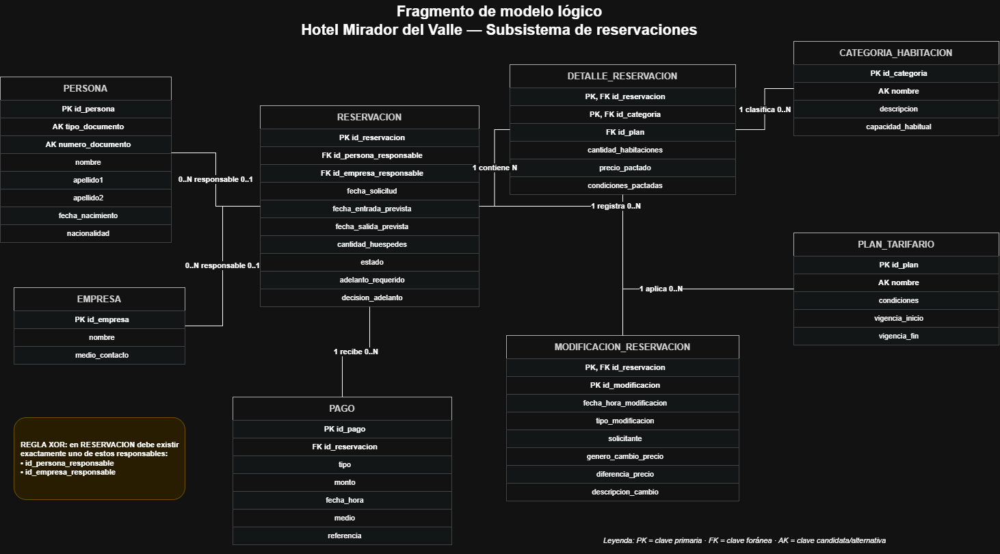

# Laboratorio 3 — Del modelo lógico a la implementación física

**Curso:** IC-4301 Bases de Datos I (G50) · II semestre 2026
**Grupo 6 — Caso:** Hotel y administración de hospedaje (Hotel Mirador del Valle)
**Integrantes:** Fernanda Arce Estrada (2025116542) · Fabián Campos Santamaría (2025087262)
**Motor:** PostgreSQL 14
**Cliente:** pgAdmin 4 — Query Tool

La implementación y las pruebas del laboratorio se realizaron en PostgreSQL desde **pgAdmin 4**, utilizando **Query Tool** sobre la misma base de datos, en el siguiente orden:

1. `sql/01_esquema.sql`
2. `sql/02_datos.sql`
3. `sql/04_rutinas.sql`
4. `sql/03_consultas.sql`
5. `sql/05_pruebas.sql`

## Contenido del repositorio

```
lab03/grupo-06/
├── README.md
├── modelo/fragmento-modelo-logico.png    diagrama del fragmento del modelo lógico
├── sql/
│   ├── 01_esquema.sql                    tablas, claves, restricciones e índices
│   ├── 02_datos.sql                      datos ficticios
│   ├── 03_consultas.sql                  5 consultas de negocio
│   ├── 04_rutinas.sql                    2 funciones, 1 procedimiento y la técnica adicional
│   └── 05_pruebas.sql                    9 pruebas (3 deben funcionar, 6 deben fallar)
└── evidencias/                           capturas y resultados de ejecución
    ├── evidencia_01_esquema.png
    ├── evidencia_02_datos.png
    ├── evidencia_03_rutinas_creadas.png
    ├── evidencia_04_funcion_total.png
    ├── evidencia_05_consulta_q1.png
    ├── evidencia_06_consulta_q2.png
    ├── evidencia_07_consulta_q3.png
    ├── evidencia_08_consulta_q4.png
    ├── evidencia_09_consulta_q5.png
    ├── evidencia_10_pruebas_detalle.png
    ├── evidencia_11_pruebas_resumen.png
    └── Evidencias_Laboratorio3_Grupo06.pdf detalle textual de consultas y pruebas
```

## 1. Proceso implementado y límite del subsistema

**Proceso:** reservación de habitaciones por categoría. Una persona o una empresa reserva una o varias categorías de habitación bajo un plan tarifario (con precio y condiciones congelados al confirmar), puede modificar o cancelar la reservación dejando historial, y puede dejar un adelanto cuya devolución o penalización se decide al cancelar.

**Tablas (8):** `persona`, `empresa`, `categoria_habitacion`, `plan_tarifario`, `reservacion`, `detalle_reservacion`, `modificacion_reservacion`, `pago`.

Son más que las 4 a 6 de referencia porque el proceso necesita sus tablas vinculadas: la reservación apunta a persona y empresa, su detalle apunta a categoría y plan, y el historial y los adelantos dependen de ella. Quitar cualquiera obligaba a eliminar claves foráneas (que el laboratorio prohíbe) o a dejar sin implementar una regla del caso (RN-02, RN-11, RN-13, RN-14, RN-15).

**Qué cubre el subsistema**

- Relación uno-a-muchos: `reservacion` → `modificacion_reservacion` y `reservacion` → `pago`.
- Relación muchos-a-muchos materializada: `reservacion` × `categoria_habitacion` mediante `detalle_reservacion`.
- Operaciones de negocio que involucran más de una tabla: cancelar una reservación (`sp_cancelar_reservacion`: toca `reservacion`, `modificacion_reservacion` y lee `pago`) y vencer reservaciones sin adelanto.

**Qué queda fuera y cómo se maneja cada dependencia externa**

| Entidad del modelo lógico que queda fuera | Cómo se maneja |
|---|---|
| Estancia, OcupaciónHabitación, HuéspedOcupación | Ampliar el alcance no se justifica para este proceso. El estado `convertida en estancia` existe como valor del dominio de `reservacion.estado`, pero no se implementa la tabla `estancia`; se documenta como limitación. |
| Habitación, Bloqueo, CaracteristicaHabitacion | La reservación contrata una **categoría** y no una habitación concreta (RN-11), así que no se necesitan. La asignación de números ocurre después, en la estancia. |
| Tarifa | `detalle_reservacion.precio_pactado` es una **copia congelada** (RN-13), no una referencia viva a `tarifa`. En los datos de prueba el precio se inserta directamente. |
| Cargo, PagoCargo, Consumo, Servicio, PlanServicio, ConceptoAutorizado | Pertenecen al subsistema de cobros de la estancia. La penalización por cancelación se registra aquí solo como **decisión** (`decision_adelanto = 'penalizar'`); el cargo de tipo penalización lo generaría el subsistema de cobros. |
| MedioContactoPersona | El contacto de la empresa está en `empresa.medio_contacto`; verificar que la persona responsable tenga contacto (parte de RN-03) queda como limitación. |

No se eliminó ninguna clave foránea del modelo lógico entre las tablas implementadas.


### A1. Fragmento del Modelo y Matriz de Trazabilidad

El siguiente fragmento presenta las entidades y relaciones principales del subsistema de reservaciones implementado para el Hotel Mirador del Valle.



| Relación lógica | Tabla física | Clave primaria | Claves foráneas | Restricciones relevantes | Justificación de cambios |
|---|---|---|---|---|---|
| Persona | `persona` | `id_persona` | — | `UNIQUE (tipo_documento, numero_documento)` (RN-01); `nombre`, `apellido1` NOT NULL; `apellido2` opcional; textos no vacíos | Solo nombres sin tildes. |
| Empresa | `empresa` | `id_empresa` | — | `medio_contacto` NOT NULL (RN-03) | Sin cambios. |
| CategoríaHabitación | `categoria_habitacion` | `id_categoria` | — | `UNIQUE (nombre)`; `CHECK capacidad_habitual > 0` | Sin cambios. |
| PlanTarifario | `plan_tarifario` | `id_plan` | — | `UNIQUE (nombre)`; `CHECK vigencia_fin >= vigencia_inicio` o nula | Sin cambios. |
| Reservación | `reservacion` | `id_reservacion` | `id_persona_responsable` → `persona`; `id_empresa_responsable` → `empresa` | `CHECK` exactamente un responsable (RN-02/03); `CHECK` salida > entrada; `CHECK` estado en los 6 valores del ciclo de vida; `CHECK` decisión ∈ {devolver, penalizar} y solo si el estado es `cancelada` o `no presentada` (RN-15) | Ver divergencias D2 y D3. |
| DetalleReservación | `detalle_reservacion` | (`id_reservacion`, `id_categoria`) | → `reservacion` (ON DELETE CASCADE); → `categoria_habitacion`; → `plan_tarifario` | `CHECK cantidad_habitaciones > 0`; `CHECK precio_pactado >= 0`; condiciones no vacías | ON DELETE CASCADE: el detalle no tiene sentido sin su reservación. |
| ModificaciónReservación | `modificacion_reservacion` | (`id_reservacion`, `id_modificacion`) | → `reservacion` (ON DELETE CASCADE) | `CHECK` tipo ∈ {fechas, ocupacion, categorias, cancelacion}; `CHECK` la diferencia de precio solo tiene valor si `genero_cambio_precio`; solicitante no vacío | Ver divergencia D5. |
| Pago | `pago` | `id_pago` | `id_reservacion` → `reservacion` | `CHECK monto > 0`; `CHECK` tipo y medio en dominio cerrado; `CHECK` un adelanto exige `id_reservacion` (RN-15/26); `CHECK` la referencia no parece número de tarjeta | Ver divergencia D4. |

### Divergencias entre el modelo lógico y el esquema (todas documentadas)

| # | Divergencia | Por qué |
|---|---|---|
| D1 | Nombres de tablas y columnas en `snake_case` sin tildes ni eñes (`ModificaciónReservación` → `modificacion_reservacion`) y valores de dominio sin tildes (`ocupacion`, `categorias`, `cancelacion`). | Evita problemas de codificación y de comillas dobles en PostgreSQL. No cambia ninguna regla. |
| D2 | RN-02/RN-03 (exactamente un responsable) se implementa con un `CHECK`. En el Proyecto 1 estaba marcada «no representable completamente en el diseño lógico». | El Proyecto 1 prohibía código de implementación; el laboratorio sí lo permite y pide preferir `CHECK` a código procedural. La regla es la misma. |
| D3 | `decision_adelanto` solo puede tener valor si el estado es `cancelada` o `no presentada`. | Sale del texto de RN-15 («cuando la reservación se cancela o no se presenta»). La otra mitad de la regla del diccionario («solo si existe un pago de tipo adelanto») cruza tablas, no puede ser `CHECK`, y la aplica `fn_decision_adelanto` (devuelve nulo si no hay adelanto). Una actualización directa a la tabla podría saltarse esa mitad. |
| D4 | La referencia de pago rechaza cadenas que parecen número de tarjeta (13 a 23 caracteres numéricos con espacios o guiones). | El caso dice que no se almacenan datos sensibles completos de tarjetas; el modelo lógico solo lo indicaba como texto. Es una protección parcial: no detecta todos los formatos posibles. |
| D5 | `id_modificacion` (discriminador de la entidad débil) lo calcula la rutina como `MAX + 1` dentro de la reservación, bloqueada con `FOR UPDATE`. | PostgreSQL no tiene identificadores «por padre». Un `INSERT` manual debe respetar esa convención. |
| D6 | `precio_pactado` se inserta directamente en lugar de copiarse de `tarifa`. | `tarifa` está fuera del subsistema (ver sección 1). |

Dos **supuestos de laboratorio** (no cambian el modelo lógico; el caso no los define y se anotan en el código):

- **Política de cancelación:** el enunciado dice que «las políticas de cancelación determinan» si el adelanto se devuelve o se penaliza, pero no las define. Se aplicó la condición que traen los planes de los datos de prueba: 2 o más días antes de la entrada se devuelve; menos de 2 días se penaliza. Una política distinta por plan requeriría una tabla de políticas.
- **Vigencia de una reservación sin adelanto:** 7 días desde la solicitud (parámetro de `sp_marcar_reservaciones_vencidas`).

## 3. Decisiones de diseño físico

- **Identificadores:** `INTEGER GENERATED BY DEFAULT AS IDENTITY`. Es la forma estándar actual de llaves sustitutas; `BY DEFAULT` permite cargar los datos con claves explícitas (se avanzan las secuencias al final de `02_datos.sql`).
- **Dinero:** `NUMERIC(12,2)`, nunca `REAL`/`FLOAT`, para no acumular errores de redondeo.
- **Fechas:** `DATE` para fechas de calendario (entrada, salida, vigencia) y `TIMESTAMP` para el momento exacto de una modificación (RN-14).
- **Dominios cerrados:** `CHECK (… IN (…))` en vez de `ENUM`, porque cambiar un `CHECK` es una sola sentencia y no requiere alterar tipos. `tipo_documento` y `nacionalidad` quedan abiertos (catálogo abierto, supuesto 1.7 del Proyecto 1).
- **Esquema:** todo vive en el esquema `hotel`, para no mezclar con `public`.
- **Borrado:** `ON DELETE CASCADE` solo en los dependientes débiles (`detalle_reservacion`, `modificacion_reservacion`). El resto usa el comportamiento por defecto (rechazar), por ejemplo un pago nunca desaparece al borrar una reservación.
- **Índices adicionales** (los de PK y UNIQUE ya existen):
  1. `idx_reservacion_estado_entrada (estado, fecha_entrada_prevista)`: las consultas operativas y la rutina de vencimiento filtran por estado y fecha.
  2. `idx_pago_reservacion (id_reservacion) WHERE id_reservacion IS NOT NULL`: PostgreSQL no indexa la columna que referencia una FK; el adelanto se busca por reservación en `fn_decision_adelanto` y en el `NOT EXISTS` del vencimiento. Es parcial porque los pagos de tipo `pago` no tienen reservación.
  3. `idx_detalle_reservacion_categoria (id_categoria)`: la PK empieza por `id_reservacion`; las consultas por categoría (Q2) necesitan entrar por `id_categoria`.

## 4. Datos de prueba (B1)

`02_datos.sql` carga datos inventados, con fechas fijas para que los resultados sean reproducibles: 6 personas (3 tipos de documento, 5 nacionalidades, dos sin segundo apellido), 2 empresas, 3 categorías, 3 planes y 8 reservaciones, 10 líneas de detalle, 5 adelantos y 4 modificaciones.

**Por qué es suficiente:** las 8 reservaciones cubren los estados `solicitada`, `confirmada`, `cancelada` (una con decisión *devolver* y otra *penalizar*), `no presentada` y `convertida en estancia`; hay reservaciones hechas por persona y por empresa; dos mezclan categorías; una exige adelanto sin pagarlo (candidata a vencer) y otra de empresa no exige adelanto. El estado `vencida` no tiene fila a propósito: lo produce la rutina de vencimiento y se prueba en P03 (y se verifica la versión por conjuntos en E02). Con eso cada consulta devuelve resultados distintos y cada rama de las funciones se ejercita.

## 5. Consultas (B2)

En `sql/03_consultas.sql`; cada una trae su pregunta de negocio, la necesidad de información del Proyecto 1 y el resultado esperado calculado a mano. Observados en [evidencias/Evidencias_Laboratorio3_Grupo06.pdf](evidencias/Evidencias_Laboratorio3_Grupo06.pdf).

| ID | Pregunta de negocio | Técnica |
|---|---|---|
| Q1 | ¿Qué reservaciones están confirmadas, quién responde, qué habitaciones y cuánto se espera facturar? | JOIN de 5 tablas + función propia |
| Q2 | ¿Qué categorías superan 500.000 de ingreso estimado en reservaciones vigentes? | GROUP BY + SUM + COUNT DISTINCT + HAVING |
| Q3 | ¿Qué reservaciones exigen adelanto y aún no lo han cubierto? | LEFT JOIN + GROUP BY + HAVING |
| Q4 | ¿Qué modificaciones y cancelaciones ha tenido cada reservación? | JOIN con la entidad débil |
| Q5 | ¿Dónde se decidió penalizar y cuánto adelanto queda retenido? | JOIN + SUM |

## 6. Rutinas (C1, C2, C3)

Todas en `sql/04_rutinas.sql`, con parámetros, retorno, reglas y ejemplos en los comentarios.

| Rutina | Tipo | Justificación |
|---|---|---|
| `fn_total_reservacion(id)` | Función (valor calculado) | El total estimado no se guarda (es derivado y cambia si cambia el detalle). La necesitan Q1 y la facturación futura. Usa precios congelados (RN-13). |
| `fn_decision_adelanto(id, fecha)` | Función con decisión de negocio (`CASE`) | Concentra RN-15 en un solo lugar: devolver o penalizar según anticipación. Devuelve nulo si no hay adelanto. |
| `sp_cancelar_reservacion(id, solicitante, fecha)` | Procedimiento | Operación real del caso. Valida con `RAISE EXCEPTION` (solicitante vacío, reservación inexistente, estado no cancelable, cancelación posterior a la entrada) y recién entonces actualiza `reservacion` e inserta el historial. Las restricciones declarativas siguen en el esquema; el procedimiento no las reemplaza. |
| `sp_marcar_reservaciones_vencidas(corte, dias)` | Procedimiento con **cursor explícito** (C3) | Ver discusión abajo. |
| `sp_marcar_reservaciones_vencidas_conjunto(corte, dias)` | Alternativa basada en conjuntos | Mismo resultado en una sola sentencia con CTE. |

**Discusión de C3 (honesta):** el cursor recorre las reservaciones pendientes y, para cada una, hace `UPDATE … WHERE CURRENT OF`, calcula el siguiente `id_modificacion`, inserta el historial y emite un aviso por reservación. Esa trazabilidad fila a fila es lo único que aporta. Para este problema la solución por conjuntos (`sp_marcar_reservaciones_vencidas_conjunto`) es más simple, más corta y más rápida con muchas filas, y la verificación E02 (en `evidencias/Evidencias_Laboratorio3_Grupo06.pdf`) demuestra que ambas producen el mismo resultado sobre los mismos datos. Se eligió el cursor porque el laboratorio pide una técnica del temario de la semana 12 y porque ilustra el bloqueo `FOR UPDATE`; en producción se preferiría la versión por conjuntos. No se usó SQL dinámico porque las consultas son de estructura fija.

## 7. Pruebas de integridad (B3) y evidencias (D2)

`sql/05_pruebas.sql` tiene **9 pruebas**: 3 deben funcionar (P01–P03) y 6 deben ser rechazadas (P04–P09). Se eligieron para cubrir cada tipo de restricción que pide el laboratorio (unicidad, obligatoriedad, rangos, referencias) y cada rutina, sin repetir casos equivalentes:

| ID | Tipo | Categoría | Qué demuestra |
|---|---|---|---|
| P01 | Funciona | Procedimiento | `sp_cancelar_reservacion` con 16 días de anticipación: la decisión es *devolver* y queda historial (RN-14, RN-15) |
| P02 | Funciona | Procedimiento | `sp_cancelar_reservacion` con 1 día de anticipación: la decisión es *penalizar* (la otra rama de `fn_decision_adelanto`) |
| P03 | Funciona | Cursor | `sp_marcar_reservaciones_vencidas`: vence la R6 sin adelanto y no toca la R8, que no lo exige |
| P04 | Falla | Unicidad | Documento repetido (`uq_persona_documento`, RN-01) |
| P05 | Falla | Obligatoriedad | Persona sin nombre (`NOT NULL` en `nombre`) |
| P06 | Falla | Regla de negocio | Reservación sin responsable (`ck_reservacion_responsable`, RN-02/03) |
| P07 | Falla | Rango | Salida anterior a la entrada (`ck_reservacion_fechas`) |
| P08 | Falla | Referencia | Detalle con categoría inexistente (`fk_detalle_categoria`) |
| P09 | Falla | Rutina | Cancelar una reservación que ya está cancelada (`RAISE EXCEPTION`) |

Cada prueba documenta precondición, sentencia ejecutada, resultado esperado, resultado observado y conclusión.

**Qué queda cubierto y qué no.** El procedimiento tiene dos casos exitosos (P01, P02) y uno rechazado (P09); `fn_decision_adelanto` se prueba en sus dos ramas a través de P01/P02, y `fn_total_reservacion` se verifica con Q1 y E01. Otras restricciones del esquema (estado permitido, tarjeta en la referencia, coherencia de la modificación) están definidas en `01_esquema.sql` pero no tienen una prueba propia en esta entrega.

Las pruebas inválidas **no detienen el resto**: cada una se ejecuta dentro de un subbloque con manejo de excepciones y se deshace al terminar, así que la base queda igual que antes (el propio script lo comprueba al final). Las dos funciones auxiliares que lo hacen y la tabla `resultado_pruebas` se crean en el esquema `hotel` al inicio del script; al final se borran las funciones y se conserva `resultado_pruebas`, que se puede consultar con `SELECT * FROM hotel.resultado_pruebas ORDER BY id;`. No son rutinas del negocio y el script se puede repetir sin errores.

Resultado de la corrida: **9 pruebas, 9 pasan, 0 fallan.** Todo el detalle, con las sentencias y los mensajes observados, está en [evidencias/Evidencias_Laboratorio3_Grupo06.pdf](evidencias/Evidencias_Laboratorio3_Grupo06.pdf).

## 8. Evidencias de ejecución

Las siguientes capturas corresponden a la ejecución real del laboratorio en **pgAdmin 4** sobre la base `Lab03`. Se muestran directamente en este README para facilitar la revisión de la entrega.

### Evidencia 01 — Creación del esquema y las tablas

Se ejecutó `01_esquema.sql`. PostgreSQL confirmó la creación de los objetos del esquema `hotel` sin errores.


## 9. Instrucciones de ejecución (A3)

Requisitos: PostgreSQL 14, pgAdmin 4 y un usuario con permiso para crear esquemas. No se usa ninguna extensión.

**Con pgAdmin 4 (cliente usado para las evidencias)**

1. Abrir pgAdmin 4 y conectarse al servidor PostgreSQL.
2. Seleccionar una base vacía, en esta ejecución llamada `Lab03`.
3. Clic derecho sobre la base → **Query Tool**.
4. Abrir cada archivo SQL con el botón de carpeta y ejecutarlo completo con **Execute/▶** en este orden:

   `01_esquema.sql` → `02_datos.sql` → `04_rutinas.sql` → `03_consultas.sql` → `05_pruebas.sql`

5. Para obtener evidencia de cada consulta, seleccionar únicamente el `SELECT` correspondiente y ejecutarlo para que su resultado aparezca en **Data Output**.
6. Al terminar `05_pruebas.sql`, consultar `hotel.resultado_pruebas` para comprobar el detalle y el resumen de las pruebas.

El orden es **01 → 02 → 04 → 03 → 05**, porque `03_consultas.sql` utiliza funciones creadas previamente en `04_rutinas.sql`.


```

**Para repetir la ejecución:** los scripts no contienen `DROP` a propósito. Hay que recrear la base de laboratorio (en pgAdmin: eliminar la base de laboratorio y crearla de nuevo; con `psql`: `dropdb lab03_hotel && createdb lab03_hotel`). Esto borra todo lo que contenga esa base.

## 10. Limitaciones

- La reservación debería tener al menos un detalle; el esquema no puede exigirlo de forma declarativa. Queda como verificación de aplicación.
- La política de cancelación es única (48 horas) y no por plan (ver supuestos).
- `id_modificacion` depende de que se use la rutina o la convención `MAX + 1`.
- La penalización no genera un cargo (subsistema de cobros fuera del alcance) y no se valida contra una tarifa vigente porque `tarifa` no está implementada.
- No se implementó la estancia: el estado `convertida en estancia` es solo un valor del dominio.
- La verificación de datos de tarjeta (D4) es una protección parcial.
- Los triggers no se usaron (el laboratorio los deja para el siguiente bloque). Los casos que hoy dependen de las rutinas (por ejemplo la mitad de D3) serían candidatos a un trigger.

## 11. Uso de herramientas de inteligencia artificial

Durante el desarrollo se utilizaron herramientas de inteligencia artificial como apoyo para revisar redacción, estructura de los scripts, organización de pruebas y documentación. El grupo revisó manualmente el contenido generado, ejecutó los scripts en PostgreSQL y verificó que las consultas, restricciones y rutinas correspondieran con las reglas del caso.

### Revisión del grupo

- **Fernanda Arce Estrada:** se enfocó en revisar la coherencia entre el modelo lógico del Proyecto 1 y el esquema físico implementado para el laboratorio. Durante esa revisión se analizaron varias alternativas de diseño y se descartaron algunas para mantener la solución más simple y fiel al caso. Por ejemplo, se consideró ampliar el subsistema para incluir `estancia`, `habitacion` y las tablas de consumos y cargos, pero se decidió no hacerlo porque el proceso elegido era la reservación por categoría y agregar esas entidades aumentaba la complejidad sin ser necesario para cumplir el alcance. También se revisó la posibilidad de manejar algunos dominios mediante tipos `ENUM`, pero se prefirieron restricciones `CHECK` porque resultan más fáciles de modificar y mantienen las reglas visibles directamente en las tablas. Fernanda revisó además la matriz de trazabilidad, las relaciones entre tablas y los datos de prueba para verificar que las decisiones documentadas coincidieran con lo implementado.

- **Fabián Campos Santamaría:** se concentró principalmente en la revisión técnica y ejecución de los scripts en PostgreSQL. Durante las pruebas se identificaron alternativas que finalmente se rechazaron. Por ejemplo, se consideró colocar algunas validaciones únicamente dentro de procedimientos almacenados, pero se decidió mantener las reglas que podían expresarse de forma declarativa mediante `CHECK`, `UNIQUE`, `NOT NULL` y `FOREIGN KEY`, dejando los procedimientos para operaciones que realmente requieren lógica de negocio. También se evaluó utilizar SQL dinámico para la técnica adicional del laboratorio, pero se descartó porque las consultas tienen estructura fija y su uso no aportaba una ventaja real. Para C3 se dejó un cursor explícito como demostración de la técnica procedimental y, al mismo tiempo, se documentó una alternativa basada en conjuntos por ser más sencilla y eficiente para un escenario real. Fabián verificó además las funciones, procedimientos y pruebas, corrigió incompatibilidades encontradas durante la ejecución y comprobó que los resultados observados coincidieran con los esperados.

- **Decisiones revisadas y alternativas rechazadas por el grupo:** durante la revisión final se discutieron varias opciones antes de cerrar la implementación. Se descartó eliminar claves foráneas para reducir la cantidad de tablas, porque eso habría roto la trazabilidad con el modelo lógico. También se decidió no utilizar triggers en esta entrega, ya que no eran requeridos por el laboratorio y pertenecen al siguiente bloque práctico. Se rechazó guardar como columna física información derivada que pudiera recalcularse, para evitar inconsistencias futuras. Asimismo, se decidió no implementar la tabla `tarifa` dentro del subsistema y conservar `precio_pactado` directamente en `detalle_reservacion`, porque el objetivo era mantener congelado el precio ofrecido al confirmar la reservación. Finalmente, se mantuvo la regla de que una reservación tenga exactamente un responsable —persona o empresa— mediante un `CHECK`, en lugar de crear una jerarquía adicional, porque esa solución preserva la regla del negocio sin aumentar innecesariamente la complejidad.

- **Revisión conjunta:** ambos integrantes realizaron una revisión final del repositorio antes de la entrega. Compararon el modelo lógico con las tablas implementadas, verificaron que los cinco scripts obligatorios estuvieran presentes y en el orden correcto, revisaron las consultas y pruebas y confirmaron que las decisiones rechazadas y las alternativas seleccionadas quedaran documentadas. También se aseguraron de comprender las razones de cada decisión para poder explicarlas durante la defensa individual y no limitarse únicamente a mostrar que el código se ejecuta.

## 12. Defensa individual (D3)

| Integrante | Enlace al video (máx. 5 min) |
|---|---|
| Fernanda Arce Estrada | [https://youtu.be/0MEe9ZRqsmU] |
| Fabián Campos Santamaría | [https://1drv.ms/v/c/7e51439ce456e072/IQD1XbhwVVRVTZh3ku9KT-RiAdX1seztII7KEwo1r1m0Bfg?e=fexTdi] |
