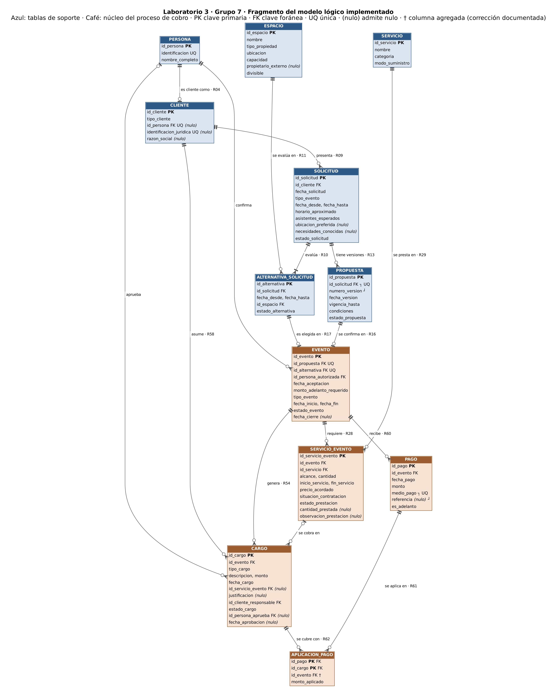

# Laboratorio 3 - Del modelo logico a la implementacion fisica

**IC-4301 Bases de Datos I - Grupo 7 - Caso: Eventos Nexo - PostgreSQL 16**

| Integrante | Parte que defiende | Video |
|---|---|---|
| Maikel Aguilera | Esquema e integridad | https://youtu.be/IPMtGIzaaXY |
| Jostin Calderon | Programacion almacenada | https://youtu.be/kn_CaITU8yo |

## 1. Proceso implementado

**Cobro del evento** (RN-18 y RN-19 del Proyecto 1): un evento confirmado
genera cargos, el cliente paga en uno o varios pagos, y cada pago se aplica
a los cargos pendientes. La operacion central es **registrar un pago y
repartirlo entre los cargos**.

| Grupo | Tablas |
|---|---|
| Nucleo (5) | EVENTO, SERVICIO_EVENTO, CARGO, PAGO, APLICACION_PAGO (N:M) |
| Soporte minimo (7) | PERSONA, CLIENTE, SOLICITUD, ALTERNATIVA_SOLICITUD, PROPUESTA, ESPACIO, SERVICIO |

**Por que 12 tablas:** EVENTO tiene tres FK obligatorias (propuesta,
alternativa y persona autorizada), que a su vez dependen de SOLICITUD,
CLIENTE y ESPACIO. Para no eliminar FK se incluyeron como tablas de soporte
con sus columnas obligatorias, sin logica adicional.

**Fuera de alcance:** las otras 17 relaciones del Proyecto 1 (reservas,
cronograma, personal, contrataciones, ajustes, incidencias, etc.). Las FK
**opcionales** que apuntan a ellas se omitieron (ver §5). Por eso este
subconjunto solo admite cargos de tipo Componente y Penalizacion: Ajuste y
Adicional necesitan AJUSTE_EVENTO e INCIDENCIA, y se rechazan en lugar de
aceptarse sin su origen.

## 2. Fragmento del modelo lógico



## 3. Matriz de trazabilidad

| Relacion logica | Tabla | PK | FK | Restricciones relevantes | Cambios |
|---|---|---|---|---|---|
| PERSONA | `persona` | id_persona | - | UNIQUE identificacion | - |
| CLIENTE | `cliente` | id_cliente | id_persona | UNIQUE id_persona, identificacion_juridica; **CHECK arco exclusivo** (RN-05) | - |
| ESPACIO | `espacio` | id_espacio | - | CHECK tipo, capacidad > 0, propietario si es de terceros | - |
| SOLICITUD | `solicitud` | id_solicitud | id_cliente | CHECK rango de fechas, asistentes > 0, estado | - |
| ALTERNATIVA_SOLICITUD | `alternativa_solicitud` | id_alternativa | id_solicitud, id_espacio | CHECK rango, estado | Sin id_area (D4) |
| PROPUESTA | `propuesta` | id_propuesta | id_solicitud | **UNIQUE (id_solicitud, numero_version)**; CHECK vigencia, estado | - |
| EVENTO | `evento` | id_evento | id_propuesta, id_alternativa, id_persona_autorizada | **UNIQUE id_propuesta, id_alternativa (1:1)**; CHECK fechas, estado, fecha_cierre si Cerrado | - |
| SERVICIO | `servicio` | id_servicio | - | CHECK modo_suministro | - |
| SERVICIO_EVENTO | `servicio_evento` | id_servicio_evento | id_evento, id_servicio | CHECK cantidad, horario, precio; cantidad_prestada solo si es parcial (RN-17) | Sin FK opcionales (D4) |
| CARGO | `cargo` | id_cargo | id_evento, **(id_servicio_evento, id_evento)**, id_cliente_responsable, id_persona_aprueba | **CHECK origen segun tipo** (RN-18), monto > 0, estado, aprobacion | D2, D4 |
| PAGO | `pago` | id_pago | id_evento | **UNIQUE (medio_pago, referencia)**; CHECK monto > 0, medio, referencia salvo Efectivo | - |
| APLICACION_PAGO | `aplicacion_pago` | (id_pago, id_cargo) | **(id_pago, id_evento), (id_cargo, id_evento)** | CHECK monto_aplicado > 0 | D1 |

## 4. Ejecucion

Probado en **PostgreSQL 16.15**, sin extensiones. Sobre una base vacia:

```bash
createdb eventos_nexo_lab3
cd lab03/grupo-07/sql
for f in 01_esquema 02_datos 04_rutinas 03_consultas 05_pruebas; do
  psql -v ON_ERROR_STOP=1 -d eventos_nexo_lab3 -f $f.sql
done
```

En DBeaver: ejecutar cada archivo como script (Alt + X) en el mismo orden.

**Repetir:** 01 y 02 no tienen `DROP`, para no borrar nada sin aviso; para
volver a empezar se recrea la base (`dropdb` + `createdb`). 04 usa
`CREATE OR REPLACE`, 03 solo lee y 05 termina en `ROLLBACK`, asi que esos
tres se pueden repetir.

## 5. Decisiones de diseño fisico

- **Tipos:** identificadores `INTEGER GENERATED BY DEFAULT AS IDENTITY`
  (claves sustitutas del Proyecto 1); montos `NUMERIC(12,2)`, para dinero
  exacto; categorias `VARCHAR` + `CHECK IN`, mas faciles de ampliar que un
  `ENUM`.
- **Reglas «obligatorio si…» del diccionario** como `CHECK` de fila, en
  lugar de codigo procedural.
- **`DEFAULT`** solo para estados iniciales definidos en el diccionario
  (cargo Pendiente de aprobacion, evento Confirmado, servicio Por
  verificar) y para `es_adelanto = FALSE` y `fecha_pago = CURRENT_DATE`.
- **Indices:** PostgreSQL no indexa las FK. Se agregaron `cargo(id_evento)`
  y `pago(id_evento)`, porque el saldo y las consultas filtran por evento,
  y `aplicacion_pago(id_cargo)`, porque la PK empieza por id_pago y no
  sirve para buscar por cargo.

**Divergencias respecto al Proyecto 1** (ninguna cambia una cardinalidad):

| # | Cambio | Motivo |
|---|---|---|
| D1 | `aplicacion_pago.id_evento` con dos FK compuestas | La regla «solo se aplica a cargos del mismo evento» era NR; ahora la garantiza el motor (prueba T07) |
| D2 | FK compuesta de `cargo` a `servicio_evento` | El servicio cobrado debe ser del mismo evento |
| D3 | UNIQUE (id, id_evento) en servicio_evento, cargo y pago | PostgreSQL lo exige para ser destino de una FK compuesta |
| D4 | Se omiten las FK opcionales id_area, id_propuesta + numero_linea, id_actividad, id_ajuste e id_incidencia | Su tabla destino está fuera de alcance |

## 6. Rutinas

| Rutina | Requisito | Que hace |
|---|---|---|
| `fn_saldo_evento(id_evento)` | C1 | Devuelve los cargos aprobados menos lo aplicado. El saldo se calcula, no se guarda (RN-19). |
| `fn_estado_pago_evento(id_evento)` | C1 (decisión) | Clasifica el evento: Sin cargos aprobados, Pagado, Adelanto pendiente, Pendiente o Parcial. Un evento cancelado ya no exige adelanto. |
| `sp_registrar_pago(...)` | C2 | Antes de insertar valida que el evento exista, que tenga saldo, que el monto no exceda el saldo y que no se registren adelantos en eventos cerrados o cancelados. Si algo falla, rechaza con `RAISE EXCEPTION`; si no, inserta el pago y lo aplica. No repite lo que ya cubren los CHECK y UNIQUE. |
| `sp_aplicar_pago(id_pago)` | C3 (cursor explícito) | Reparte el pago entre los cargos pendientes, del más antiguo al más reciente. |

**Por qué un cursor:** el reparto es secuencial. Lo que recibe cada cargo
depende de lo que quedó después del anterior, y el recorrido se detiene
cuando se acaba el dinero. **Alternativa por conjuntos:** el mismo reparto
se puede hacer con una suma acumulada (`SUM() OVER`), que es la consulta Q4.
Es más corta, pero con los pocos cargos que tiene un evento el rendimiento
no decide, y el cursor hace más clara y fácil de cambiar la regla de
prioridad. Las dos versiones dan el mismo resultado (T03 = Q4).

## 7. Datos, consultas y pruebas

- **Datos:** 4 eventos, uno por cada estado de cobro: Pagado (incluye el
  N:M en ambos sentidos), Parcial (cliente organización), Adelanto
  pendiente y Pendiente (evento cancelado con penalización). Así se ve con
  datos reales cada rama de la función y del procedimiento. Todos los
  datos son ficticios.
- **Consultas (Q1–Q4):** estado de cuenta por evento (JOIN), clientes con
  saldo (GROUP BY + HAVING), recaudación por medio de pago (agregación) y
  simulación del reparto de un pago. La pregunta y el resultado esperado
  están en cada consulta.
- **Pruebas (T01–T11):** 4 válidas y 7 inválidas (unicidad, FK, FK
  compuesta, CHECK, NOT NULL y rechazo del procedimiento). Las inválidas
  capturan el error con `EXCEPTION`, así el script no se detiene.

## 8. Limitaciones

- Las validaciones que comparan varias filas (lo aplicado no excede el
  pago ni el cargo; solo cargos Aprobado) se cumplen si los pagos se
  registran con `sp_registrar_pago`. Un `INSERT` directo en
  `aplicacion_pago` las saltaría; la solución completa es un trigger, que
  corresponde al siguiente bloque del curso.
- Siguen como NR: que la alternativa sea de la misma solicitud que la
  propuesta y que la persona autorizada esté vigente (RN-06).

## 9. Evidencias

Resultados de las consultas, las llamadas a rutinas y las pruebas,
identificados con su ID: **[evidencias/resultados.md](evidencias/resultados.md)**.

## 10. Uso de IA

Se usó Claude como apoyo para redactar los scripts a partir del esquema y
el diccionario del Proyecto 1. El equipo revisó el código contra el
diccionario y verificó los resultados ejecutando los scripts en una base
vacía.
