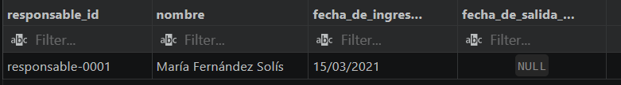
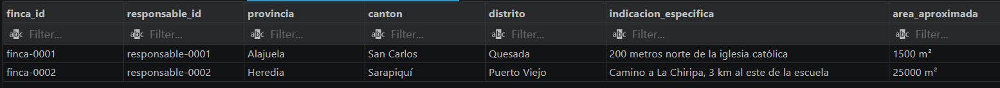
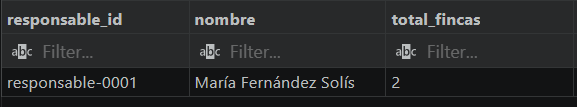
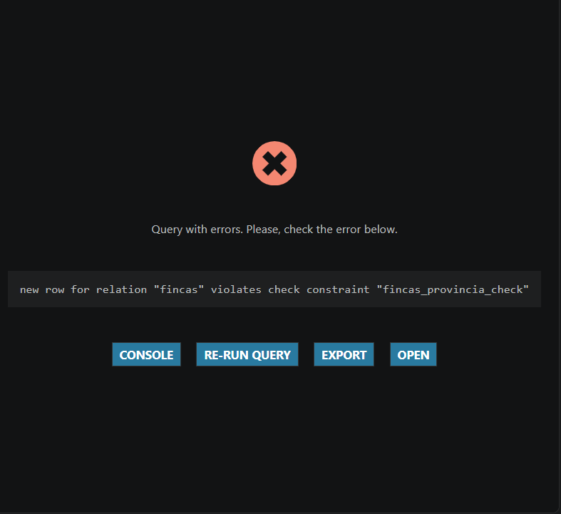
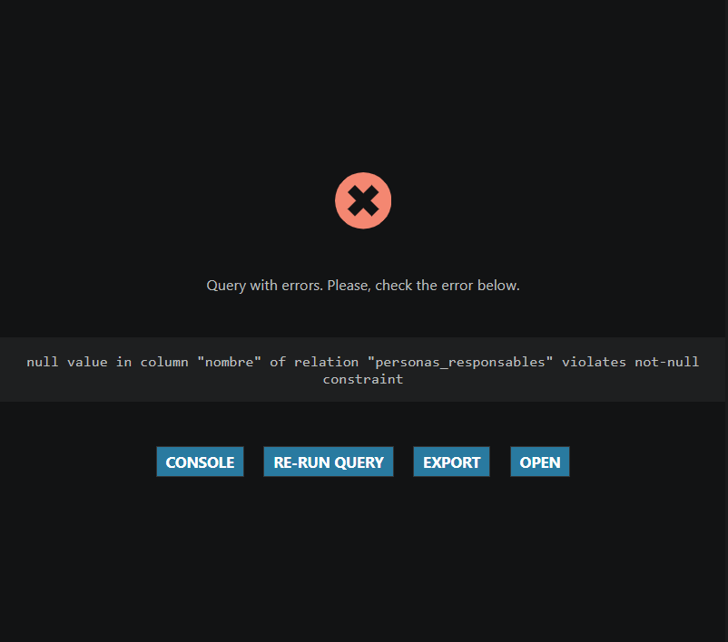
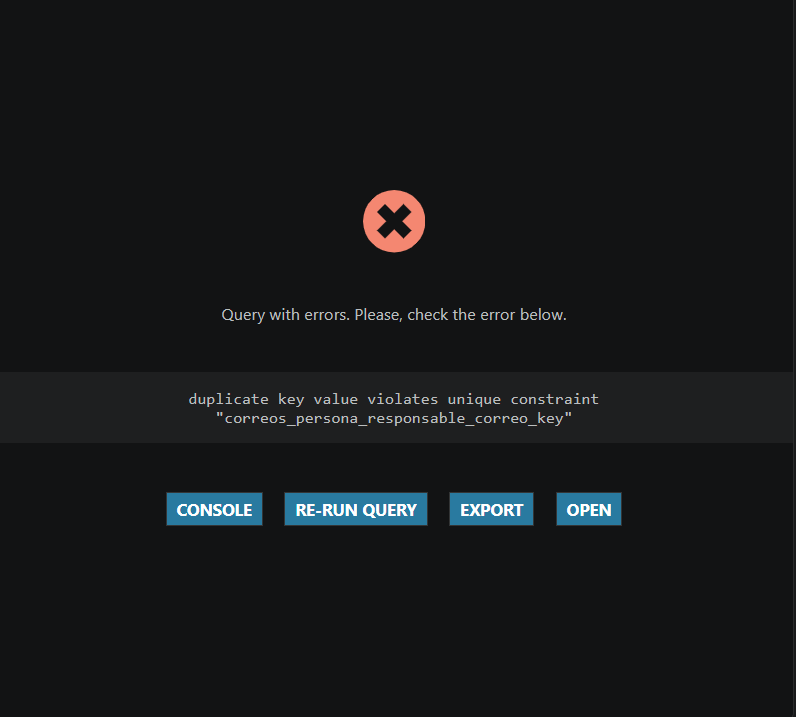

# Laboratorio 3 — Grupo 11

¡Hola! Bienvenidos al repositorio del **Grupo 11** para el Laboratorio 3 del curso IC-4301 · Bases de Datos I.

Estudiante: Dilan Andrey Sibaja Ugalde / Carnet: 2025116585 / Caso: Cooperativa Valle Verde

# Proceso implementado

Se implemento usando SQL el proceso de registrar una finca, junto su debido historial con registros de los responsables de esa finca en cada tiempo dado. Este proceso incluye al propietario de la finca, al responsable de la finca, a un historial unico de la finca, y a varios registros dentro de ese historial de responsables.

# Fragmento del modelo logico

## Matriz de trazabilidad

| Relación lógica | Tabla física | Clave primaria | Claves foráneas | Restricciones relevantes |
|---|---|---|---|---|
| FINCA | fincas | (productor_id, finca_id) | productor_id -> PRODUCTOR.productor_id, responsable_id -> PERSONA_RESPONSABLE.responsable_id | solamente el responsable_id puede ser nulo |
| TELEFONO_PRODUCTOR | telefonos_productor | (telefono,productor_id) | productor_id -> PRODUCTOR.productor_id | El teléfono debe seguir el formato: “NNNN-NNNN” |
| CORREO_PRODUCTOR | correos_productor | (correo,productor_id) | productor_id -> PRODUCTOR.productor_id | El correo debe serguir el formato: “nombre@dominio” |
| TELEFONO_RESPONSABLE_FINCA | telefonos_persona_responsable | (telefono, responsable_id) | responsable_id -> PERSONA_RESPONSABLE.responsable_id | El teléfono debe seguir el formato: “NNNN-NNNN” |
| CORREO_RESPONSABLE_FINCA | correos_persona_responsable | (correo, responsable_id) | responsable_id -> PERSONA_RESPONSABLE.responsable_id | El correo debe serguir el formato: “nombre@dominio” |
| HISTORIAL_RESPONSABLES | historiales_responsable | (historial responsables_ _id, productor_id, finca_id) | productor_id -> PRODUCTOR.productor_id, finca_id -> FINCA.finca_id | Solo puede tener una finca, y es única para todos los historiales |
| REGISTRO_EN_HISTORIAL_DE_RESPONSABLES | registro_en_historial | (historial_responsables_id, productor_id, finca_id, responsable_id) | productor_id -> PRODUCTOR.productor_id, responsable_id -> PERSONA_RESPONSABLE.responsable_id, finca_id -> FINCA.finca_id, historial responsables_ _id | Solo la fecha de salida puede ser nula |

# Instrucciones de ejecucion

Yo lo ejecute desde vs code, usando las extensiones: SQLTools y SQLTools PostgreSQL/Cockroach Driver.
Se puede probar con cualquier base de datos vacia, siguiendo los siguientes pasos:
1. hacer click en el simbolo de cilindro (es de Cockroach Driver) y darle en agregar conexion
2. la conexion va a pedir datos de la bases de datos como: server adress (direccion del servidor), port (puerto), database (nombre de la base de datos), username, use password (clave del PostgreSQL propio. este ultimo al principio usa el SQLTools Driver Credentials, pero se puede cambiar a. esos campos se llenan con los datos correspondientes a la base de datos a usar 'save as plaintext in settings' si se prefiere ingresar la clave propia).
3. Si todo se lleno correctamente, nos va a dar la opcion 'connect now', se le da click y el vscode quedaria conectado a la base de datos.

A partir de ese punto, arriba del todo de cada script de sql, da la opcion de 'run on active connection' que basicamente lo ejecuta y hace los cambios en la base de datos y los muestra en una especie de consola en la parte derecha de la pantalla.

# Decisiones de diseño fisico

Las principales decisiones fue ponerle limites exactos a las id para que siguieran su formmato, asi:
propietario_id es de 14 caracteres, finca_id es de 10 caracteres, historial_responsables_id es de 15 caracteres, responsable_id es de 16 caracteres.

se usaron CHECK para fijar un formato en los id, fechas, telefonos, correos, y area aproximada, y para fijar un rango de valores posibles para columnas como provincia, canton, y condicion.
# link al md de evidencias
Link: [md de evidencias de consultas y pruebas de integridad](evidencias/resultados.md) 
# Capturas de evidencias
## evidencias de consultas

Consulta 1 (c01): responsables de una finca durante un periodo dado (en este caso: de la finca (productor-0001,finca-0001))

Consulta 2 (c02): todas las fincas pertenecientes a un productor dado (en este caso: fincas del productor-0001)

Consulta 3 (c03): total de fincas de las que un responsable dado a estado a cargo (en este caso: del responsable-0001)

## evidencia de pruebas de integridad
p01: se realizo la insercion del productor correctamente

p02: no permitio que se insertara una finca de canton invalido

p03: se realizo la insercion de la finca correctamente

p04: no permitio que se insertara un responsable sin nombre

p05: no permitio que se insertara que hiciera que dos responsables tuvieran el mismo correo

p06: se realizo la insercion del correo correctamente pues no violaba unicidad
# enlace a video de defensa
video: https://youtu.be/xYeTsugOkpI

