# Pruebas ejecutadas

Solo se ejecutaron las pruebas de pruebas_publicas.sql, en este documento se encuentra un resumen del resultado de cada prueba
Aclaracion: estas pruebas se ejecutaron con los esquemas y datos originales antes de cualquier correccion o normalizacion, y despues se volvieron a ejecutar con los esquemas y datos corregidos

## Prueba 1 (carnets duplicados en ESTUDIANTE)

output con los datos originales:

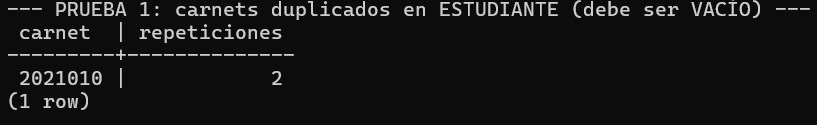

output con datos corregidos:

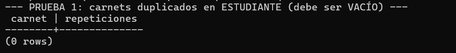

## Prueba 2 (cédulas duplicadas en PROFESOR)

output con los datos originales:

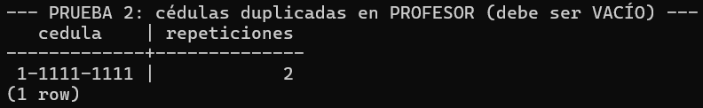

output con datos corregidos:

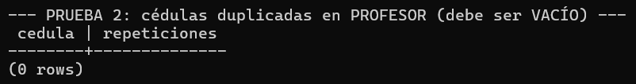

## Prueba 3 (matrículas duplicadas, mismo estudiante y grupo)

output con los datos originales:

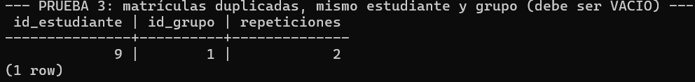

output con datos corregidos:

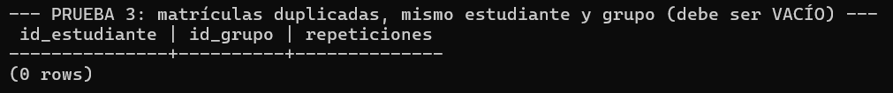

## Prueba 4 (cursos con menos de 1 crédito)

output con los datos originales:

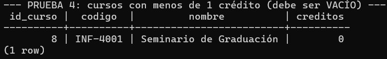

output con datos corregidos:

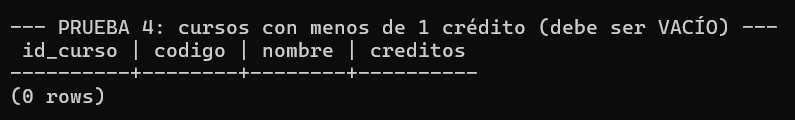

## Prueba 5 (notas fuera del rango 0-100)

Nota: en los datos originales no hay una nota menor a 0 o mayor a 100, a pesar de que el esquema original lo permite (visto en Cambios.md). Por lo tanto, se realizo el siguiente UPDATE para forzar este caso:

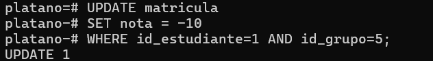

output con el caso de nota negativa:

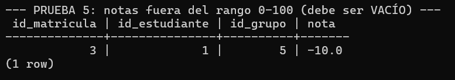

output con datos corregidos:

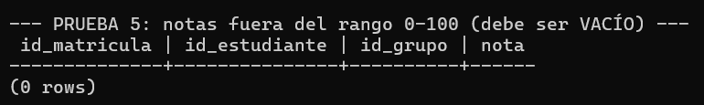

## Prueba 6 (cursos que son requisito de sí mismos)

output con los datos originales:

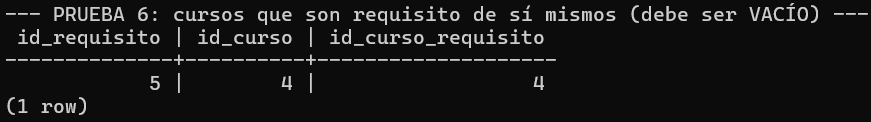

output con datos corregidos:

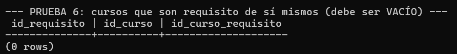

## Prueba 7 (estudiantes sin carrera asignada)

output con los datos originales:

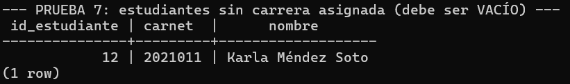

output con datos corregidos:

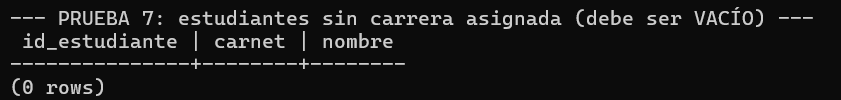

## Prueba 8 (existencia de las 8 tablas del modelo)

Nota: se modifico esta consulta para que incluyera a la tabla 'registro', que fue resultado de la normalizacion aplicada a 'auditoria', documentada en Cambios.md

output con los datos originales:

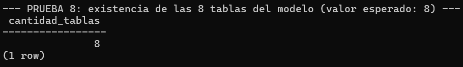

output con datos corregidos:

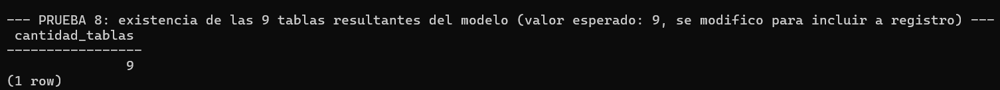

## Prueba 9 (aprobación en el umbral exacto)

output con los datos originales:

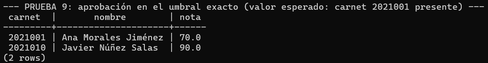

output con datos corregidos:

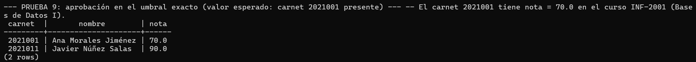

## Prueba 10 (cursos sin ningún grupo registrado)

output con los datos originales:

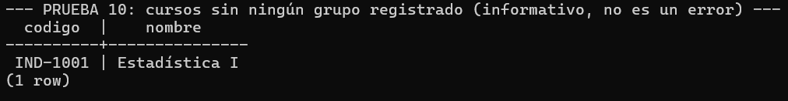

output con datos corregidos:

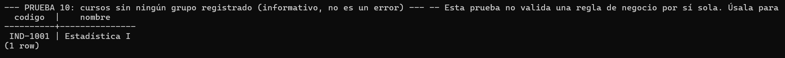
